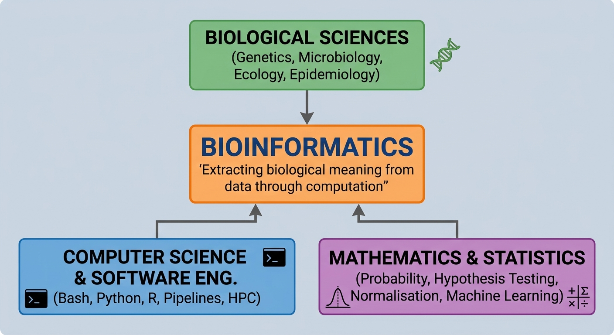

::: {.callout-tip}
#### Learning Objectives

- Define bioinformatics and explain its role across modern life sciences and public health.
- Identify the foundational pillars that constitute bioinformatics practice (biology, computer science, and statistics).
- Explain why bioinformatics capacity is vital for low- and middle-income countries (LMICs) and how it addresses local challenges.
- Characterise the technical, infrastructural, and pedagogical challenges of working and teaching in low-resource environments.
- Contrast traditional, high-resource training paradigms with resource-aware teaching strategies.
:::

## Introduction: Defining Bioinformatics

At its core, **bioinformatics** is an interdisciplinary field that develops and applies computational, mathematical, and statistical methods to store, manage, analyse, and interpret biological data. 

The term was coined in 1970 by Paulien Hogeweg and Ben Hesper to define "the study of informatic processes in biotic systems". Today, bioinformatics has evolved into an indispensable component of the biological sciences. It transforms vast amounts of raw data—such as nucleotide sequences, protein structures, and mass spectra—into actionable biological knowledge.



Bioinformatics is often confused with related terms. As a trainer, helping your learners distinguish between these terms builds clarity and sets realistic expectations:

::: {.callout-note}
## Disentangling Related Terminology

- **Bioinformatics:** The development and application of computational tools, databases, and pipelines to manage and analyse large biological datasets (e.g. sequence alignment, variant calling, RNA-seq quantification).
- **Computational Biology:** The development and application of data-analytical and theoretical methods, mathematical modelling, and computational simulation techniques to study biological systems (often more theory- and model-driven).
- **Biostatistics:** The application of statistical methods to biological and medical experiment design, data collection, and inference (focussing heavily on hypothesis testing, confounding factors, and clinical trials).
- **Data Science:** An umbrella term encompassing statistics, data engineering, machine learning, and domain-specific knowledge to extract patterns from structured and unstructured data.
:::

In practice, these disciplines overlap heavily. A working bioinformatician frequently switches between the roles of software user, pipeline engineer, data analyst, and biological interpreter.


## The Foundational Pillars of Bioinformatics

To be an effective practitioner—and an effective trainer—one must recognise that bioinformatics is supported by three distinct pillars. An imbalance among these three pillars is one of the most common causes of difficulty for learners:

1. **Biological Domain Knowledge:**
   Bioinformatics is driven by biological questions. Without an understanding of molecular biology, experimental design, and the limitations of laboratory assays (e.g. library preparation biases, PCR duplicates, sequencing platform error profiles), computational analysis becomes an exercise in blindly running commands. As trainers, we must constantly tether computational steps back to the biological question: *Why are we trimming reads? What does an alignment score signify biologically?*

2. **Computational and Software Skills:**
   Biological data files are typically far too large to open in spreadsheet applications like Microsoft Excel. Bioinformaticians rely on the Unix/Linux command-line environment, scripting languages (principally Python and R), file format standards (FASTQ, FASTA, SAM/BAM, VCF, GFF/GTF), version control (Git), and containerisation (Docker, Singularity/Apptainer). Mastery of these tools allows researchers to handle data systematically, automate multi-step analyses, and ensure reproducibility.

3. **Statistical and Quantitative Rigour:**
   Modern omics technologies generate high-dimensional data where the number of measured features (e.g. 20,000 genes) far exceeds the number of biological replicates. Understanding concepts such as multiple testing correction (e.g. False Discovery Rate), normalisation strategies, batch effects, and statistical power is critical to prevent spurious discoveries.


## Why Bioinformatics Matters in Low-Resource Settings

Bioinformatics offers an unprecedented opportunity to democratise scientific discovery and public health surveillance, especially in low- and middle-income countries (LMICs):

### 1. Tackling Local Health and Agricultural Priorities
Low-resource regions often bear the heaviest burdens of endemic infectious diseases (such as malaria, tuberculosis, cholera, HIV, and neglected tropical diseases), emerging epidemic outbreaks, antimicrobial resistance (AMR), and climate-induced food insecurity. 

Locally driven bioinformatics empowers researchers and public health agencies to:
- Track transmission routes and outbreaks in real time using pathogen genomics.
- Identify novel mutations linked to drug resistance or vaccine escape.
- Characterise local crop and livestock varieties to breed climate-resilient strains.
- Catalogue and preserve regional biodiversity.

### 2. Dismantling "Helicopter / Parachute Science"
Historically, many research initiatives in LMICs followed an extractive model: samples were collected locally, exported to institutions in high-income countries for sequencing and analysis, and published with minimal or purely nominal local participation. 

Building local bioinformatics capacity flips this power dynamic. When local scientists possess the expertise to analyse and interpret their own data, they retain ownership of biological resources, drive the research agenda based on national priorities, and translate findings directly to local healthcare and agricultural policies.

### 3. High Scientific Impact with Modest Capital Investment
Building and maintaining wet laboratories requires continuous investments: specialized reagents, expensive consumables, reliable cold-chain storage, and costly equipment service contracts. 

In contrast, bioinformatics leverages computational power, open-source software, and globally shared public repositories (e.g. NCBI, EBI, GISAID). A single computer with skilled analytical talent can conduct world-class discovery science, re-analyse published datasets, and generate publishable insights without requiring millions of dollars in laboratory infrastructure.

      
| Traditional Wet-Lab Focus  | Bioinformatics Capacity   |
| -------------------------- | ------------------------- |
| Recurring reagent costs    | Free open-source software |
| Cold chains & consumables  | Reusable public datasets  |
| Hardware locked to lab     | Portable analytical skill |
| High barrier to iterate    | Rapid hypothesis testing  |

: Table 1: Wet lab versus bioinformatics

## Realities and Constraints in Low-Resource Environments

While the promise of bioinformatics is vast, performing and teaching bioinformatics in resource-constrained environments presents unique practical hurdles. As an educator, your training design must directly account for these real-world constraints rather than ignoring them.

### 1. Technical & Infrastructural Barriers
- **Unreliable or High-Cost Internet Bandwidth:** Live downloads of multi-gigabyte reference genomes or raw read archives (FASTQ files) often fail, choke institutional connections, or incur high cellular data costs.
- **Power Grid Instability:** Unscheduled power outages can corrupt ongoing pipeline runs and disrupt classroom sessions unless uninterruptible power supplies (UPS) or cloud-hosted sessions are used.
- **Hardware Limitations:** Learners frequently bring personal laptops with modest specifications (e.g. 4–8 GB RAM, dual-core processors, limited disk space, 32-bit or older Windows systems), which cannot execute memory-heavy tools like standard genome aligners or de novo assemblers.
- **Absence of Local HPC Facilities:** Many universities and institutes lack dedicated High-Performance Computing clusters, system administrators, or stable server environments.

### 2. Educational & Human Capital Barriers
- **Curricular Silos:** Biological science curricula in many institutions rarely include foundational computer science, Linux command line, or programming. Trainees are often exposed to computation for the first time during postgraduate studies.
- **The "Lone Bioinformatician":** Many trainees return from workshops to departments where they are the sole individual with computational skills, lacking local peer support, code review, or experienced mentorship.
- **High Attrition:** Skilled computational personnel are frequently recruited away by international organisations or private industry, leaving local institutions in a cycle of constant capacity rebuilding.

::: {.callout-important}
## The "Double Hurdle" in Bioinformatics Training
Adult learners from wet-lab or clinical backgrounds face two steep cognitive hurdles simultaneously:

1. **New Conceptual Complexity:** Learning abstract biological and statistical algorithms (e.g. de Bruijn graphs, hidden Markov models, Bayesian phylogenetics).
2. **New Technical Modality:** Interacting with a computer via a text-only terminal, understanding absolute vs. relative file paths, handling syntax errors, and managing command flags.

If both hurdles are presented at once with complex, multi-gigabyte files, cognitive overload occurs quickly. Effective training separates these hurdles and builds mastery incrementally.
:::


## Rethinking Training for Low-Resource Settings

Standard bioinformatics training materials created in well-resourced institutions often make implicit assumptions: gigabit internet, institutional Linux clusters, powerful Mac/Linux laptops, and uninterrupted power. When delivered unchanged in resource-limited settings, these courses frequently stumble.

As trainers, we must adopt **resource-aware pedagogy**:

| Conventional Training Assumption | Resource-Aware Pedagogical Strategy |
| :------------------------------- | :---------------------------------- |
| "Download this 5 GB FASTQ dataset" | Use **micro-datasets** (subsampled, downsampled to a few thousand reads) that execute in seconds on a basic laptop. |
| "Run this tool on our local HPC cluster" | Teach using lightweight environments: local containers, lightweight virtual machines, or portable web-based interfaces. |
| "Install software via complex compilation" | Pre-configure environments (Conda/Mamba, Docker/Singularity) or provide self-contained sandboxes. |
| "Follow this 50-step copy-paste script" | Focus on conceptual understanding: input files, parameter intuition, output interpretation, and troubleshooting. |
| "Look up documentation online" | Provide offline-accessible documentation, cheatsheets, and pre-cached local resources. |


## Interactive Reflection & Discussion

To design effective training, you must first understand the reality of your learners' environment and identify potential stumbling blocks.

::: {.callout-exercise}
## Assessing Trainee Realities and Context

Think about the specific group of learners you plan to train in your institution or region.

1. **Hardware & OS:** What operating systems and hardware configurations do your learners typically possess?
2. **Connectivity:** How reliable is the internet connection in your training venue? Can you rely on live internet downloads during class?
3. **Prior Experience:** Have your participants ever used a command-line interface (CLI) or terminal before?
4. **Actionable Adaptation:** Identify one potential point of failure during a live hands-on workshop and describe how you would design an offline fallback.

::: {.callout-hint}
Consider common issues such as 30 students trying to download a 200 MB reference genome at the same minute, or Windows laptops lacking a native Unix environment.
:::

::: {.callout-answer}

- **Hardware & OS:** In many LMIC settings, over 80% of learners use Windows laptops with 4–8 GB RAM. Recommended strategies include using WSL2 (Windows Subsystem for Linux), web-based platforms, or lightweight Linux live USBs.
- **Connectivity:** Never rely on live downloads during a workshop. Trainers should pre-load all datasets, software packages (or container images), and documentation onto shared USB thumb drives or a local classroom server (e.g. Raspberry Pi or local Wi-Fi router).
- **Prior Experience:** Most life-science learners have never used the terminal. Dedicate time to core navigation (`cd`, `ls`, `pwd`) and mental models of the filesystem before introducing bioinformatics tools.
- **Offline Fallback:** Always maintain pre-computed intermediate and final output files. If an assembly or alignment tool fails or runs too slowly on a participant's laptop, they can immediately load the pre-computed output and continue with downstream interpretation without falling behind.
:::
:::

::: {.callout-exercise}
## Deconstructing a Command: The Learner's Perspective

Consider a standard bioinformatics command introduced in an introductory genomics tutorial:

```bash
fastp -i sample1_R1.fastq.gz -I sample1_R2.fastq.gz \
      -o trimmed_R1.fastq.gz -O trimmed_R2.fastq.gz \
      --detect_adapter_for_pe --html sample1_fastp.html -w 4
```

List at least **four distinct computational concepts or hidden assumptions** that a wet-lab biologist must understand in order to run and modify this command successfully.

::: {.callout-answer}

1. **Working Directory & File Paths:** The learner must understand that `sample1_R1.fastq.gz` must exist in the *current directory*, or else provide relative/absolute paths.
2. **Command Syntax & Flags:** The learner must recognise that `-i`, `-I`, `-o`, `-O`, and `-w` are flags (arguments) modifying how `fastp` operates, and that case sensitivity matters (`-i` vs `-I`).
3. **Line Continuations (`\`):** The backslash is a shell continuation character. Typing a space after the backslash causes syntax errors that bewilder novices.
4. **Hardware Resources (`-w 4`):** The `-w 4` flag requests 4 worker threads. On a dual-core laptop, this can cause sluggishness or confusion about what "threads" mean.
5. **Output Redirection & Formats:** The command produces both compressed sequence files (`.fastq.gz`) and an HTML report (`.html`), requiring an understanding of how to view each file type.

*Lesson for Trainers:* Deconstruct commands step-by-step and explain the syntax anatomy before asking students to modify them.
:::
:::


## Summary

::: {.callout-tip}
#### Key Points

- **Bioinformatics** is an intrinsically multidisciplinary science combining biological knowledge, computational skills, and statistical rigour to turn biological data into meaningful insights.
- In low-resource settings, bioinformatics is a powerful equalizer—allowing impactful research, disease surveillance, and scientific independence with minimal wet-lab capital expenditure.
- Trainers must recognise the reality of their learners' environments: limited bandwidth, power instability, consumer-grade hardware, and minimal prior computational experience.
- The **"double hurdle"** requires separating biological concepts from computational syntax, preventing cognitive overload in adult learners.
- Effective training in resource-limited contexts relies on resource-aware approaches: **micro-datasets**, offline-first materials, scaffolded command-line learning, and pre-computed fallbacks.
:::
