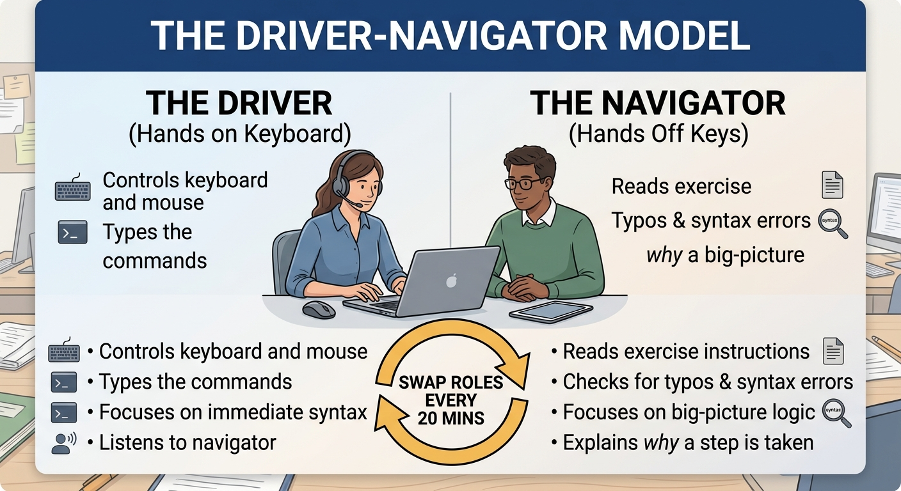

::: {.callout-tip}
#### Learning Objectives

- Apply participatory live coding to teach command-line and computational concepts with optimal pacing and transparency.
- Implement paired programming (Driver-Navigator) to accelerate peer learning and relieve helper bottlenecks in diverse classrooms.
- Scaffold computational instruction using "faded examples" to transition learners from guided observation to independent problem-solving.
- Deploy active learning models (blended learning, flipped classrooms, and distributed hub-and-spoke training) tailored for low-resource environments.
- Manage learner cognitive load by interleaving short instructional chunks with frequent formative challenges.
:::

## Introduction: Moving Beyond Passive Instruction

Traditional academic instruction relies heavily on lectures: an instructor displays static presentation slides while students passively take notes. In computational biology, this approach consistently produces poor learning outcomes. 

A student can watch 50 slides explaining read alignment or Python syntax, yet find themselves completely paralyzed the moment they face a blank terminal window.

| Passive lecturing | Active pedagogical models |
| :--- | :--- |
| Static presentation slides | Participatory live coding |
| Abstract command syntax | Immediate hands-on execution |
| Student listens in silence | Peer discussion & pair coding |
| High cognitive passivity | Frequent formative checkpoints |
| Delayed failure (at home alone) | Instant feedback & live debugging |

: Table 1: Passive Lecture versus active strategies

Teaching bioinformatics effectively—especially to adult life scientists in low-resource settings—requires **active pedagogical strategies** where learners construct mental models through immediate physical practice, real-time feedback, and structured collaboration.


## Participatory Live Coding

**Participatory live coding**—pioneered by The Carpentries—is the gold standard instructional technique for teaching programming and the command line.

Instead of displaying code on slides, the instructor shares their terminal or code editor on the projector and types every command live in real time while students type along simultaneously on their own machines.

| Instructor Screen | Learner Screen |
| :--- | :--- |
| 1. Explain the biological goal | Understand context |
| 2. Type command deliberately | Type along simultaneously |
| 3. Press Enter & examine output | Observe matching output |
| 4. Intentional typo / bug! | Diagnose error together |

: Table 2: The live coding communication loop

### Golden Rules of Effective Live Coding

1. **Enlarge Your Screen Font:** Set your terminal or editor font size to at least 18pt–24pt. Ensure dark text on a light background or high-contrast themes so learners in the back of the room can read every character.
2. **Never Type in Silence:** Narrate everything you do before and while typing. Say: *"I am going to type `fastp`, followed by a space, then `-i` for input file..."*
3. **Pace Yourself Deliberately:** Remember that novice learners must split their attention between looking at your screen, looking at their own screen, and typing on their keyboard. Slow down your natural typing speed by at least 50%.
4. **Use Tab-Completion Visually:** Announce every time you press `Tab` to auto-complete a file path. This reinforces essential habits and prevents typing errors.
5. **Celebrate and Diagnose Typos:** When you make an accidental typo (or make a deliberate one), do not quickly erase it in shame. Use it as a teaching moment: read the error message aloud with the room and walk through the diagnostic steps.


## Paired Programming: The Driver-Navigator Model

In many low-resource workshops, class sizes are large (25–40 students) while teaching assistants or helpers are scarce (often just the instructor and one assistant). 

**Paired programming** is a collaborative learning technique adapted from software engineering that dramatically improves learning retention and reduces the burden on instructors.



### Why Pair Programming Excels in Resource-Constrained Classrooms

- **Solves Hardware Shortages:** If an institutional computer lab has only 12 functional computers for 24 students, paired programming turns a deficit into a pedagogical advantage.
- **Reduces Helper Bottlenecks:** Pairs catch 80% of syntax errors (missing spaces, typos, wrong slashes) between themselves before raising their hands, freeing helpers to focus on deeper conceptual misunderstandings.
- **Peer Tutoring and Social Learning:** Pairing a slightly more experienced student with a complete novice builds confidence in both: the novice receives immediate, non-judgmental guidance, while the experienced student solidifies their knowledge by explaining it.


## Scaffolded Learning: The Power of Faded Examples

When introducing a new computational pattern (such as writing a shell loop or parsing a VCF file), novices experience cognitive overload if asked to write code completely from scratch on a blank screen.

Cognitive psychology research shows that **faded examples** provide the most effective scaffolding for technical learning:

```
┌────────────────────────────────────────────────────────────────────────┐
│                   THE FADED EXAMPLE CONTINUUM                          │
├────────────────────────────────────────────────────────────────────────┤
│                                                                        │
│   Step 1: Fully Worked Example (Observation & Comprehension)           │
│   for sample in *.fastq.gz; do                                         │
│       fastp -i "${sample}" -o "trimmed_${sample}"                      │
│   done                                                                 │
│                                │                                       │
│                                ▼                                       │
│   Step 2: Partially Faded Example (Fill in the blanks)                 │
│   for sample in *.fastq.gz; do                                         │
│       # Fill in the output flag and prefix:                            │
│       fastp -i "${sample}" _______ "trimmed_${sample}"                 │
│   done                                                                 │
│                                │                                       │
│                                ▼                                       │
│   Step 3: Heavily Faded Example (Structural Scaffold)                  │
│   # Loop over all BAM files and run samtools flagstat:                 │
│   for bam in _______; do                                               │
│       samtools flagstat "_______" > "_______"                          │
│   done                                                                 │
│                                │                                       │
│                                ▼                                       │
│   Step 4: Independent Problem Solving (From Scratch)                   │
│   "Write a loop that indexes all sorted BAM files in results/"         │
│                                                                        │
└────────────────────────────────────────────────────────────────────────┘
```

By gradually fading the scaffolding, learners build confidence and autonomy without falling into the "blank screen panic" that causes beginners to freeze.


## Training Delivery Models for Low-Resource Contexts

Instructors in resource-limited environments must select training delivery models that balance educational depth with connectivity and infrastructure realities:

```
┌────────────────────────────────────────────────────────────────────────┐
│                     TRAINING DELIVERY ARCHITECTURES                    │
├─────────────────────┬───────────────────┬──────────────────────────────┤
│ Delivery Model      │ Structure         │ Low-Resource Trade-offs      │
├─────────────────────┼───────────────────┼──────────────────────────────┤
│ 1. In-Person        │ 2–4 days, fully   │ High impact, high logistical │
│    Intensive        │ hands-on, live TAs│ cost (travel/accommodation); │
│    Bootcamp         │ in room           │ vulnerable to local outages  │
├─────────────────────┼───────────────────┼──────────────────────────────┤
│ 2. Flipped          │ Pre-recorded short│ Maximizes classroom hands-on;│
│    Classroom        │ videos + in-class │ requires students to have    │
│                     │ problem-solving   │ reliable home power/internet │
├─────────────────────┼───────────────────┼──────────────────────────────┤
│ 3. Distributed Hub- │ Central online    │ Low cost, wide reach; relies │
│    and-Spoke        │ broadcast + local │ heavily on the quality of    │
│    (H3ABioNet IBT)  │ classroom TAs     │ local in-person assistants   │
└─────────────────────┴───────────────────┴──────────────────────────────┘
```

### The Distributed Hub-and-Spoke Model (H3ABioNet Model)
Pioneered by H3ABioNet across dozens of African university nodes:
- A central team of expert instructors broadcasts lectures and live demonstrations via low-bandwidth video conferencing.
- Each participating institution hosts an in-person physical classroom staffed by local teaching assistants ("facilitators").
- Exercises are performed on standardized local virtual machines or container environments.
- **Why it works:** Overcomes the scarcity of senior bioinformatics faculty across the region while maintaining the vital personal support of local classroom helpers.


## Cognitive Load Management: The 15-Minute Rule

The human working memory has severe capacity limits, holding only 4–7 novel chunks of information at once. In a technical workshop, cognitive overload sets in quickly if an instructor lectures continuously.

::: {.callout-important}
## The 15-Minute Instructional Rule
Never lecture or live-code for more than **15 consecutive minutes** without a pause, active learner action, or formative check. 
Break every 90-minute workshop session into short, interactive cycles:
- **7–10 mins:** Live coding / conceptual framing.
- **3–5 mins:** Micro-exercise / prediction challenge ("What will happen if I run this?").
- **2 mins:** Debrief and sticky-note check.
:::


## Interactive Exercises for Future Trainers

These exercises will help you practice designing active learning interventions and managing live coding sessions.

::: {.callout-exercise}
## Designing a Faded Example Sequence

You are teaching a group of wet-lab microbiologists how to use `grep` to extract specific genes from a GFF3 annotation file. 

Create a 3-step **faded example sequence** that takes learners from a fully worked demonstration to an independent task:
1. Provide the fully worked initial example.
2. Create a partially faded example with clear blanks and instructions.
3. Formulate an independent challenge task.

::: {.callout-hint}
Ensure the progression tests the same conceptual pattern (searching by feature type or attribute) while gradually removing syntax hints.
:::

::: {.callout-answer}
### 3-Step Faded Example Sequence

1. **Step 1: Fully Worked Example (Instructor demonstrates live):**
   ```bash
   # Find all ribosomal RNA (rRNA) features in the annotation file
   grep "rRNA" annotations.gff > results/rRNA_features.gff
   ```

2. **Step 2: Partially Faded Example (Learners complete):**
   ```bash
   # Find all transfer RNA (tRNA) features and save to results/tRNA_features.gff
   grep "________" annotations.gff > results/________.gff
   ```

3. **Step 3: Independent Challenge:**
   *"Now, write a single command from scratch that searches `annotations.gff` for all CDS (coding sequence) features, counts how many there are, and prints only the count to the terminal screen."*
   *(Solution: `grep -c "CDS" annotations.gff` or `grep "CDS" annotations.gff | wc -l`)*
:::
:::

::: {.callout-exercise}
## Managing Pacing Disparities in Live Coding

During a live-coding session on Bash navigation, you observe that three learners with prior computer science exposure are typing ahead, finishing tasks in 30 seconds, and looking bored. Meanwhile, five clinical researchers who have never used a terminal are struggling with file paths and falling 10 minutes behind.

1. Why is continuing at the pace of the fast learners a fatal mistake?
2. What concrete pedagogical strategies can you deploy to keep advanced learners engaged without abandoning novice learners?
3. How can pair programming resolve this specific classroom tension?

::: {.callout-answer}
### Facilitator Intervention

1. **The Danger of Following Fast Learners:**
   Advanced learners naturally speak up, type quickly, and nod when asked *"Is everyone ready?"*. If the instructor paces the class to these few vocal students, the remaining 80% of the room becomes lost, gives up, and mentally checks out.

2. **Concrete Strategies for Fast Learners:**
   - **Provide "Bonus Challenges" / Stretch Goals:** Add an optional extension question at the bottom of every exercise: *"Finished early? Try modifying your command to sort the results alphabetically by gene name."*
   - **Enlist Them as Peer Helpers:** Ask advanced students to assist their immediate table neighbors: *"If you have a green sticky note up, look to your left and right and help your neighbor debug their path."*

3. **Pair Programming Solution:**
   Pair the advanced learner (as Navigator) with the novice learner (as Driver). The advanced student cannot touch the keys; they must verbally articulate the computational logic, deepening their own understanding, while the novice gains hands-on muscle memory and personalized support.
:::
:::


## Summary

::: {.callout-tip}
#### Key Points

- **Live Coding Over Slides:** Teach programming and CLI skills through participatory live coding. Type slowly, narrate your keystrokes, enlarge screen fonts, and use typos as collaborative debugging lessons.
- **Pair Programming Solves Deficits:** Pairing learners (Driver and Navigator) eliminates hardware shortages, catches typos early, and fosters peer learning.
- **Scaffold with Faded Examples:** Transition learners from fully worked examples to partially completed blanks before demanding independent code generation.
- **Adopt Distributed Delivery Models:** Overcome geographic and faculty shortages by using hub-and-spoke models (central broadcast + local in-person TAs).
- **Enforce the 15-Minute Rule:** Protect working memory by breaking lectures into short cycles of instruction, immediate practice, and formative checks.
:::
