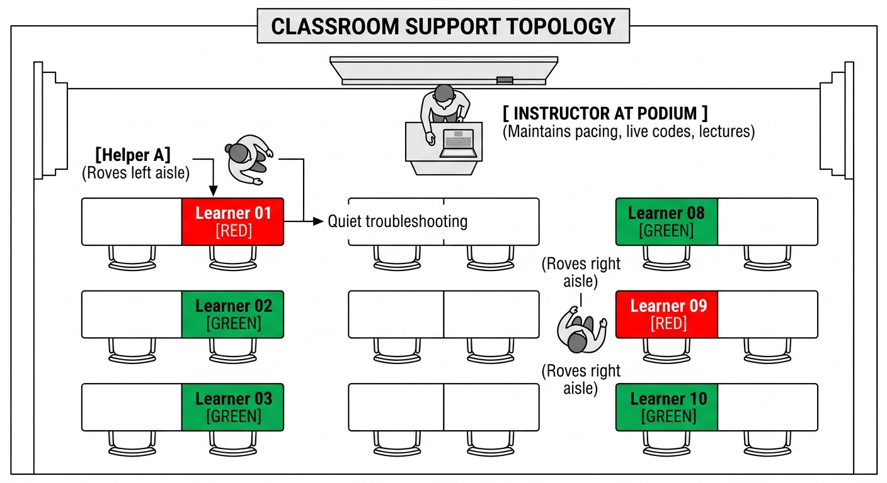
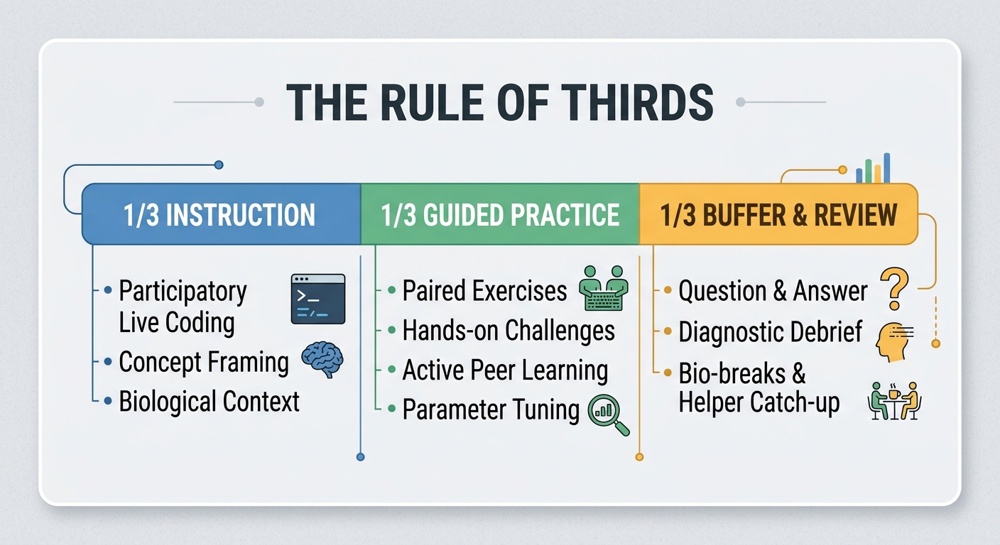

::: {.callout-tip}
#### Learning Objectives

- Optimize human staffing ratios by recruiting and briefing helpers to manage classroom troubleshooting.
- Implement the "Hands-Off-the-Keyboard" coaching rule to ensure learners build genuine self-efficacy.
- Audit and prepare physical and digital classroom logistics in low-resource venues (power distribution, visual contrast, offline caches).
- Apply the "Rule of Thirds" to pace workshops realistically, resisting the temptation of including too much material in your curriculum.
- Utilize real-time formative feedback mechanisms (sticky notes, one-minute papers) to adapt instruction dynamically.
:::

## Introduction: The Anatomy of a Successful Workshop

Delivering effective bioinformatics training requires far more than technical expertise and well-crafted slides. A workshop can feature world-class scientific content, yet fail completely if:

- Half the room is locked out by software errors while the instructor lectures ahead.
- The classroom Wi-Fi collapses and there is no offline fallback.
- Novice learners feel too intimidated or embarrassed to ask questions.
- Laptops die halfway through the morning because the venue lacks power outlets.

Effective training is the deliberate intersection of **human staffing**, **robust logistics**, and **flexible pacing**.

## Human Support: Helpers/Facilitators

The most significant predictor of a smooth computational workshop is not how well the instructor delivers the materials, but the presence of **roving helpers (facilitators)**.

### One Helper per 6–8 Learners
In a room of 25 participants, having a single instructor trying to teach while running around the room fixing individual syntax errors brings the entire workshop to a stop. 

- Maintain a ratio of **one helper for every 6 to 8 students**.
- Helpers can be postgraduate students, local bioinformaticians, or alumni of previous workshops.

::: {.callout-important}
## The Hands-Off-the-Keyboard Rule
The single most important rule for workshop helpers: when helping a struggling student, **NEVER take their keyboard or mouse away from them.** 

- If you grab their keyboard and type the fix in 5 seconds, you demonstrate your competence, not theirs. The student learns nothing and feels disempowered.
- Instead, place your hands behind your back. Guide the student verbally: *"Look at line 3. Do you see a missing space after the comma? What happens if you add a space and run it again?"*
- Let the student's own fingers type the correction and experience the triumph of solving the problem.
:::

## Physical & Technical Logistics in Low-Resource Venues

In low-resource venues, environmental and logistical failures can derail training faster than software bugs. An effective trainer audits the venue before learners arrive:

| Category | Practical Verification Step |
| :--- | :--- |
| 1. Electrical Power | • Count physical wall outlets vs. students • Bring 4–6 heavy-duty multi-plug extension cords • Verify venue generator / UPS backup status |
| 2. Display & Screen | • Test projector resolution and brightness • Adjust blinds/curtains to prevent sun glare • Enlarge terminal font to 18pt–24pt |
| 3. Connectivity | • Bring dedicated mobile 4G/5G Wi-Fi hotspot reserved exclusively for the instructor • Pre-load all data & tools onto USB drives |
| 4. Comfort & Audio | • Check room acoustics; use a microphone if room exceeds 25 participants • Ensure adequate ventilation and drinking water |

: Low-resource venue audit checklist

::: {.callout-warning}
## The Laptop Battery Crisis
Bioinformatics pipelines (e.g. alignment, assembly, trimming) run CPU cores at 100% capacity. An ordinary consumer laptop that lasts 5 hours during web browsing will drain its battery in **45–60 minutes** during a practical! If learners cannot plug in their chargers, the afternoon session will collapse as laptops shut down.
:::

## Pacing and Time Management: The Rule of Thirds

The most common mistake made by new trainers is **curriculum bloat**, cramming five days' worth of content into a two day schedule. Rushing through slides to "finish the training" produces cognitive overload and reduces learner retention.

### The Rule of Thirds
Structure your workshop schedule around three balanced allocations:

Always plan to deliver 20% less content than you think you have time for. Mastering foundational navigation, file manipulation, and quality control thoroughly is far more valuable to a beginner than skimming superficially through advanced variant calling pipelines.

## Continuous Formative Feedback

How do you know if the room is following your instruction or completely lost? Never ask: *"Does everyone understand?"* (Shy learners will not speak up, and confident learners will nod).

Deploy two proven formative feedback mechanisms:

**1. Two-Color Sticky Notes (Real-Time Telemetry)**
Give every learner two sticky notes (Green and Red):

- **Green on laptop lid:** *"I have completed the task and my code worked."*
- **Red on laptop lid:** *"I am stuck or encountered an error; I need a helper."*

This allows the instructor to scan the room in one second: if 70% of the room has red stickies up, the instructor knows to pause immediately and address a universal issue on the main screen.

**2. The Daily Synthesis**
At the end of each day (or before the lunch break), give learners three minutes to answer two anonymous questions on a sticky note or online form:

1. *What was the most important concept or skill you learned today?*
2. *What is still confusing or causing you anxiety?*

Read these responses in the evening. At the start of the next morning, spend the first 15 minutes directly addressing the most confusing points. This builds trust and ensures misconceptions are corrected before new content is introduced.

## Interactive Exercises for Future Trainers

These exercises will test your ability to manage classroom dynamics and utilize formative feedback to adjust your teaching.

::: {.callout-exercise}
## Training Your Workshop Helpers

You are recruiting two postgraduate students from your university to serve as helpers for an upcoming three day introductory genomics workshop. Neither has ever served as a facilitator before.

1. Write a four bullet-point briefing guide detailing how helpers should interact with struggling learners during hands-on practicals.
2. What specific instruction will you give regarding the "Hands-off-the-keyboard" rule?
3. How should helpers communicate with the main instructor during class if they notice a widespread systemic problem (e.g. everyone's Wi-Fi failing or a corrupted download)?

::: {.callout-hint}
Focus on learner empowerment, body language, and non-disruptive classroom signaling.
:::

::: {.callout-answer}
### Helper Briefing Guide

1. **Core Helper Guidelines:**

   - **Move around the room:** Walk slowly through the aisles and scan for red sticky notes or distressed body language (frowning, crossed arms). Do not sit at the back checking your phone.
   - **Adopt approachable posture:** Kneel down or pull up a chair next to the student so your eyes are at their level. Standing over someone while they struggle can feel intimidating.
   - **Guide verbally, never take keys:** Explain what is wrong and guide their fingers to type the solution. Never touch their mouse or keyboard.
   - **Keep explanations concise:** Solve the immediate blockage and encourage the student to continue. Do not launch into a 15-minute theoretical digression.

2. **Hands-Off-the-Keyboard Instruction:**
   *"If you touch a student's keyboard, you rob them of the 'Aha!' moment of fixing their own code. Keep your hands behind your back or hold a notepad. Tell them what to look for, ask questions, and let them type the solution themselves."*

3. **Communicating Systemic Problems:**
   Helpers should not shout across the room or wait until the end of the day. If two consecutive students encounter the exact same error (e.g. a missing reference file or broken link), the helper should walk up to the instructor's podium and whisper: *"Pause for a second - everyone in Row 2 is getting a permissions error on `sample1.fq`."*
:::
:::

::: {.callout-exercise}
## Analyzing Daily Feedback

At the end of Day 1 of your Linux and sequencing QC course, you collect feedback on sticky notes from 20 participants. 

When reviewing the responses, you notice:

- 12 students wrote: *"I loved FastQC, but I still do not understand what absolute and relative paths mean, and `cd ..` is making me confused."*
- 5 students wrote: *"The pace in the afternoon was too fast; I couldn't keep up with typing."*

1. How should you adjust your lesson plan for the start of Day 2 based on this feedback?
2. How should you address this feedback transparently with the class the next morning?
3. Outline a 10-minute classroom activity for the opening of Day 2 to clear up the "muddiest point" (paths and `cd ..`).

::: {.callout-answer}
### Responsive Action Plan

1. **Schedule adjustment:**
   - Cut or compress the least critical afternoon topic planned for Day 2 to create a 30-minute buffer.
   - Slow down live-coding typing pace by 30% and institute mandatory sticky note checks after every three commands.

2. **Transparent morning address:**
   *"Good morning everyone! Thank you for your feedback yesterday. Over half of you mentioned that relative paths and `cd ..` are still confusing you, and that our typing pace was too quick in the afternoon. Thank you for telling me! Today, we are slowing down, and we are going to spend our first 15 minutes mastering paths physically on the whiteboard until everyone feels 100% confident."*

3. **10 Minute Physical Activity (Spatial Mental Model):**
   - Draw a large directory tree on the physical whiteboard (`/` root, `home/`, `user/`, `projects/`, `data/`).
   - Give a student an eraser or magnetic marker representing the terminal cursor (`pwd`).
   - Have the room call out: *"Where does the cursor land if we type `cd data`? What happens if we type `cd ..`?"*
   - Let students physically move the marker up and down the tree on the board until the spatial concept clicks before opening laptops.
:::
:::

## Summary

::: {.callout-tip}
#### Key Points

- **Roving Helpers are Essential:** Maintain a ratio of one helper per 6–8 learners to catch syntax errors quickly without halting the main lecture.
- **Hands Off the Keyboard:** Helpers must never take over a student's keyboard. Guide learners verbally so they build genuine problem-solving self-efficacy.
- **Audit Low-Resource Logistics:** Plan for electrical power strips, screen visibility, audio amplification, and offline USB backups before learners arrive.
- **Pace with the Rule of Thirds:** Dedicate 1/3 of your time to instruction, 1/3 to hands-on practice, and 1/3 to review and buffer. Plan to cut 20% of planned material to go deeper on core fundamentals.
- **Gather Real-Time Feedback:** Use two-color sticky notes for instantaneous classroom status checks and daily feedback to address confusion dynamically.
:::
