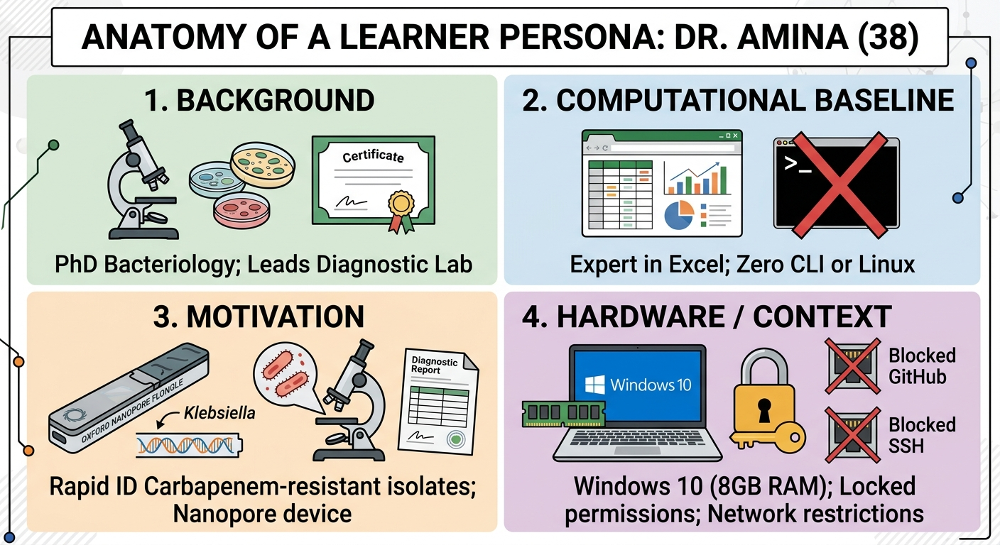
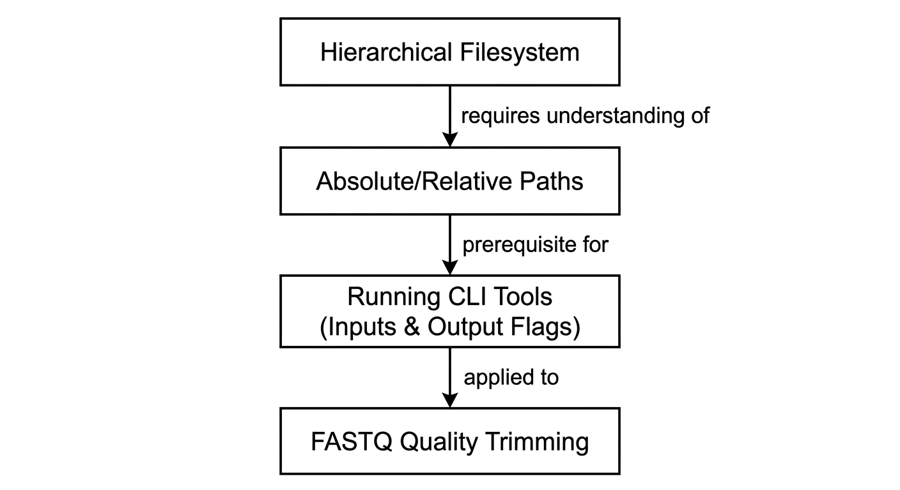

::: {.callout-tip}
#### Learning Objectives

- Apply the **Backward Design** framework to structure bioinformatics courses around desired competencies and authentic evidence rather than software tool lists.
- Develop realistic **Learner Personas** that capture professional motivations, domain backgrounds, and technical/infrastructure constraints.
- Formulate precise, measurable learning outcomes using revised **Bloom's Taxonomy** action verbs.
- Construct **Concept Maps** to identify prerequisite knowledge dependencies and prevent hidden cognitive leaps.
- Incorporate low-resource realities (bandwidth limits, hardware ceilings, offline requirements) as primary architectural constraints during initial curriculum design.
:::

## Introduction: The "Forward Design" Trap

When asked to design a new bioinformatics workshop, instructors often begin by listing software tools:

> *"We have three days. Let's do FastQC on Monday, BWA and SAMtools on Tuesday, and GATK on Wednesday."*

This approach—known as **Forward Design**—is driven by content rather than learning. The instructor decides what tools they want to demonstrate, creates lectures around tool syntax, and at the end of the course wonders why students are unable to analyze their own research data independently.

| FORWARD DESIGN (Content) | BACKWARD DESIGN (Outcomes) |
| :--- | :--- |
| 1. Pick tools (FastQC, BWA, GATK) | 1. Identify Desired Results: What will learners be able to DO at the end of the course? |
| 2. Design lectures around syntax | 2. Determine Acceptable Evidence: How will they demonstrate it? |
| 3. Give students a canned script | 3. Plan Learning Experiences: What datasets and scaffolding lead to that outcome? |
| 4. Hope that learning occurred | |

: Table 1: Forward design versus backward design

**Backward Design** (Wiggins & McTighe, 2005) reverses this process. By starting with the final intended competencies and working backward, instructors create tightly integrated, purposeful training programs where every lecture, exercise, and dataset directly serves a measurable objective.

## Stage 1: Learner Personas — Knowing Your Audience

You cannot design an effective curriculum for "anyone interested in bioinformatics." A 50-year-old hospital pathologist has fundamentally different technical baselines, career incentives, and hardware constraints than a 22-year-old master's student in computer science.

A **Learner Persona** is a short, fictional archetype that embodies the characteristics, prior knowledge, motivations, and pain points of your target audience.

### Why Personas Drive Critical Design Decisions

When planning your curriculum, consult your persona to resolve pedagogical debates:

- *"Should we teach how to compile BCFtools from C source code?"*
  $\rightarrow$ Look at Dr. Amina: No! She lacks root permissions and needs to solve a clinical problem, not learn software engineering. Provide a pre-built static binary or container.
- *"Should we use a 15 GB human exome dataset?"*
  $\rightarrow$ Look at Dr. Amina: No! Her laptop has 8 GB RAM and her focus is bacterial AMR. Use a 2 MB locus-targeted bacterial micro-dataset.

## Stage 2: Formulating Measurable Learning Outcomes

Once you know your audience, define what they should be able to achieve. Use **Bloom’s Revised Taxonomy** to align your learning objectives with the appropriate cognitive level:

| Level | Description | Action Verbs to Use |
| :--- | :--- | :--- |
| 6. Create | Design new workflows, pipelines or automated solutions | Construct, assemble, automate, formulate |
| 5. Evaluate | Judge data quality or justify analytical choices | Assess, appraise, validate, critique |
| 4. Analyze | Differentiate true signal from technical artifacts; filter data | Distinguish, diagnose, troubleshoot, filter |
| 3. Apply | Execute commands and pipelines on novel datasets | Run, execute, modify, calculate, implement |
| 2. Understand | Explain concepts, data formats and algorithmic trade-offs | Differentiate, outline, summarize, predict |
| 1. Remember | Recall syntax, flag meanings, and directory structures | Identify, list, recall, name, state |

: Table 2: Bloom's taxonomy for bioinformatics

::: {.callout-warning}
## Avoid "Zombie Verbs"
Never write learning objectives with vague, unmeasurable verbs:

- ❌ *"Learners will understand Linux."* (How do you measure "understand"?)
- ❌ *"Learners will be exposed to variant calling."* (Exposure does not mean competence).
- ❌ *"Learners will appreciate high-throughput sequencing."*

**Use Observable Action Verbs:**

- ✅ *"Learners will **execute** read trimming using `fastp` and **critique** post-filtering quality metrics."*
- ✅ *"Learners will **diagnose** Out-Of-Memory errors in SPAdes and **adjust** thread and memory parameters accordingly."*
:::

## Stage 3: Determining Acceptable Evidence (Assessment First)

In Backward Design, before you write a single slide or choose a tutorial, ask yourself: **"How will the learners and I know that they have achieved the learning outcome?"**

Design your **summative challenge** or end-of-module practical first:

- *Desired Outcome:* "Learners will be able to identify antimicrobial resistance mutations in a bacterial isolate."
- *Acceptable Evidence (Assessment):* Provide learners with a raw paired-end micro-dataset of an uncharacterized *Klebsiella* isolate. Give them 45 minutes to run QC, map reads to a reference contig, call variants, and report which antibiotic the strain is resistant to.
- *Instructional Plan:* Now design the specific live coding sessions, faded examples, and command deconstructions needed to equip them for that challenge!

## Concept Mapping: Mapping Dependencies

Bioinformatics learning is strictly hierarchical. You cannot teach read mapping before learners understand file paths; you cannot teach variant filtering before they understand VCF columns.

A **Concept Map** is a visual diagram connecting concepts with labeled relationship arrows. Building a concept map reveals **hidden dependencies**:

If an instructor tries to teach quality trimming without verifying that students understand relative paths, the lesson will collapse into frantic troubleshooting of `No such file or directory` errors.

## Designing with Low-Resource Constraints as First Principles

In low-resource environments, constraints are not bugs; they are fundamental design parameters:

| Constraint | Design Rule |
| :--- | :--- |
| 1. Zero Internet Guarantee | Curriculum must execute 100% offline from local USB drives or pre-loaded classroom mirrors. |
| 2. 4 GB RAM Ceiling | No tool or dataset may require > 2 GB RAM (reserving 2 GB for the operating system). |
| 3. Non-Root Lab Permissions | Tools must run in user space (static binaries, Micromamba environments, or Apptainer). |
| 4. Modular Schedule | Break curriculum into self-contained 2-hour modules that can survive sudden power outages. |

: Constraint-first curriculum audit

## Interactive Exercises for Future Trainers

These exercises will guide you through building a learner persona and mapping a backward-designed module.

::: {.callout-exercise}
## Creating a Contextualized Learner Persona

You are tasked with designing a 3-day workshop titled *"Practical Pathogen Genomics for Outbreak Surveillance"* to be held at a public research institute in West Africa.

Develop a complete **Learner Persona** for this course by specifying:

1. **Name, Age, and Professional Role.**
2. **Biological Domain Expertise vs. Computational Baseline.**
3. **Primary Motivation (Why are they taking time away from work to attend?).**
4. **Three Specific Technical / Infrastructural Constraints they will bring to the classroom.**

::: {.callout-hint}
Make the persona realistic and multidimensional. Include hardware, network, and institutional restrictions.
:::

::: {.callout-answer}
### Model Learner Persona

1. **Identity:**
   - **Name:** Dr. Jean-Paul (Age: 34).
   - **Role:** Medical Epidemiologist at the National Public Health Laboratory.

2. **Expertise & Baseline:**
   - **Domain:** Expert in infectious disease surveillance, diagnostic RT-PCR, and clinical epidemiology during cholera and viral hemorrhagic fever outbreaks.
   - **Computational:** Uses Windows 11 daily for Excel and Epi Info; has never opened a terminal, written a script, or run a Linux command.

3. **Motivation:**
   - His laboratory recently acquired an Oxford Nanopore MinION to sequence cholera and mpox isolates locally. Currently, raw sequencing files are sent abroad for analysis, delaying outbreak response by weeks. He needs to run local QC, assembly, and lineage assignment within 24 hours of sequencing.

4. **Constraints:**
   - **Hardware:** Uses an older institutional Windows laptop with 6 GB RAM and only 25 GB of free hard drive space.
   - **Permissions:** Does not have administrator/root access to install software on his work laptop.
   - **Connectivity:** Works in an office with frequent 2-to-3-hour power cuts and relies on an intermittent cellular hotspot with expensive data limits.
:::
:::

::: {.callout-exercise}
## Applying Backward Design to a Variant-Calling Module

A training team submits a draft module titled *"Introduction to Variant Calling"*. The current plan starts with a 45-minute lecture on the math of Bayesian variant probability, followed by running a 10-line GATK Bash script.

Apply the three stages of **Backward Design** to restructure this module:

1. **Stage 1 (Desired Results):** Formulate two Bloom-aligned, measurable learning outcomes.
2. **Stage 2 (Acceptable Evidence):** Design a hands-on assessment task that proves learners achieved those outcomes.
3. **Stage 3 (Learning Plan):** Outline the learning activities and micro-datasets required to prepare them for that assessment.

::: {.callout-answer}
### Backward Design Blueprint

1. **Stage 1: Desired Learning Outcomes:**
   - *"Learners will **execute** variant calling on a bacterial micro-dataset using `bcftools`."* (Bloom: Apply)
   - *"Learners will **filter** raw variant calls to eliminate low-depth and strand-biased artifacts, **validating** candidate drug-resistance SNPs in IGV."* (Bloom: Evaluate)

2. **Stage 2: Acceptable Evidence (Assessment Task):**
   - Provide trainees with an alignment BAM file of a candidate resistant *M. tuberculosis* isolate. 
   - Task: Generate a filtered VCF file containing only variants with $\text{QUAL} \ge 30$ and $\text{DP} \ge 15$, open the candidate mutation in IGV, and submit a 2-sentence clinical diagnosis stating whether the isolate carries the Rifampicin resistance mutation.

3. **Stage 3: Learning Plan & Scaffolding:**
   - **Activity 1:** 15-minute live coding deconstructing VCF columns (`CHROM`, `POS`, `REF`, `ALT`, `QUAL`, `INFO`).
   - **Activity 2:** Faded example exercise constructing a `bcftools filter` command.
   - **Activity 3:** Visual demonstration in IGV comparing an authentic mutation against a sequencing error.
   - **Dataset:** 1.5 MB locus-targeted BAM file of the *rpoB* gene cassette that executes in 10 seconds.
:::
:::

## Summary

::: {.callout-tip}
#### Key Points

- **Begin with the End in Mind:** Backward Design guarantees that every lecture, tool, and practical directly serves measurable student competencies rather than software vendor lists.
- **Anchor Design in Real Personas:** Create concrete learner personas that reflect real-world technical baselines, professional incentives, and institutional hardware constraints.
- **Use Measurable Action Verbs:** Eliminate vague "zombie verbs" (understand, appreciate); use Bloom’s Taxonomy verbs (execute, diagnose, differentiate, validate) to define observable outcomes.
- **Assess Before You Teach:** Design the summative challenge and evidence of mastery before drafting presentation slides.
- **Map Dependencies Explicitly:** Use concept maps to diagnose prerequisite bottlenecks and prevent cognitive leaps in the classroom.
- **Design for Constraints:** Treat limited bandwidth, low RAM, and lack of root permissions as primary architectural design parameters from day one.
:::
