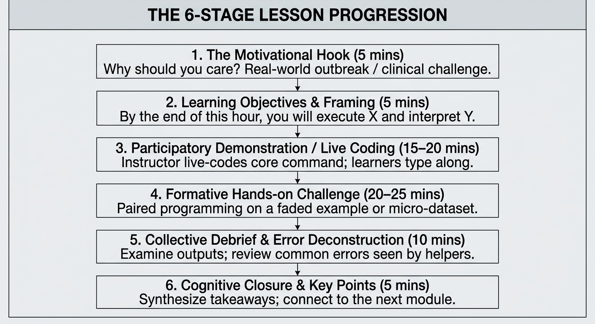
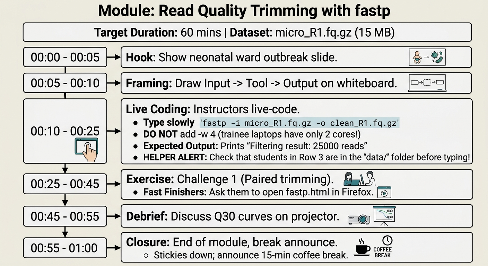

::: {.callout-tip}
#### Learning Objectives

- Structure a 60-to-90-minute computational training session using a six stage pedagogical layout (Motivation, Objectives, Demonstration, Challenge, Debrief, Closure).
- Apply the **"Double-Time Rule"** to budget realistic timelines for hands-on computational exercises.
- Author comprehensive **Instructor Delivery Notes** that document exact commands, expected terminal outputs, and helper alerts.
- Develop an operational **Contingency Matrix (Plan B and Plan C)** to insulate classroom sessions against power outages, network crashes, and software bugs.
- Design purposeful cognitive buffers to prevent end-of-day exhaustion in multi-day workshops.
:::

## Introduction: The "Know-it-all" Instructor

Experienced bioinformaticians often believe that because they have run a pipeline hundreds of times in their research, they can walk into a classroom and teach it without a detailed plan. 

In practice, unstructured teaching in computational biology quickly disintegrates:

- The instructor loses track of time, spending 45 minutes on basic directory navigation and leaving 10 minutes for the actual analysis.
- Live commands throw unexpected errors because of missing sample files or unstated environment variables.
- Novice learners become overwhelmed by unstructured streams of consciousness.

| Unstructured | Structured lesson plan |
| :--- | :--- |
| • Wandering, stream-of-thought | • Tight six stage pedagogical plan |
| • Unpredictable time consumption | • Explicit time-budgeted segments |
| • Silent panic when tools fail | • Documented expected outputs |
| • Leaves slower learners behind | • Pre-planned contingency fallbacks |
| • Unclear learning takeaways | • Measurable closure & reflection |

: Table 1: Unstructured versus planned lesson delivery

A **Lesson Plan** is the operational script for a specific learning module. It helps guarantee that instructional time is protected, cognitive load is managed, and helpers know exactly how and when to support students.

## Structuring Your Lessons

Every modular session of your training (typically 60 to 90 minutes) should follow a structured pedagogical progression:

**Stage 1: The Motivation (5 Minutes)**

Never start with syntax. Start with the biological or operational problem:

- *"Imagine you receive a call from the local hospital's epidemiologist: three infants in the neonatal ward have contracted multidrug-resistant Serratia. We need to determine if they share an identical strain within the next two hours. How do we extract that answer from raw sequencing data?"*

**Stage 2: Objective & Mental Model Framing (5 Minutes)**

Clearly state the single capability learners will gain. Draw a 3-box workflow on the whiteboard:
$$\text{Raw FASTQ} \xrightarrow{\text{fastp (Trimming)}} \text{Clean FASTQ} \xrightarrow{\text{fastp.html (Report)}}$$

**Stage 3: Participatory Demonstration (15–20 Minutes)**

Live-code the foundational command deliberately. Deconstruct the flags, press Enter together, and inspect the resulting output files with `ls -lh` and `head`.

**Stage 4: Formative Hands-on Challenge (20–25 Minutes)**

Learners immediately put hands to keys in pairs. They modify parameters, run a second sample, or fill in a faded template while helpers move around the room.

**Stage 5: Collective Debrief & Error Deconstruction (10 Minutes)**

Bring the room back together. Ask a learner to share what their report showed. Highlight a common bug that multiple students encountered during the exercise and explain *why* it occurred.

**Stage 6: Cognitive Closure (5 Minutes)**

Summarize the core mental model and preview what comes next: *"Now that our reads are clean, in the next session we will map them to our reference genome."*

## Time Budgeting: The "Double-Time Rule"

The single greatest planning failure in computational training is underestimating how long novice learners take to complete an exercise:

::: {.callout-important}
## The Double-Time Rule
Any computational exercise that takes an experienced instructor **5 minutes** to type and execute will take novice learners **at least 15 to 20 minutes** (3x to 4x longer).
:::

### Why Novices Require 3x More Time:
1. **Locating Windows:** Switching between the browser tutorial, the terminal window, and file directories takes novices multiple clicks and spatial orientation time.
2. **Keyboard Friction:** Novices hunt for special characters like `~` (tilde), `|` (pipe), `\` (backslash), and `_` (underscore), which reside in different keyboard locations across international laptop layouts.
3. **Typing Speed & Syntax Errors:** Beginners average 15–20 words per minute and make typos that require helper intervention.
4. **Tool Execution Latency:** On older consumer laptops with 4 GB RAM, a tool runs 2–3 times slower than on an instructor's high-spec MacBook or Linux laptop.

## Authoring Instructor Delivery Notes

A polished lesson plan includes **Instructor Delivery Notes**, a private cheatsheet used by the trainer at the podium:

## The Contingency Matrix: Planning for Failure

In low-resource environments, instructional planning must include **Plan B and Plan C**:

| Failure Point | Plan B (Fallback) | Plan C (Emergency Survival) |
| :--- | :--- | :--- |
| 1. Internet Drops Completely | Distribute files via USB 3.0 sticks | Local Raspberry Pi / laptop serves files over local Wi-Fi |
| 2. Electrical Power Blackout | Switch room to laptop batteries (good for 60 mins) | Transition to unplugged whiteboard activity or group data-interpretation task |
| 3. Tool Fails on Windows/macOS | Pair student with a neighbor (Driver/Navigator) | Provide pre-computed output file so student joins the downstream analysis |
| 4. Long Job Hangs or OOM Crashes | Kill process; use smaller subsampled micro-dataset | Skip live assembly; explore pre-assembled contig file already provided on USB |

: Table 2: Classroom contingency matrix

## Interactive Exercises for Future Trainers

These exercises will test your ability to construct realistic lesson timelines and prepare for live classroom contingencies.

::: {.callout-exercise}
## Drafting a Time-Budgeted Lesson Plan

You have been allocated a **75 minute morning session** to teach *"Inspecting Alignments with SAMtools"* to 20 master's students in agricultural genomics.

Draft a detailed lesson plan that applies the six stage lesson plan:

1. Allocate specific minute-by-minute timings for each of the six stages.
2. Formulate the opening **Motivation**.
3. Detail the specific hands-on task for the learners during the formative challenge stage.
4. Specify where you will incorporate a deliberate five minute buffer.

::: {.callout-hint}
Remember the Double-Time Rule: keep the hands-on challenge focused and achievable within 20 minutes.
:::

::: {.callout-answer}
### 75 Minute Lesson Plan Blueprint

1. **Timeline Breakdown:**
   - **00:00 - 00:05 (Stage 1: Motivation):** Show an outbreak of cassava mosaic disease. Explain why knowing whether sequencing reads map uniquely across viral strains dictates disease control.
   - **00:05 - 00:10 (Stage 2: Objectives):** Define learning outcomes: convert SAM to sorted BAM, index the file, and calculate mapping depth.
   - **00:10 - 00:25 (Stage 3: Demonstration):** Participatory live coding of `samtools view -bS` and `samtools sort`. Enlarge font; narrate the `-@` and `-o` flags.
   - **00:25 - 00:45 (Stage 4: Formative Challenge):** Paired hands-on exercise (see below).
   - **00:45 - 00:55 (Buffer / Catch-Up):** Built-in 10-minute buffer for helpers to assist struggling pairs and ensure every laptop finishes.
   - **00:55 - 01:05 (Stage 5: Collective Debrief):** Examine flagstat results on screen; discuss why 12% of reads were unmapped.
   - **01:05 - 01:15 (Stage 6: Closure & Key Points):** Review key points; green stickies check; break.

2. **Formative Hands-on Challenge:**
   *"Working with your partner, run `samtools flagstat` on `cassava_sample2_sorted.bam`. Write down: (1) What percentage of reads mapped successfully? (2) How many reads mapped as proper pairs? Post a green sticky when both questions are answered."*
:::
:::

::: {.callout-exercise}
## Resolving a Live Classroom Emergency

At 14:15 on Day 2 of your workshop, a thunderstorm knocks out the power grid at your training venue. The room goes dark, the ceiling projector turns off, and the venue Wi-Fi router dies immediately. 

Learner laptops have approximately 45–60 minutes of battery life remaining. Your schedule calls for a 2 hour practical on *de novo* genome assembly using SPAdes.

1. Why would attempting to run the planned SPAdes assembly practical on laptop batteries be a bad idea?
2. Formulate an immediate 45 minute "Plan C" emergency activity that continues active learning using remaining battery life without internet or heavy CPU computation.
3. How will you adjust the schedule once power returns?

::: {.callout-answer}
### Emergency Response Protocol

1. **Why SPAdes on Battery Fails:**
   SPAdes is a CPU-intensive multi-threaded de Bruijn graph assembler that runs all processor cores at 100%. Running SPAdes will exhaust laptop batteries in 20 minutes, causing machines to shut down mid-assembly and corrupting files. Furthermore, without the projector, learners cannot follow live coding.

2. **45-Minute "Plan C" Activity (Low-Power Data Interpretation):**
   - **Action:** Instruct learners to immediately dim laptop screen brightness to 30% to conserve battery.
   - **Activity:** Pivot to an offline **data interpretation and quality critique practical**:
     *"Everyone, open the pre-computed QUAST assembly report (`quast_report.html`) and BUSCO summary table located in your offline course folder. In pairs, compare Assembly A (standard parameters) versus Assembly B (relaxed k-mer parameters). Answer three questions: Which assembly has a higher N50? Which assembly has fewer misassemblies? Which one captures more complete core genes?"*
   - **Advantage:** Opening static HTML reports consumes almost zero CPU/battery, requires zero internet, and shifts focus to high-value biological critique.

3. **Schedule Adjustment:**
   When power returns, do not attempt to make up the lost live assembly time by rushing. Skip the live assembly execution entirely, briefly review the command syntax on the whiteboard for 10 minutes, and proceed directly to downstream annotation using pre-computed assembly outputs.
:::
:::

## Summary

::: {.callout-tip}
#### Key Points

- **Structure Protects Learning:** Adhere to the six stage lesson layout (Motivation, Objectives, Demonstration, Challenge, Debrief, Closure) to keep sessions purposeful and engaging.
- **Budget with the Double-Time Rule:** Novices require 3x to 4x longer than experienced instructors to complete computational tasks. Budget time accordingly.
- **Write Instructor Delivery Notes:** Document exact commands, expected outputs, time checkpoints, and helper warnings before taking the podium.
- **Always Prepare a Contingency Matrix:** Maintain Plan B and Plan C protocols for power cuts, internet outages, and software crashes.
- **Embrace Pre-Computed Outputs:** When hardware or environmental disruptions happen, switch to pre-computed outputs to keep biological inquiry moving forward.
:::
