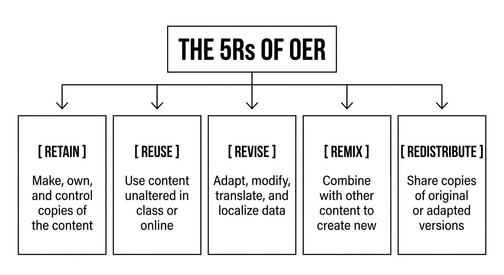
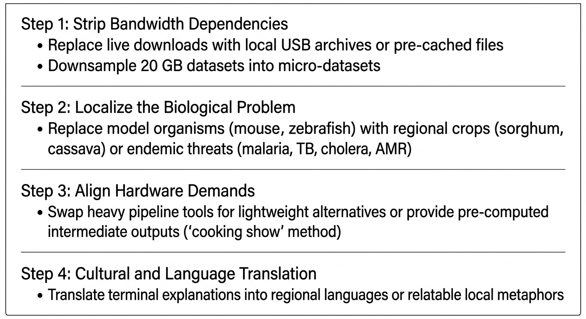

::: {.callout-tip}
#### Learning Objectives

- Define Open Educational Resources (OER) and evaluate training materials using the "5R Permissions" framework (Retain, Reuse, Revise, Remix, Redistribute).
- Differentiate between Creative Commons licensing models (CC0, CC BY, CC BY-SA, CC BY-NC, CC BY-ND) and their implications for course delivery and adaptation.
- Apply the **FAIR Principles for Training Materials** (Findable, Accessible, Interoperable, Reusable) to ensure educational content is sustainably structured and discoverable.
- Navigate major bioinformatics OER repositories and training networks (The Carpentries, Galaxy Training Network, ELIXIR TeSS, and H3ABioNet).
- Implement offline caching, website mirroring, and archival strategies (`wget --mirror`, static HTML bundles, USB distribution) for bandwidth-constrained venues.
- Contextualize global OER materials for low-resource settings by adapting datasets to local biological priorities (e.g. endemic pathogens, local crops) and stripping bandwidth-heavy assumptions.
- Contribute localized training materials, translations, and micro-datasets back to the global open-science commons.
:::

## Introduction: Why Reinvent the Wheel?

Creating a modern, high-quality bioinformatics curriculum from scratch requires hundreds of hours of design, code testing, dataset curating, and slide preparation. For educators in low- and middle-income countries (LMICs), who frequently balance heavy university teaching loads, clinical duties, wet-lab management, and administrative responsibilities, building an entire curriculum from the ground up is an overwhelming burden.

Fortunately, the global scientific community has embraced **Open Educational Resources (OER)**. Today, thousands of peer-reviewed, classroom-tested bioinformatics lessons, interactive workflows, and curated datasets are freely available online.

| Building from scratch | Adapting open resources |
| :--- | :--- |
| • 200+ hours of solo development | • 10–20 hours of localization |
| • Untested in live classrooms | • Battle-tested by hundreds of international instructors |
| • Unstandardised pedagogical flow | • Evidence-based lesson design |
| • Rapidly becomes outdated | • Continuously updated by the global open-science community |
| • High risk of instructor burnout | |

: Table 1: The Curriculum development dilemma

The role of a modern bioinformatics educator in a resource-limited setting is not to author every line of training material from scratch. **Your aim is curating, contextualizing, and delivering existing open resources to meet the precise needs of your local learners.**


## What Are Open Educational Resources? The 5Rs

According to UNESCO, **Open Educational Resources (OER)** are learning, teaching, and research materials in any format and medium that reside in the public domain or are released under an open license that permits no-cost access, reuse, repurpose, adaptation, and redistribution by others.

Educational researcher David Wiley codified the operational definition of open content into the **"5R Permissions"**:



1. **Retain:** The right to make, own, and control copies of the content (e.g. downloading lessons to offline USB drives without fear of expiration or paywalls).
2. **Reuse:** The right to use the content in its original, unaltered form (e.g. running a Software Carpentry Unix tutorial in your workshop).
3. **Revise:** The right to adapt, adjust, modify, or translate the content (e.g. replacing a human cancer dataset with local *Plasmodium falciparum* sequencing data).
4. **Remix:** The right to combine the original or revised content with other open materials to create something new (e.g. merging a Galaxy QC tutorial with an R visualization practical).
5. **Redistribute:** The right to share copies of your original, revised, or remixed materials with your students, regional colleagues, and the public.


## The FAIR Principles for Training Materials

Just as research data must be **FAIR** (Findable, Accessible, Interoperable, and Reusable), international bioinformatics training networks (including ELIXIR and the Global Bioinformatics Education Network) have established the **FAIR Principles for Training Materials**:

| Principle | Practical Implementation for Instructors |
| :--- | :--- |
| 1. Findable | • Deposit materials in indexed registries (TeSS)<br>• Assign persistent identifiers (DOIs via Zenodo)<br>• Include structured metadata (keywords, targets) |
| 2. Accessible | • Publish on open, barrier-free platforms (web)<br>• Guarantee clear access protocols (no paywalls)<br>• Provide downloadable offline copies (PDF/HTML) |
| 3. Interoperable | • Use open, plain-text formats (Markdown, Quarto)<br>• Reference standard biological ontologies (EDAM)<br>• Avoid proprietary vendor-locked slide formats |
| 4. Reusable | • Attach an explicit open license (e.g. CC BY)<br>• Define prerequisites & target learner personas<br>• Provide executable code & micro-datasets |

: Table 2: FAIR principles in bioinformatics training

Adopting FAIR training practices ensures that your localized materials don't disappear on an abandoned hard drive when a grant concludes, but remain findable and reusable by educators worldwide.


## Open Licensing: Navigating Creative Commons

A common misconception is that anything freely accessible on the internet is open to be copied, modified, and redistributed. Under international copyright law, works without an explicit license are protected by **"All Rights Reserved"** by default.

To grant the 5R permissions, authors attach **Creative Commons (CC)** licenses:

| License | Requirements | Is it OER? | Impact on Teaching |
| :--- | :--- | :--- | :--- |
| CC0 (No Rights) | Public Domain (No attribution) | Yes (Full) | Unconditional reuse |
| CC BY | Attribution only | Yes (Gold Standard) | Ideal for science; free to adapt/remix |
| CC BY-SA | Attribution + ShareAlike | Yes | Derived works must keep the same license |
| CC BY-NC | Attribution + NonCommercial | Yes (With Caveat) | Cannot be used in fee-charging courses |
| CC BY-ND | Attribution + NoDerivatives | ❌ NO! (Not OER) | Cannot adapt, modify, or translate files! |

: Table 3: Creative commons licensing spectrum

::: {.callout-warning}
## The "NoDerivatives" Trap (CC BY-ND)
Materials licensed under **CC BY-ND** prohibit any modification or derivative works. You can show the material in its exact original state, but you **cannot** translate it into French or Swahili, simplify the text, or swap out the example dataset for a local pathogen. For true educational adaptation, always look for **CC BY** or **CC BY-SA** materials.
:::

### How to Give Proper Attribution (The TASL Principle)
When using or adapting OER content, follow the **TASL** framework:

- **T**itle: What is the name of the resource?
- **A**uthor: Who created it?
- **S**ource: Where did you find it (link to repository)?
- **L**icense: Under which CC license is it released (link to license)?

*Example Citation:*

> *"Adapted from 'Introduction to the Command Line for Genomics' by The Carpentries, licensed under CC BY 4.0. Regional malaria datasets substituted by Dr. A. Mensah."*


## Major Bioinformatics OER Repositories

Where can instructors find high-quality, pre-built training materials?

| Community / Portal | What They Offer |
| :--- | :--- |
| The Carpentries<br>(carpentries.org) | Hands-on beginner foundational skills: Unix CLI, Git, Python, R, Genomics, Ecology, Metagenomics. |
| Galaxy Training Network (GTN)<br>(training.galaxyproject.org) | 400+ peer-reviewed tutorials with matched workflows, slide decks, and micro-datasets across all omics. |
| ELIXIR TeSS<br>(tess.elixir-europe.org) | European registry aggregating thousands of training events, FAIR lesson packages, and learning paths |
| H3ABioNet Training<br>(h3abionet.org/training) | Comprehensive curricula designed specifically for distributed, bandwidth-constrained African nodes |

: Table 4: Key bioinformatics OER resources

**1. The Carpentries (Software & Data Carpentry)**

- **Pedagogical Model:** Evidence-based, participatory live coding, formative assessment, and 2-day modular workshops.
- **Why it matters:** The curriculum is maintained as open-source Markdown files on GitHub. Anyone can clone a lesson, modify it, and run a workshop freely.

**2. The Galaxy Training Network (GTN)**

- **Pedagogical Model:** Complete end-to-end learning modules. Every tutorial includes a written step-by-step narrative, interactive Galaxy workflow, lecture slides, and direct links to public Zenodo datasets.
- **Why it matters:** Eliminates command-line and local software hurdles entirely; tutorials can be run directly on free public Galaxy servers (`usegalaxy.org`, `usegalaxy.eu`).

**3. H3ABioNet Curricula**

- Designed specifically for Pan-African training across distributed classrooms with mixed computing infrastructure.
- Features standardized container images, pre-recorded lectures paired with local in-person teaching assistants, and bandwidth-efficient practicals.

## Adapting OER for LMICs

Simply downloading an open curriculum created at a well-funded European or North American university and presenting it unaltered to an LMIC classroom often leads to failure.

Curricula from high-resource settings frequently embed **hidden resource assumptions**:

- *"Download this 15 GB reference file from NCBI during class."* (Classroom Wi-Fi collapses).
- *"Run this Nextflow pipeline across 32 cores on your institutional cluster."* (Students only have 4 GB RAM laptops).
- *"Let us explore mutations associated with cystic fibrosis in European populations."* (Completely divorced from the infectious disease or agricultural priorities of local trainees).



::: {.callout-note}
## The Power of Local Biological Relevance
Adult learners are motivated by immediate practical relevance (Knowles' andragogical principle). When you teach variant calling using a local multidrug-resistant *Mycobacterium tuberculosis* isolate or a drought-resistant local cowpea variety, learner engagement increases dramatically compared to analyzing human cancer cell line datasets.
:::


## Offline Caching and Archival Strategies

In low-resource venues, internet connections may drop completely for hours. A critical competence for trainers is **offline preparedness**—ensuring every webpage, manual, and dataset is cached locally before stepping into the classroom.

| Tool / Approach | Purpose & Command |
| :--- | :--- |
| wget --mirror | Recursively clones entire static HTML websites<br>`wget --mirror --convert-links -P ./offline_site URL` |
| Quarto HTML Book | Renders entire curriculum into self-contained offline HTML pages (e.g. this book's _site folder) |
| Kiwix (.zim) | Offline reader for entire Wikipedia, BioStars, and StackOverflow medical & computational dumps |
| Local Zenodo Zip | Pre-download Zenodo micro-datasets into a single zip archive distributed via USB thumb drives |

: Table 5: Offline archival tools

**1. Mirroring Online Tutorials with `wget`**

You can download a complete static documentation site or tutorial with:
```bash
wget \
  --mirror \
  --convert-links \
  --adjust-extension \
  --page-requisites \
  --no-parent \
  https://example-bioinformatics-tutorial.org/
```
Students can open the downloaded `index.html` file in any browser without an internet connection.

**2. Distributing Pre-Rendered Course Books**

Because modern course templates (such as this Quarto framework) render into static HTML (`_site/`), instructors can zip the rendered `_site` directory and distribute it via USB drives. Students navigate the entire course book locally with functioning navigation bars, search indexing, and embedded images—completely offline.

## Contributing Back to the Commons

Open science is a collaborative endeavour. When educators in low-resource settings adapt global materials, their modifications are of immense value to the rest of the world.

### Ways to Give Back:
1. **Share Your Micro-Datasets:** Upload your subsampled, localized datasets to public repositories like **Zenodo** or GitHub with a CC BY license and a DOI.
2. **Submit Upstream Bug Fixes:** When you spot broken commands, typos, or outdated URLs in a Carpentries or Galaxy tutorial, submit a Pull Request on GitHub.
3. **Publish Translations:** Translate open tutorials or command cheatsheets into regional languages (e.g. French, Spanish, Portuguese, Swahili, Arabic).
4. **Share Course Webpages:** Use modern templates (like this Quarto course repository) to publish your adapted workshop materials publicly on GitHub Pages so other regional trainers can benefit.

## Interactive Exercises for Future Trainers

These exercises will test your ability to evaluate licenses, audit training materials for hidden resource barriers, and adapt generic lessons to local realities.

::: {.callout-exercise}
## Evaluating Open Licenses for Workshop Use

You are organizing a 5 day regional bioinformatics workshop in East Africa. To cover venue rental, coffee breaks, and printed materials, your university charges participants a nominal registration fee of $30 USD.

You identify three online tutorials you would like to adapt and bundle into the course manual:

- **Tutorial A:** Marked *"Copyright © 2024 University X. All Rights Reserved."*
- **Tutorial B:** Licensed under **CC BY-NC 4.0** (Attribution-NonCommercial).
- **Tutorial C:** Licensed under **CC BY-SA 4.0** (Attribution-ShareAlike).

1. Can you legally download, modify, and print Tutorial A for your participants?
2. Does charging a $30 cost-recovery registration fee violate the non-commercial restriction of Tutorial B?
3. What legal obligation do you have if you adapt Tutorial C and distribute the revised manual to your students?

::: {.callout-hint}
Review the legal distinction between commercial exploitation and non-profit cost-recovery, and remember the "ShareAlike" clause.
:::

::: {.callout-answer}
### Legal & Licensing Evaluation

1. **Tutorial A (All Rights Reserved):**
   **No.** Without an explicit open license, international copyright law prohibits unauthorized copying, modification, or redistribution, even for non-profit education. You must contact the original authors to obtain written permission.

2. **Tutorial B (CC BY-NC 4.0):**
   **High legal ambiguity / Risk.** Creative Commons defines non-commercial as *"not primarily intended for or directed towards commercial advantage or monetary compensation"*. While charging a nominal registration fee to cover catering/venue costs is considered cost-recovery by educators, some institutional legal teams interpret any fee as commercial. If possible, seek clarification from the author or choose a pure **CC BY** resource to avoid legal ambiguity.

3. **Tutorial C (CC BY-SA 4.0):**
   **Yes, you can freely use, adapt, and print it.** However, under the **ShareAlike (SA)** clause, your adapted manual must also be released under the exact same **CC BY-SA 4.0** license, and you must provide proper attribution (TASL) to the original creators.
:::
:::

::: {.callout-exercise}
## Auditing and Contextualizing a High-resource Setting OER Lesson

You find a popular, well-written online tutorial on *"RNA-Seq Differential Expression Analysis"* published by an institute in the United States. 

The original lesson:

- Downloads a 12 GB paired-end mouse dataset from the NCBI SRA via `fastq-dump` during class.
- Uses `STAR` aligner (requiring 32 GB of RAM to build the genome index).
- Explores gene expression changes in mouse liver tissue following high-fat diet consumption.

Audit this lesson and describe three concrete modifications you must make to adapt it for a classroom of 20 trainees in Ghana with 8 GB RAM laptops and a 5 Mbps shared Wi-Fi connection.

::: {.callout-answer}
### Adaptation Audit & Redesign

1. **Bandwidth Remediation:**
   - *Problem:* Running `fastq-dump` across 20 laptops for 12 GB will crash the 5 Mbps network within minutes.
   - *Fix:* Subsample the raw reads into a micro-dataset beforehand. Distribute the subsampled FASTQ files via USB flash drives or a local classroom router so zero internet bandwidth is required.

2. **Hardware Remediation:**
   - *Problem:* `STAR` requires 32 GB RAM just to load the mammalian genome index, which will immediately trigger an Out-Of-Memory (`Killed`) crash on 8 GB student laptops.
   - *Fix:* Replace `STAR` with a lightweight pseudo-aligner (such as `kallisto` or `salmon`), which runs in under 2 GB of RAM and executes in minutes, OR use a single-chromosome/micro-dataset index.

3. **Biological Contextualization:**
   - *Problem:* Mouse liver metabolic response to high-fat diets is irrelevant to local public health and infectious disease research in Ghana.
   - *Fix:* Swap the dataset for an authentic public dataset investigating transcriptional responses of *Plasmodium falciparum* to artemisinin treatment, or a local crop (cassava mosaic virus resistance). The core statistical principles (counts, normalisation, DESeq2, Volcano plots, FDR) remain 100% identical, but learner motivation and local relevance are dramatically enhanced.
:::
:::


## Summary

::: {.callout-tip}
#### Key Points

- **Leverage Existing OER:** Avoid curriculum burnout by adapting previously tested, peer-reviewed educational materials from global communities rather than writing courses from scratch.
- **The 5Rs Define Openness:** True OER grants the rights to **Retain, Reuse, Revise, Remix, and Redistribute** content freely.
- **Adopt FAIR Training Principles:** Ensure training materials are **Findable, Accessible, Interoperable, and Reusable** by using open formats (Markdown/Quarto), attaching DOIs, and providing clear metadata.
- **Choose the Right License:** Favor **CC BY** (Attribution) for maximum educational flexibility; avoid **CC BY-ND** (NoDerivatives), which legally prohibits adapting or translating materials.
- **Contextualization is Mandatory:** Never deliver curricula from high-resources settings unexamined. Proactively strip bandwidth-heavy live downloads, right-size compute requirements for modest hardware, and replace generic model organisms with regionally relevant health and agricultural datasets.
- **Plan for Offline Delivery:** Mirror websites (`wget --mirror`), package static HTML books, and distribute micro-datasets on USB flash drives to insulate courses from internet outages.
- **Contribute Back:** Complete the open-science cycle by publishing your localized micro-datasets, exercises, and translations under open licenses with DOIs on platforms like Zenodo and GitHub.
:::
