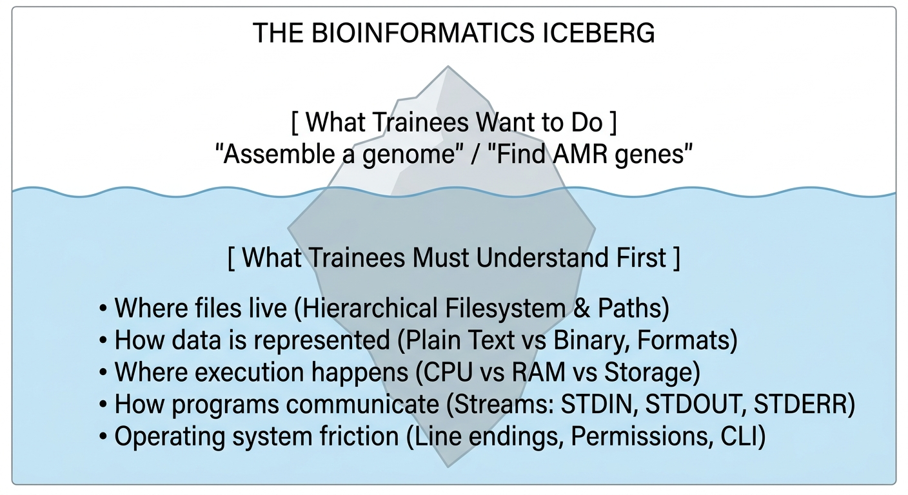
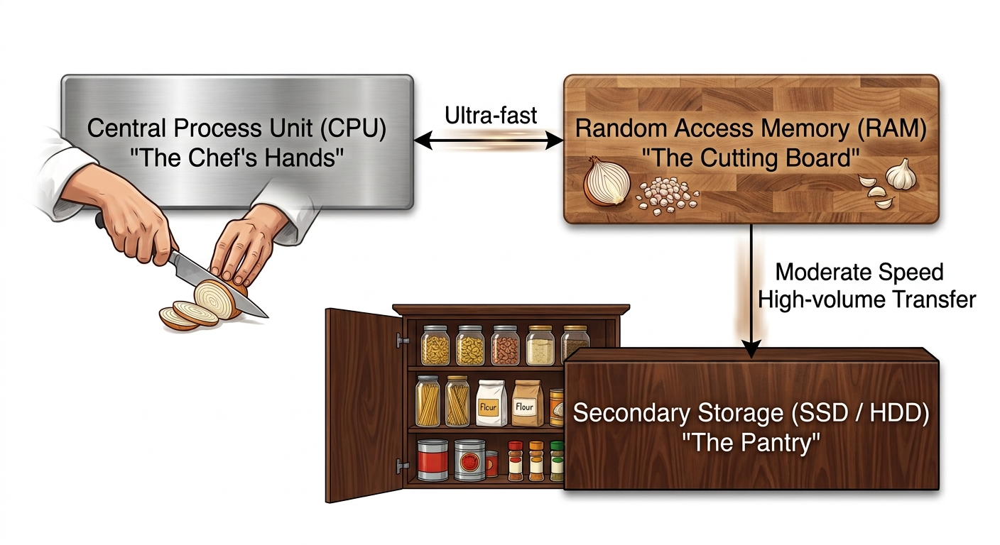
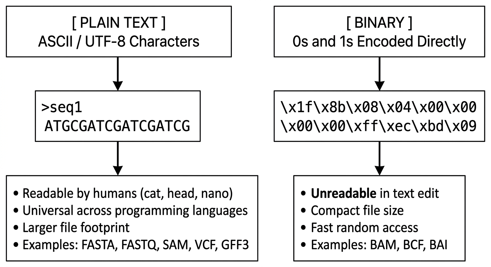
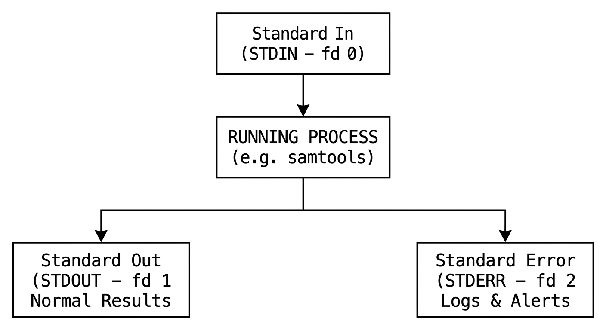
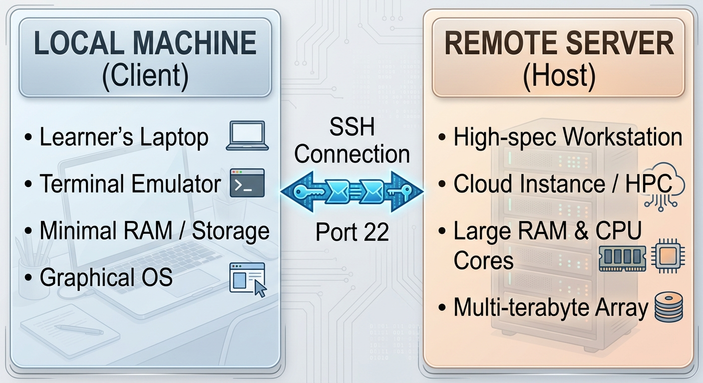

::: {.callout-tip}
#### Learning Objectives

- Explain the primary hardware components of a computer (CPU, RAM, storage, I/O) and how their constraints dictate bioinformatics workflow design.
- Demystify the hierarchical filesystem, distinguishing between absolute and relative paths, working directories, and file permissions.
- Differentiate between plain text, compressed, and indexed binary file formats, and explain the significance of character encoding and line endings across operating systems.
- Outline the client-server model, remote compute paradigms, and the anatomy of a running process (including standard streams and exit codes).
- Apply effective pedagogical analogies and scaffolding strategies to teach abstract computational concepts to life-science learners.
- Diagnose and troubleshoot common computational misconceptions and errors that arise in resource-constrained training environments.
:::

## Introduction: Why Computational Concepts Matter for Trainers

Many trainees who enter bioinformatics workshops have formal backgrounds in biology, biochemistry, medicine, or agriculture. They understand PCR, enzymatic reactions, cell culture, and phylogenetics. However, their day-to-day interaction with computers has often been limited to graphical user interfaces (GUIs), web browsers, and spreadsheet software like Microsoft Excel.

When suddenly introduced to the command line, automated pipelines, or cloud clusters, learners often view the computer as an unpredictable "black box". When a command fails, they cannot tell whether the error is due to a biological flaw, a typing mistake, an operating system incompatibility, or a hardware resource exhaustion.



As trainers, especially in low-resource settings where hardware and bandwidth margins are thin, **we cannot afford to treat computational fundamentals as assumed knowledge**. Grounding our learners in clear mental models prevents panic, accelerates troubleshooting, and empowers them to become autonomous problem-solvers.

## Anatomy of a Computer: Hardware Mental Models

Before asking learners to run heavy bioinformatics tools, they need an intuitive mental model of what a computer does when executing an analysis.



### The Culinary Analogy: CPU, RAM, and Storage

A proven and memorable metaphor to help biological learners distinguish hardware components is the **commercial kitchen analogy**:

1. **Storage (HDD / SSD) — The Pantry:**
   - Long-term, persistent storage where your ingredients (raw FASTQ files, reference genomes, databases) are kept.
   - It is spacious (e.g. 500 GB – 2 TB) and durable (data survives when the machine is powered off), but relatively slow to access.
2. **RAM (Random Access Memory) — The Cutting Board:**
   - The immediate workspace where the chef prepares active ingredients.
   - It is extremely fast, but limited in size (e.g. 4 GB – 16 GB on a typical laptop) and **volatile** (everything vanishes if the power is cut).
   - A tool cannot process data directly from the pantry; it must load the necessary data onto the cutting board first.
3. **CPU (Central Processing Unit) — The Chef:**
   - The worker performing the operations (chopping, mixing, assembling).
   - Each **CPU core** represents one chef. A dual-core machine has two chefs; an 8-core machine has eight chefs working simultaneously (multithreading / multiprocessing).
   - The **clock speed** (e.g. 2.5 GHz) measures how fast each chef can chop.

### Why This Matters in Low-Resource Settings

In well-funded institutions with large institutional compute clusters, bioinformaticians rarely worry if an alignment tool requests 32 GB of RAM. In low-resource settings, where learners are often running exercises on 4 GB or 8 GB RAM consumer laptops:

- **The Out-Of-Memory (OOM) Crash:** If a tool tries to load a 10 GB human genome index onto an 8 GB cutting board, the operating system kernel panics and kills the process (often throwing a cryptic message like `Killed` or `Exit code 137`). Novices assume the software has a bug; understanding RAM allows them to recognise a resource exhaustion.
- **Disk Thrashing (Swapping):** When RAM fills up, the OS begins moving chunks of memory onto the hard disk ("swap space"). Because storage is orders of magnitude slower than RAM, the entire machine grinds to a halt.
- **Over-subscribing CPU Cores:** If a learner sees an option `-t` or `--threads` and enters `-t 16` on a 4-core laptop, the computer spends more time juggling tasks (context switching) and overheating than actually computing, causing the pipeline to run slower, not faster.

::: {.callout-note}
## Practical Trainer Tip: Teaching Resource Awareness Early
Before running any tool in your workshop, explicitly state its hardware footprint:
*"This trimming tool requires 1 CPU core and under 500 MB of RAM, so it will easily run on your laptop. Next, when we run genome assembly, SPAdes needs at least 8 GB RAM for a standard bacterial dataset. That is why we will use a subsampled micro-dataset instead."*
:::


## The Filesystem: Navigating the Tree

The transition from a graphical user interface (GUI) to a command-line interface (CLI) is one of the most disorienting experiences for life-science trainees.

### The Mental Shift: From Spatial Pointing to Coordinate Addressing

In a GUI (Windows Explorer, macOS Finder):

- Users find files by visual browsing: clicking folders, looking at icons, or using a global search bar.
- The computer hides the exact hierarchical path, displaying friendly labels like "My Documents" or "Desktop".

In the Command Line:

- The computer never guesses where a file is.
- The user must explicitly declare **who** they are, **where** they currently stand in the filesystem hierarchy, and **where** the target file lives.

```
                             / (Root)
                             │
            ┌────────────────┴────────────────┐
            │                                 │
          home/                              var/
            │
      ┌─────┴─────┐
      │           │
    alice/      bob/ (Current Working Directory: pwd)
      │           │
   Desktop/    projects/
                  │
             pathogens/
                  │
             sample1.fastq.gz
```

### Absolute vs Relative Paths

This is consistently one of the highest-friction hurdles in introductory computational training:

- **Absolute Path:** The full, unambiguous postal address starting from the filesystem root (`/`). It works regardless of where the user is currently located.
  - Example: `/home/bob/projects/pathogens/sample1.fastq.gz`
- **Relative Path:** Directions given from the user's **Current Working Directory** (`pwd`).
  - If Bob is in `/home/bob/projects/`: `pathogens/sample1.fastq.gz`
  - If Bob is inside `/home/bob/Desktop/`: `../projects/pathogens/sample1.fastq.gz`

### Crucial Path Metaphors and Conventions

| Symbol / Command | Meaning | Real-World Analogy |
| :--------------- | :------ | :----------------- |
| `/` (at start)   | Root directory | The foundation / bedrock of the entire building |
| `~` (tilde)      | User's Home directory | Your private office / bedroom |
| `.` (single dot) | Current working directory | "Right here, where I am standing" |
| `..` (double dot)| Parent directory | "Step one level up the staircase" |
| `pwd`            | Print Working Directory | "Look at the GPS coordinates on my map" |

::: {.callout-warning}
## Common File Naming Traps in Bioinformatics
Novices coming from Windows/Office often use file names like `My TB Data (Final) 2026.fastq`. In the Unix terminal:

1. **Spaces break arguments:** The shell interprets a space as a separator between two different parameters. `fastqc My TB Data.fastq` attempts to analyse three separate files: `My`, `TB`, and `Data.fastq`.
2. **Special characters cause shell expansion:** Symbols like `(`, `)`, `*`, `?`, `&`, and `$` have special programmatic meanings in Bash.
3. **Case sensitivity:** `Sample1.fastq` and `sample1.fastq` are two completely different files on Linux and HPC systems, whereas Windows may treat them as identical.

**Rule to teach your learners:** Stick strictly to alphanumeric characters, underscores (`_`), and hyphens (`-`).
:::


## Data Representation: Plain Text vs Binary

A common misconception among biological learners is that all data files are fundamentally the same, just opened by different applications. Teaching the distinction between **human-readable plain text** and **machine-readable binary** is fundamental to bioinformatics.



### The Plain Text Currency of Bioinformatics

Bioinformatics was built on plain text. Most raw and intermediate formats—FASTA (sequences), FASTQ (sequences + quality scores), SAM (alignments), VCF (variants), BED and GFF (genomic coordinates)—are simple text tables or delimited records.

Because they are plain text:

- They can be inspected, searched, filtered, and manipulated using standard command-line utilities (`head`, `grep`, `awk`, `cut`, `sed`, `sort`) without loading them into memory-heavy software.
- They are future-proof and independent of proprietary software vendor lock-in.

### The Role of Compressed and Indexed Binary Formats

Plain text is inefficient for multi-gigabyte datasets:

- **Compression (`.gz`):** Gzip compression reduces genomic text files by 70–80%, saving vital disk space and network bandwidth in low-resource environments. Modern bioinformatics tools (e.g. `bwa`, `minimap2`, `fastp`, `samtools`) can read gzipped text streams directly without uncompressing them to disk first.
- **Indexed Binary Formats (BAM, BCF, BigWig):** When inspecting a specific gene on chromosome 12, opening a 50 GB SAM text file requires reading the entire file from line 1. A BAM file stores the same data in compressed binary alongside an index file (`.bai`), allowing software (like IGV or `samtools`) to jump directly to the target coordinates in milliseconds.

### The Hidden Trap: Line Endings Across Operating Systems

One of the most frustrating "invisible bugs" encountered during workshops involving mixed operating systems is the **line-ending mismatch**:

- **Unix / Linux / macOS:** Ends lines with a Line Feed character (`\n` or `LF`).
- **Windows:** Ends lines with a Carriage Return + Line Feed (`\r\n` or `CRLF`).

When a learner downloads a script or tabular metadata file edited in Windows Notepad and executes it in Linux or WSL, the hidden `\r` (Carriage Return) character is interpreted as part of the command or variable name, generating bizarre errors:

```bash
$ bash script.sh
: command not found: 
: No such file or directory
```
Teaching learners to identify this with `file script.sh` (which reports `ASCII text, with CRLF line terminators`) and fix it with `dos2unix script.sh` saves hours of classroom frustration.


## Processes, Execution, and Streams

When a user types a command and presses **Enter**, what actually happens? 

Understanding the life cycle of a **process** and how it communicates through standard data streams is essential for writing pipelines and handling errors.

### The Process Lifecycle

1. **Stored Program:** The executable tool (e.g. `fastp`, `bwa`) rests silently on the hard drive or SSD.
2. **Process Spawned:** When executed, the operating system allocates a unique Process ID (`PID`), copies the executable into RAM, and begins executing instructions on CPU cores.
3. **Execution State:** While running, the process consumes memory and CPU cycles. It can run in the **foreground** (locking the terminal until completion) or in the **background** (using `&` or tools like `tmux`/`screen`).
4. **Termination & Exit Codes:** When finished, every process returns an integer **exit status code**:

   - `0` means complete success.
   - Any non-zero integer (e.g. `1`, `127`, `137`) indicates an error or abnormal termination.



### The Three Standard Streams

Every Unix process is automatically equipped with three input/output communication channels:

1. **Standard Input (STDIN - file descriptor 0):** The stream of data fed into the process (by default, typed from the keyboard).
2. **Standard Output (STDOUT - file descriptor 1):** The stream where the program emits its normal, successful results (by default, printed to the terminal screen).
3. **Standard Error (STDERR - file descriptor 2):** The stream reserved for diagnostic warnings, progress meters, and error messages (also printed to the terminal screen by default).

### Piping and Redirection: The Unix Philosophy

Understanding streams unlocks the power of Unix pipelines:

- **Redirection (`>` and `>>`):** Redirects STDOUT into a file on disk instead of printing to screen.
  - `samtools view -b sample.sam > sample.bam`
- **Redirecting Error Logs (`2>`):** Captures error diagnostics separately from data.
  - `bwa mem ref.fa reads.fq > aligned.sam 2> bwa_run.log`
- **The Pipe (`|`):** Connects the STDOUT of one program directly into the STDIN of another without saving intermediate files to disk!
  - `samtools view -h sample.bam | grep -v "^@" | wc -l`

::: {.callout-tip}
## Bandwidth and Disk Saver: Streaming in Low-Resource Settings
Connecting tools with pipes (`|`) prevents writing massive intermediate files to small laptop hard drives. For example, piping read mapping directly into binary compression and sorting:
`bwa mem -t 4 ref.fa R1.fq R2.fq | samtools sort -o sorted.bam -`
This saves gigabytes of temporary disk writes and reduces wear on consumer SSDs.
:::


## Remote Computing and the Client-Server Model

In bioinformatics, the machine on your desk is often just a gateway to a more capable machine elsewhere.



### Demystifying Key Remote Terms for Learners

- **Client:** The local device making requests (the trainee's laptop).
- **Server:** The remote computer waiting to serve computing power, files, or web pages.
- **SSH (Secure Shell):** An encrypted network protocol that allows a user to open a text-based terminal session on a remote server across the internet or local network.
- **Headless Server:** A server running without a monitor, keyboard, or mouse. Everything must be controlled via text commands.

### The Power Outage Vulnerability

In low-resource settings, network drops and power cuts happen routinely during live training. 

If a trainee starts a 3-hour analysis over an SSH connection and the local Wi-Fi drops, the SSH session dies, sending a Hangup Signal (`SIGHUP`) to the remote server, which immediately terminates the running pipeline!

**Essential concept to teach:** Terminal multiplexers like `tmux` or `screen`. They keep sessions alive on the remote server even if the local laptop loses power or disconnects from the internet.


## Pedagogical Strategies: Bridging the Cognitive Gap

Teaching computational concepts to adult biological researchers requires specific pedagogical sensitivity. As explored in adult learning theory, adult learners are motivated by practical relevance but can experience high anxiety when their existing domain mastery feels undermined by unfamiliar computational mechanics.

### 1. Concrete Before Abstract
Do not introduce the concept of "regular expressions" or "piping" in the abstract. Always start with a tangible biological problem:

- *Abstract:* "A pipe feeds stream 1 to stream 0." (Baffling to beginners)
- *Concrete:* "We want to count how many sequences in this FASTA file have the word 'Plasmodium'. Let's search with `grep` and immediately send the matching lines to `wc -l` to count them."

### 2. Participatory Live Coding
Avoid presenting code solely on static slides. Use **participatory live coding**:

- Type commands in real time while learners type along on their own screens.
- Keep your typing pace deliberately moderate.
- Intentionally make a common typo (e.g. omitting a space, misspelling a path). Show the resulting error message, ask the room to diagnose it, and demonstrate the fix. This de-stigmatises errors and teaches real-world debugging.

### 3. Build Spatial Mental Models First
Before having students type `cd ../../data`, draw the directory tree on a physical whiteboard. Ask learners:

- *"Where is the terminal cursor standing right now?"*
- *"If you want to reach the folder `data`, which branch of the tree must you climb?"*


## Interactive Exercises for Future Trainers

These exercises are designed to help you, as a future instructor, anticipate learner friction and construct clear explanations for foundational computational concepts.

::: {.callout-exercise}
## Designing a Hardware Analogy for Memory Exhaustion

One of your future workshop participants runs an RNA-seq quantification tool on their 4 GB RAM Windows laptop. The command runs for 45 seconds, prints `Killed` to the terminal, and abruptly halts. The participant raises their hand in distress and says: *"The software is broken. I think I downloaded a corrupted file."*

1. How would you explain to this learner what `Killed` actually means without overwhelming them with operating system jargon?
2. What analogy would you use to explain why the program aborted?
3. What concrete troubleshooting step or alternative would you offer so the learner can continue the workshop?

::: {.callout-hint}
Recall the kitchen cutting board metaphor and consider the role of the operating system as a safety supervisor preventing the whole machine from crashing.
:::

::: {.callout-answer}
### Model Instructor Response

1. **Clear Explanation:**
   *"The software isn't broken, and your file isn't corrupted! What happened is that the tool needed more working memory (RAM) than your laptop currently has available. To prevent your entire computer from freezing or crashing, your operating system stepped in and safely stopped the program."*

2. **The Analogy:**
   *"Think of your computer as a kitchen. Your hard drive is your pantry where you store all your recipe books and ingredients. Your RAM is your kitchen cutting board. The program tried to put a 6-foot chopping board's worth of genomic data onto your 4-foot table. When it ran out of room, the kitchen manager (the OS) had to clear the table."*

3. **Immediate Actionable Solution:**
   - Switch the participant to a **micro-dataset** (e.g. 50,000 reads instead of 5,000,000 reads) that fits comfortably within their 4 GB RAM.
   - Alternatively, have them load a **pre-computed output file** so they can participate in downstream visualization and interpretation exercises alongside the rest of the class.
:::
:::

::: {.callout-exercise}
## Diagnosing the "Invisible" Script Bug

During a practical hands-on session, a learner writes a bash script called `run_pipeline.sh` on their Windows laptop using standard Notepad, and copies it to a Linux environment. When they run `./run_pipeline.sh`, they receive the following error:

```
$ ./run_pipeline.sh
bash: ./run_pipeline.sh: /bin/bash^M: bad interpreter: No such file or directory
```

1. What is causing this error?
2. Why does the character `^M` appear in the message?
3. How can you demonstrate this concept visually to your class, and what command solves it?

::: {.callout-hint}
Consider how Windows and Unix represent the end of a line in plain text documents.
:::

::: {.callout-answer}
### Diagnosis and Demonstration

1. **Root Cause:**
   The script was saved with **Windows CRLF line endings** (`\r\n`). Linux expects Unix LF line endings (`\n`).

2. **The `^M` Mystery:**
   The `^M` is the visual representation of the ASCII Carriage Return character (`\r`, ASCII 13). Because Linux doesn't expect `\r`, it treats it as part of the interpreter path, looking for a program called `/bin/bash\r` instead of `/bin/bash`. Since no program with that name exists, it fails with `bad interpreter`.

3. **Demonstration & Solution:**
   - **Show the invisible characters:** Run `cat -v run_pipeline.sh` or `file run_pipeline.sh` to let students see the hidden `^M` characters with their own eyes.
   - **Fix the file:** Run `dos2unix run_pipeline.sh` (or in `sed`: `sed -i 's/\r$//' run_pipeline.sh`).
   - **Preventative Teaching:** Advise learners to use code editors designed for programming (e.g. VS Code, Notepad++, nano) and configure them to save with Unix (LF) line endings by default.
:::
:::

::: {.callout-exercise}
## Identifying Cognitive Overload in Command Construction

Look at the following command commonly found in genomic tutorials:

```bash
hisat2 -p 8 -x /references/grch38/genome -1 sample_R1.fastq.gz -2 sample_R2.fastq.gz | \
samtools view -bS - | \
samtools sort -@ 4 -m 2G -o sample_sorted.bam -
```

Assume you are teaching this command to a group of agricultural scientists who have only had one 2-hour introductory session on the terminal.

1. List **five separate computational concepts** that are crammed into this single composite command.
2. Why is showing this command all at once likely to trigger cognitive overload?
3. How would you scaffold this lesson to teach the underlying logic step-by-step?

::: {.callout-answer}
### Scaffolding Strategy

1. **Crammed Concepts:**
   - Multi-threading parameters across different tools (`-p 8` in hisat2 vs `-@ 4` in samtools).
   - Piping data streams across three distinct processes (`|`).
   - Standard input placeholder syntax (the trailing `-` in samtools).
   - Memory allocation flags (`-m 2G` per thread, meaning $4 \times 2 = 8\text{ GB}$ total RAM).
   - Line continuation backslashes (`\`).

2. **Why Cognitive Overload Occurs:**
   The learner is forced to decode tool-specific biology (mapping paired-end reads to a reference index), shell syntax (pipes, backslashes, dashes), and hardware allocation (cores and RAM) simultaneously. If any character is mistyped, the resulting error cascade does not indicate which of the three tools failed.

3. **Step-by-Step Scaffolding:**
   - **Step 1:** Run `hisat2` alone with output written to a file: `hisat2 -x index -1 R1.fq -2 R2.fq -S test.sam`. Inspect the resulting SAM header with `head`.
   - **Step 2:** Convert SAM to BAM using `samtools view` as a separate, distinct command. Check file size with `ls -lh`.
   - **Step 3:** Sort the BAM file with `samtools sort`.
   - **Step 4:** Once the input-output logic of each individual tool is understood, introduce the pipe (`|`) as an optimisation that saves disk space and eliminates temporary files.
:::
:::


## Summary

::: {.callout-tip}
#### Key Points

- **Hardware Literacy is Essential:** Understanding the roles of CPU (execution), RAM (temporary working memory), and Storage (persistent files) allows learners to anticipate memory bottlenecks, avoid OOM errors, and tune pipeline parameters appropriately.
- **Paths are Coordinates:** Master the filesystem tree early. Most beginner errors are path errors (`No such file or directory`); teaching absolute vs relative paths and the current working directory (`pwd`) eliminates initial frustration.
- **Plain Text is the Core Currency:** FASTA, FASTQ, SAM, and VCF files are plain text tables that can be inspected with simple CLI tools. Compressed (`.gz`) and indexed binary formats (`.bam`, `.bai`) provide space savings and rapid random access.
- **Beware Operating System Clashes:** Cross-platform workshops frequently encounter hidden bugs like Windows CRLF line endings (`^M`) and spaces in file paths.
- **Streams Enable Scalability:** Understanding STDIN, STDOUT, and STDERR allows bioinformaticians to pipe data between tools without storing huge intermediate files on limited disks.
- **Scaffold Computational Teaching:** Introduce hardware and command concepts incrementally. Use relatable physical analogies (like the kitchen cutting board) and deconstruct composite commands into manageable steps before introducing pipes and background processes.
:::
