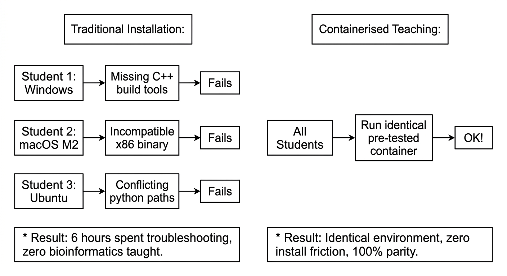

::: {.callout-tip}
#### Learning Objectives

- Explain the conceptual differences between bare-metal installations, virtual machines (VMs), and software containers.
- Differentiate between Docker and Singularity/Apptainer, identifying when each is appropriate across personal laptops, cloud instances, and shared HPC systems.
- Execute bioinformatics tools packaged inside containers, correctly mounting local host directories to read input data and preserve results.
- Implement offline distribution strategies (USB-based sharing, pre-loaded images, local LAN registries) to circumvent classroom bandwidth limitations.
- Leverage open registries like BioContainers to source verified, reproducible tools without manual compilation.
- Apply pedagogical techniques to demystify container isolation, directory binding, and root permissions for life-science learners.
:::

## Introduction: The "Works on My Machine" Dilemma

Bioinformatics tools have notoriously intricate dependency chains. A single phylogenetics or metagenomics pipeline might require a specific version of Python, an outdated Perl module, particular C++ compiler libraries (`glibc`), and dozens of specialized R packages. 

In a traditional workshop setting, instructors often spend the entire first day walking around the room diagnosing failed installations across different student operating systems (Windows 10, Windows 11, macOS Intel, macOS Apple Silicon, and assorted Linux distributions). This scenario—known as **"dependency hell"**—wastes valuable instructional time and demoralizes novice learners.



**Containerisation** solves this fundamental challenge. It allows developers and trainers to package an entire software environment—including the operating system userland, tools, libraries, dependencies, and configuration files—into a single, portable, self-contained unit that runs identically on any computer.


## The Conceptual Model: Containers vs Virtual Machines

To teach containers effectively, instructors must first address the question every computational novice asks: *"Isn't this just a Virtual Machine?"*

The physical shipping container analogy remains the most powerful mental model:

::: {.callout-note}
## The Intermodal Shipping Container Analogy
Before the 1950s, cargo was loaded loosely onto ships as "break bulk"—sacks of grain, barrels of oil, and wooden crates of varying sizes. Loading a ship was slow, labor-intensive, and prone to damage. The invention of the standardized **intermodal shipping container** revolutionized global commerce: cranes, trucks, trains, and cargo ships now handle the exact same steel box regardless of whether it holds bananas, medical devices, or cars.

**Software containers are the standardized shipping boxes of computing.** The host operating system doesn't need to know what specific libraries or Python versions are inside; it simply runs the container.
:::

```
┌────────────────────────────────────────────────────────────────────────┐
│                   VIRTUAL MACHINES vs CONTAINERS                       │
├───────────────────────────────────┬────────────────────────────────────┤
│     VIRTUAL MACHINE (Heavy)       │        CONTAINER (Lightweight)     │
├───────────────────────────────────┼────────────────────────────────────┤
│   ┌───────────────────────────┐   │   ┌────────────────────────────┐   │
│   │   Bioinformatics App      │   │   │    Bioinformatics App      │   │
│   ├───────────────────────────┤   │   ├────────────────────────────┤   │
│   │   Libraries & Binaries    │   │   │    Libraries & Binaries    │   │
│   ├───────────────────────────┤   │   └────────────────────────────┘   │
│   │   Full Guest OS (e.g. 4GB)│   │                                    │
│   └───────────────────────────┘   │   ┌────────────────────────────┐   │
│   ┌───────────────────────────┐   │   │ Container Engine (Apptainer│   │
│   │ Hypervisor (VirtualBox)   │   │   │  or Docker)                │   │
│   ├───────────────────────────┤   ├───┴────────────────────────────┤   │
│   │   Host Operating System   │   │     Host Operating System      │   │
│   ├───────────────────────────┤   ├────────────────────────────────┤   │
│   │   Physical Hardware       │   │     Physical Hardware          │   │
│   └───────────────────────────┘   └────────────────────────────────┘   │
└───────────────────────────────────┴────────────────────────────────────┘
```

### Key Differences Every Trainer Should Know

| Feature | Virtual Machine (VM) | Software Container |
| :------ | :------------------- | :----------------- |
| **Architecture** | Virtualises physical hardware; runs a complete guest operating system kernel. | Shares the host OS kernel; isolates processes and userland libraries. |
| **Startup Time** | Slow (minutes to boot the guest OS). | Instantaneous (sub-second process launch). |
| **Resource Overhead** | High: allocates fixed RAM and CPU cores (e.g. reserving 4 GB RAM away from host). | Minimal: consumes only the exact memory and CPU used by the running process. |
| **Performance** | Significant performance penalty for disk I/O and computation. | Near-native bare-metal execution speed. |
| **Low-Resource Suitability** | Poor for 4–8 GB RAM laptops (causes heavy swapping). | Excellent: low footprint allows running on modest hardware. |

: Table 1: Differences between virtual machines and software containers

## Docker vs Singularity / Apptainer

The container landscape in science is dominated by two primary technologies: **Docker** and **Singularity** (now largely standardized and maintained under the Linux Foundation as **Apptainer**).

Understanding their architectural differences is vital, especially when training researchers who move between personal laptops and institutional HPC clusters.

| Docker | Singularity/Apptainer |
| :--- | :--- |
| • Native to industry & cloud | • Native to academic HPC & science |
| • Requires background daemon | • No background daemon needed |
| • Requires root / sudo access (Security risk on shared HPC) | • Runs entirely as unprivileged user (Safe on multi-user HPC) |
| • Container filesystems isolated by default (must bind manually) | • Mounts user's home and current directory by default |
| • Multi-layered image storage | • Stored as a single standalone file (`.sif`) – easy to copy! |

: Table 2: Docker versus Singularity/Apptainer

### Why Singularity / Apptainer is the Scientific Standard

1. **Security & Permissions:** Docker requires root privileges or membership in the `docker` user group (which is functionally equivalent to root access). On shared university servers or national HPC facilities, system administrators strictly prohibit Docker. Apptainer runs with whatever permissions the logged-in user possesses—if you cannot edit `/etc/shadow` on the host, you cannot edit it inside the container.
2. **Single-File Portability (`.sif`):** Singularity encapsulates the entire container environment into a single **Singularity Image File (`.sif`)**. You can copy this file like a regular document via a USB flash drive or `scp`, making it ideal for offline distribution in low-resource settings.
3. **Seamless Filesystem Integration:** By default, Apptainer automatically mounts the user's current directory (`$PWD`) and home directory (`$HOME`), making running a container feel like executing a local command.


## Hands-on Container Operations

### 1. Working with Docker

When teaching on personal machines or cloud virtual machines (where users have root access), Docker is straightforward:

```bash
# Pull a container from Docker Hub
docker pull biocontainers/fastp:v0.23.4_cv1

# Run fastp inside the container
docker run --rm \
  -v "$(pwd)/data":/data \
  biocontainers/fastp:v0.23.4_cv1 \
  fastp -i /data/sample_R1.fq.gz -I /data/sample_R2.fq.gz -o /data/clean_R1.fq.gz -O /data/clean_R2.fq.gz
```

::: {.callout-important}
## Demystifying Volume Mounting (`-v`)
The most common mistake beginners make with Docker is forgetting that **the container is isolated from the host laptop**. 
If a learner runs:
```bash
docker run biocontainers/fastp:v0.23.4_cv1 fastp -i sample_R1.fq.gz
```
Docker will immediately abort with `Cannot find input file: sample_R1.fq.gz`.

**The Window Metaphor:** Explain to learners that volume mounting (`-v /local/path:/container/path`) is like cutting a transparent window between their personal laptop and the sealed shipping container. Without that window, the tool inside cannot reach outside to see the data, and any output produced will vanish when the container exits!
:::

### 2. Working with Singularity / Apptainer

Apptainer can convert and run any existing Docker image directly without requiring Docker to be installed:

```bash
# Build / convert a Docker image into a single .sif file
apptainer build fastp.sif docker://biocontainers/fastp:v0.23.4_cv1

# Execute a tool directly using the .sif container
apptainer exec fastp.sif fastp --help

# Run a complete command (current directory is automatically mounted!)
apptainer exec fastp.sif fastp \
  -i sample_R1.fq.gz -I sample_R2.fq.gz \
  -o clean_R1.fq.gz -O clean_R2.fq.gz \
  --html fastp_report.html
```

Notice how much simpler this is for beginners: there is no complex volume mounting syntax needed for files located in the current working directory!


## Finding Pre-built Containers: BioContainers

Trainers and researchers rarely need to build containers from scratch using custom `Dockerfiles`. The global scientific community maintains **BioContainers** (`https://biocontainers.pro`), an open-source architecture that automatically builds, tests, and publishes container images for every package added to Bioconda.

```
       Bioconda Recipe (e.g. samtools)
                     │
                     ▼ (Automated Continuous Integration)
       ┌─────────────────────────────┐
       │     BioContainers Build     │
       └──────────────┬──────────────┘
                      │
       ┌──────────────┴──────────────┐
       ▼                             ▼
  Docker Hub / Quay.io         Galaxy Tool Shed
  (Ready to docker pull)      (Ready to apptainer build)
```

To find and use a tool, search for it on `https://quay.io/organization/biocontainers`:
```bash
# Direct Apptainer pull from Quay.io
apptainer pull samtools.sif docker://quay.io/biocontainers/samtools:1.19--h50ea8bc_0
```


## Container Strategies for Low-Resource Environments

While containers solve software installation hurdles, they introduce a major bottleneck in low-resource environments: **bandwidth consumption**.

A typical bioinformatics container ranges from 500 MB to 3 GB in size. If 25 workshop participants simultaneously run `docker pull` or `apptainer pull` over a shared 10 Mbps classroom connection:
- The network connection will collapse immediately.
- Trainees will face timeout errors, partial downloads, and high mobile data bills.

```
┌────────────────────────────────────────────────────────────────────────┐
│                   CLASSROOM BANDWIDTH COLLAPSE                         │
├────────────────────────────────────────────────────────────────────────┤
│                                                                        │
│   ❌ The Naive Approach:                                               │
│      25 students × 1.5 GB Container = 37.5 GB simultaneous download    │
│      Over shared 10 Mbps Wi-Fi: ~8.5 hours download time!              │
│                                                                        │
│   ✅ The Resource-Aware Approach:                                      │
│      Instructor downloads image once before the course.                │
│      Transfers image offline via USB sticks or Local LAN mirror.       │
│      Download time during class: 0 minutes!                            │
│                                                                        │
└────────────────────────────────────────────────────────────────────────┘
```

### Practical Offline Distribution Workflows

### Strategy 1: The "Sneakernet" USB Stick Distribution (Recommended)
Trainers download and package all required containers onto high-speed USB flash drives prior to arriving at the venue.

- **For Docker:**
  ```bash
  # On instructor's machine (before the course):
  docker pull biocontainers/bwa:v0.7.17_cv1
  docker save biocontainers/bwa:v0.7.17_cv1 -o bwa_image.tar
  
  # On student's machine (during the course from USB):
  docker load -i /media/usb/bwa_image.tar
  ```
- **For Singularity / Apptainer:**
  ```bash
  # On instructor's machine:
  apptainer build bwa.sif docker://biocontainers/bwa:v0.7.17_cv1
  
  # Simply copy bwa.sif directly from the USB drive to the student's laptop!
  cp /media/usb/bwa.sif ~/course_tools/
  ```

### Strategy 2: Local Classroom Wi-Fi Cache / Mini-Registry
If students have decent local connectivity to a local router (even without an active internet gateway):

- The instructor sets up a local Docker registry or simple HTTP server (e.g. `python3 -m http.server 8000`) on a laptop or Raspberry Pi connected to the classroom Wi-Fi router.
- Students download `.sif` files or pull images locally at 100–300 Mbps over local Wi-Fi without consuming any cellular or external internet bandwidth.


## Pedagogical Considerations for Teaching Containers

When introducing containers to novice learners, avoid cognitive overload by structuring your instructional sequence carefully:

```
  Step 1: The "Why" ──► Step 2: Consumer ──► Step 3: Persistence ──► Step 4: Builder
  (Solve dependency    (Run pre-built       (Volume mounting        (Writing a
   frustration)         containers)          & file saving)          Dockerfile)
```

1. **Start as a Consumer, Not a Creator:**
   Do not begin a container module by teaching how to write a `Dockerfile` from scratch with Linux package managers (`apt-get`). First, teach learners how to **run** existing, pre-packaged containers (`docker run` or `apptainer exec`). Building containers is an advanced skill; executing them is an immediate daily necessity.
2. **Separate Container Execution from Pipeline Logic:**
   Help learners distinguish between the container command and the biological command:
   ```bash
   apptainer exec fastp.sif fastp -i sample.fq -o clean.fq
   └─── Container invocation ──┘ └─── Standard bioinformatic command ───┘
   ```
   Show them that everything after `fastp.sif` is identical to what they would type if the tool were installed directly on their system.
3. **Use Concrete Visual Aids:**
   Draw physical boundaries on a whiteboard showing the host filesystem, the container filesystem, and the mounted directory bridging the two.


## Interactive Exercises for Future Trainers

These exercises will help you anticipate common student hurdles and plan resilient containerised training sessions.

::: {.callout-exercise}
## Diagnosing the "Disappearing Results" Mystery

During a hands-on sequencing analysis practical, a student runs read trimming using Docker on their laptop:

```bash
docker run --rm biocontainers/fastp:v0.23.4_cv1 \
  fastp -i /data/raw_R1.fq.gz -o /data/trimmed_R1.fq.gz
```

The tool runs to completion, printing:
```
Read 1 before filtering: 500000 reads
Read 1 after filtering: 489120 reads
Trimming completed successfully.
```

The student returns to their terminal prompt and types `ls`. The file `trimmed_R1.fq.gz` is nowhere to be found. In panic, the student asks: *"It said it finished successfully, but where did my data go?"*

1. What caused the output file to disappear?
2. What role did the `--rm` flag play in this scenario?
3. How would you explain this concept to the student, and what is the corrected command?

::: {.callout-hint}
Consider where `/data/trimmed_R1.fq.gz` was written and whether that directory exists on the host laptop or only inside the container.
:::

::: {.callout-answer}
### Explanation & Resolution

1. **Cause:**
   The student failed to mount a local host directory using the `-v` flag. The file `trimmed_R1.fq.gz` was written to `/data/` *inside the container's isolated, ephemeral filesystem*.

2. **Role of `--rm`:**
   The `--rm` flag instructs Docker to immediately delete the container's writeable layer when the process exits. Because the container was destroyed upon exit and had no mounted host volume, the generated file was permanently deleted.

3. **Trainer Explanation & Corrected Command:**
   *"Think of the container as a clean, disposable laboratory bench in another building. You ran the experiment inside that building, but you forgot to open a window to pass the tubes back into your office. When the experiment finished, the cleaning crew wiped the bench clean."*

   **Corrected Command:**
   ```bash
   docker run --rm \
     -v "$(pwd)":/data \
     biocontainers/fastp:v0.23.4_cv1 \
     fastp -i /data/raw_R1.fq.gz -o /data/trimmed_R1.fq.gz
   ```
:::
:::

::: {.callout-exercise}
## Planning an Offline Training Session

You are invited to lead a 3-day bacterial genomics workshop at a regional university in an area known for frequent internet throttling and power cuts. The course requires three tools: `fastp`, `spades`, and `prokka`.

1. Why should you avoid asking participants to install these tools during the first morning of class?
2. Which container engine (Docker or Apptainer) would you recommend if the students are using shared institutional Linux workstations, and why?
3. Outline your step-by-step preparation protocol before traveling to the workshop venue to guarantee that zero internet bandwidth will be required for software access.

::: {.callout-answer}
### Strategic Workshop Plan

1. **Avoid Live Installs:**
   Downloading Conda environments or container layers for 25–30 students simultaneously would require over 40 GB of network traffic. In an unstable network, packages will fail mid-download, checksums will fail, and day one will be lost to debugging.

2. **Engine Recommendation:**
   **Apptainer (Singularity).** Institutional shared workstations rarely grant individual participants `sudo` or root privileges. Docker cannot run without root access, whereas Apptainer runs securely in user space.

3. **Pre-Course Preparation Protocol:**
   - **Step 1 (Pre-build):** On the trainer's high-speed home network, build standalone `.sif` files for all three tools from BioContainers:
     ```bash
     apptainer build fastp.sif docker://quay.io/biocontainers/fastp:v0.23.4_cv1
     apptainer build spades.sif docker://quay.io/biocontainers/spades:3.15.5--h95f258a_1
     apptainer build prokka.sif docker://quay.io/biocontainers/prokka:1.14.6--pl5321hdfd78af_5
     ```
   - **Step 2 (Package):** Copy `fastp.sif`, `spades.sif`, `prokka.sif`, and the subsampled micro-datasets onto 5–10 fast USB 3.0 flash drives.
   - **Step 3 (Distribute):** On the first morning, circulate the USB drives. Students copy the `.sif` files into a `~/tools/` folder in under 2 minutes per laptop.
   - **Result:** Complete independence from internet availability throughout the workshop.
:::
:::


## Summary

::: {.callout-tip}
#### Key Points

- **Containers Guarantee Parity:** Containers encapsulate application code, dependencies, and system libraries, eliminating the "works on my machine" barrier and saving hours of classroom troubleshooting.
- **Lightweight vs Virtual Machines:** Containers share the host operating system kernel, making them fast to launch and resource-efficient enough to run on modest 4–8 GB RAM laptops.
- **Docker for Personal/Cloud, Apptainer for HPC:** Docker requires root access and a background daemon; Singularity/Apptainer runs unprivileged, mounts user directories automatically, and packages environments into single `.sif` files suitable for shared academic clusters.
- **Isolation Requires Volume Mounting:** In Docker, data is ephemeral unless explicit volumes (`-v`) connect host paths to container paths.
- **Never Download in Class:** In low-resource settings, avoid live `docker pull` commands across 25 laptops. Package images offline onto USB flash drives (`docker save` / `.sif` files) or use local LAN caches.
- **Teach Use Before Creation:** Teach trainees how to execute pre-built BioContainers before introducing complex container authoring or Dockerfile compilation.
:::
