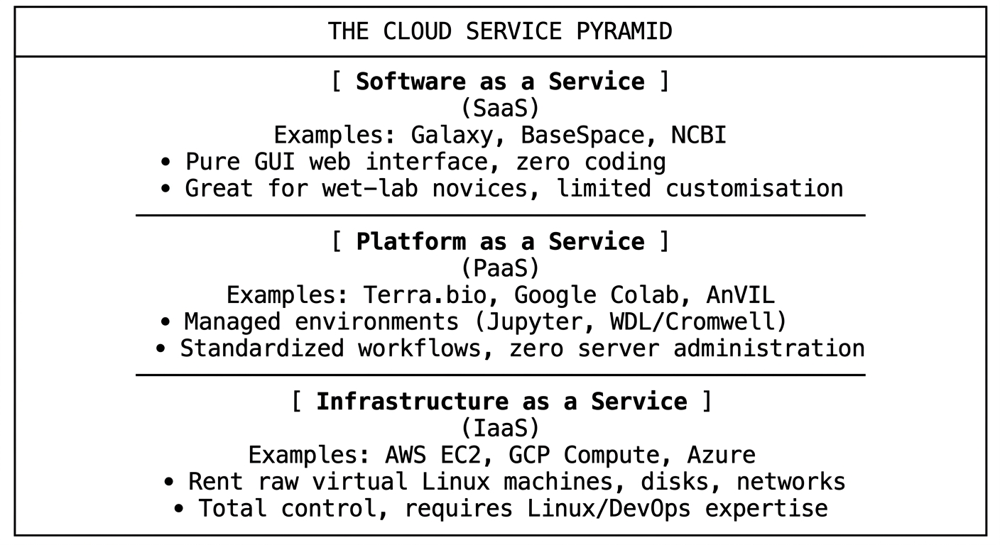
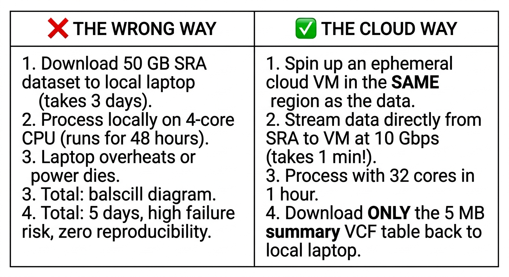

::: {.callout-tip}
#### Learning Objectives

- Assess the benefits and practical trade-offs of cloud computing (IaaS, PaaS, SaaS) for bioinformatics research and training in low-resource settings.
- Implement strategies to mitigate primary cloud barriers in low-resource environments: bandwidth bottlenecks, currency exchange restrictions, and unexpected cloud expenditure ("bill shock").
- Leverage free and subsidized scientific platforms (Galaxy, Google Colab, academic cloud grants) for hands-on classroom instruction.
- Apply the principle of **data locality** ("bringing compute to the data") to avoid transferring multi-gigabyte genomic datasets over constrained local connections.
- Configure cost-control safeguards, including spot/preemptible virtual machines, automated shutdown triggers, and billing alarms.
- Design classroom cloud architectures (e.g. centralized web servers, GitHub Codespaces) that eliminate the need for student credit cards or local software installations.
:::

## Introduction: The Cloud Paradigm in Resource-Limited Settings

In many low- and middle-income countries (LMICs), establishing and maintaining a traditional institutional high-performance computing (HPC) cluster is prohibitively challenging. Hardware procurement involves heavy import tariffs, maintenance requires specialized system administrators, and unconditioned server rooms are vulnerable to electrical brownouts, power spikes, and air-conditioning failures.

**Cloud computing** transforms computational infrastructure from physical property into an on-demand utility. Instead of purchasing a $50,000 server that sits underutilized or overheats during power outages, researchers can rent virtual machines with 64 CPU cores and 256 GB of RAM for only the specific hours needed to run an assembly or variant-calling pipeline.

| On-premises infrastructure | Cloud computing |
| :--- | :--- |
| • High upfront capital cost | • Zero upfront capital expenditure |
| • Vulnerable to power outages | • Guaranteed uptime & reliability |
| • Maintenance & cooling contracts | • Maintained by cloud provider |
| • Fixed hardware capacity | • Elastic scaling (expand/shrink) |
| • Depreciates in 3–5 years | • Access to cutting-edge hardware |

: Table 1: On-premises server versus cloud computing

However, cloud computing is not an unalloyed silver bullet. For researchers in low-resource environments, the cloud introduces new, non-trivial friction points: financial barriers, international currency restrictions, high upload latencies, and data sovereignty considerations.

## The Three Clouds: IaaS, PaaS, and SaaS in Bioinformatics

When discussing "the cloud," educators often conflate very different service models. Helping learners distinguish these models clarifies what technical skills are required:

### 1. Software as a Service (SaaS): Free Platforms like Galaxy
- **Galaxy (`usegalaxy.org`, `usegalaxy.eu`, `usegalaxy.org.au`):** A web-based scientific analysis platform that provides thousands of bioinformatics tools behind a point-and-click GUI.
- **Why it matters for training:** It is completely free for academic users, provides generous storage and compute quotas, requires zero command-line knowledge, and eliminates all local installation hurdles. Learners can run complex RNA-seq or variant calling workflows from a basic mobile browser or low-spec laptop.

### 2. Platform as a Service (PaaS): Interactive Notebooks & Portals
- **Google Colab & Kaggle Kernels:** Provide free, cloud-hosted Jupyter Notebook environments with access to free GPUs (NVIDIA T4s) and TPUs. They are ideal for teaching Python-based data science, machine learning in genomics, or structural biology tools like ColabFold.
- **Biomedical Cloud Portals (Terra.bio, AnVIL):** Managed platforms designed specifically for genomic research, hosting massive public datasets alongside standardized workflow execution engines (e.g. WDL/Nextflow).

### 3. Infrastructure as a Service (IaaS): Raw Compute Instances
- **Commercial Providers (AWS, Google Cloud, Microsoft Azure):** Users launch raw virtual machines (e.g. Amazon EC2, Google Compute Engine) running Ubuntu Linux.
- **Full Autonomy:** The user has full root access to install any software, run custom pipelines, and configure CPU/RAM allocations freely.

## The Low-Resource Realities of Cloud Computing

While cloud infrastructure eliminates local hardware maintenance, instructors teaching in or from low-resource regions must proactively address four systemic challenges:

### 1. The Bandwidth Bottleneck: Upload vs. Download Asymmetry
In many LMICs, internet connections are highly asymmetric: download speeds might reach 10–20 Mbps, while upload speeds hover around 1–2 Mbps or suffer high packet loss.

- Uploading a 50 GB paired-end sequencing run from a local lab to an AWS S3 bucket over a 2 Mbps connection will take **more than 55 hours of uninterrupted connectivity**—an impossibility in areas with daily power shedding.
- *The Solution:* The **Data Locality Principle** (see below).

### 2. Financial Friction and Currency Controls
Commercial cloud providers require billing via credit cards in US Dollars, Euros, or British Pounds.

- Many public universities in developing nations lack institutional credit cards.
- Strict national foreign currency restrictions or severe inflation can make international card payments difficult or unpredictable.
- *The Solution:* Academic credit grants (e.g. AWS Cloud Credit for Research, Google Cloud Research Grants) and centralized institutional vouchers.

### 3. "Bill Shock": The Cost Management Imperative
Unlike physical hardware where costs are fixed at purchase, cloud instances accrue charges every second they exist.

- Leaving a 32-core instance with 128 GB RAM (`r5.8xlarge`, costing ~$2.00/hour) running over an unattended weekend costs $100. Leaving it forgotten for a month costs **over $1,400 USD**—a catastrophic blow to a small research grant.
- *The Solution:* Automated shutdown scripts, spot instances, and hard budget alarms.

### 4. Data Sovereignty and Ethics
Storing human genomic or pathogen sequence data on commercial cloud servers located in US or European data centers may conflict with national data protection regulations or local research ethics protocols. Trainers should educate learners on national health data laws and institutional compliance before migrating clinical data to commercial clouds.

## The Core Architectural Principle: Data Locality

The single most important computational principle in cloud bioinformatics is: **Bring the compute to the data, not the data to the compute.**

Because public repositories (NCBI SRA, ENA, 1000 Genomes, GISAID mirrors) are already mirrored in major commercial cloud storage buckets (AWS Open Data, Google Cloud Public Datasets), launching an analysis inside that same cloud region enables blazing-fast internal transfer speeds (often exceeding 10 Gbps) at **zero data egress fees**.

## Cost Optimization: Making Cloud Affordable on a Grant

Bioinformatics workloads are typically batch-oriented and fault-tolerant. Trainers must teach learners how to minimize expenditure:

### 1. Spot and Preemptible Instances (70–90% Discounts)
Cloud providers have excess server capacity. They auction this unused capacity as **Spot Instances** (AWS) or **Spot/Preemptible VMs** (GCP/Azure) at discounts of up to **90% off standard on-demand prices**.

- *The Catch:* If the provider needs the capacity back, the instance can be reclaimed with a 2-minute warning.
- *Why it fits bioinformatics:* For pipeline steps that write intermediate checkpoints, or batch jobs managed by workflow managers (Nextflow, Snakemake), spot instances offer immense cost savings.

### 2. Hard Budget Alerts and Automated Kill Switches
Never launch a cloud project without setting automated billing alerts:

- **CloudWatch / GCP Budget Alerts:** Send immediate email and SMS alerts when spending reaches 50%, 80%, and 100% of a defined monthly threshold (e.g. $50).
- **Auto-Shutdown Daemons:** Add a simple cron script that monitors CPU utilization; if CPU activity stays below 5% for 30 consecutive minutes, the VM automatically triggers `sudo poweroff`, stopping per-hour compute charges.

## Cloud Strategies for Delivering Bioinformatics Workshops

When designing a workshop in a low-resource setting, how should instructors provide computational environments without asking students for credit cards or risking live installation failures?

| Architecture | Best For |
| :--- | :--- |
| 1. Galaxy Training Network (GTN) `(usegalaxy.*)` | Novices, wet-lab biologists, zero-command-line curricula |
| 2. GitHub Codespaces / Gitpod *(60 free core-hours/month)* | Intermediate CLI/Python/R lessons; browser-based VS Code interface |
| 3. Centralized Instructor VM *(Single multi-user cloud host)* | Advanced CLI/HPC courses; single large VM, students connect via SSH |

: Table 2: Classroom cloud architectures

### Approach 1: The Public Galaxy Network (Zero Cost, Zero CLI)
- Use established public Galaxy instances (`usegalaxy.eu` or `usegalaxy.org`).
- Instructors can create **Galaxy Training Groups**, which grant students priority queue access and temporary quota increases during workshop hours.
- Requires only a standard web browser on any device.

### Approach 2: GitHub Codespaces (Free Browser-Based Linux)
- GitHub provides every free user with **60 core-hours per month** of browser-based cloud computing.
- Trainees open a repository in their browser and instantly receive a fully functional, containerized Linux terminal and VS Code editor.
- Eliminates Windows/macOS compatibility issues while consuming minimal bandwidth (only keystrokes are transmitted across the internet).

### Approach 3: The "Single Big Classroom Server"
- The instructor provisions a single high-memory cloud instance (e.g. 16 vCPUs, 64 GB RAM on an AWS EC2 instance).
- The instructor creates individual user accounts for each student (`user01`, `user02`, etc.) with resource quotas.
- Students connect via SSH or a browser-based terminal (`ttyd` or JupyterHub).
- **Cost:** ~$1.50/hour total for the entire classroom of 25 students! The instructor stops the instance at the end of each day.

## Interactive Exercises for Future Trainers

These exercises will test your ability to design cost-effective cloud training workflows and advise researchers on resource management.

::: {.callout-exercise}
## Designing a Cost-Control Protocol to Prevent "Bill Shock"

A postgraduate researcher at your institution receives a $500 cloud credit grant for their master's project analyzing 60 bacterial whole-genome sequencing isolates. They intend to spin up a high-memory AWS EC2 instance (`m5.4xlarge`, 16 vCPUs, 64 GB RAM, costing ~$0.77/hour on-demand).

1. If the student finishes their analysis on Friday evening but forgets to terminate or stop the instance before leaving for a 3-week field trip, calculate the total unexpected expenditure.
2. What three concrete safeguards would you teach this student to put in place *before* launching their first cloud machine?
3. How does stopping an instance differ from terminating an instance in terms of ongoing costs?

::: {.callout-hint}
Remember that stopping an instance halts per-second compute charges, but attached storage volumes (EBS) still accrue monthly storage fees until terminated.
:::

::: {.callout-answer}
### Cost Analysis & Safeguards

1. **Unexpected Cost Calculation:**
   - 3 weeks = 21 days = 504 hours.
   - $504\text{ hours} \times \$0.77/\text{hour} = \$388.08\text{ USD}$.
   - Over 77% of the student's entire $500 research grant would be consumed by idle compute while they were away in the field.

2. **Three Mandatory Safeguards:**
   - **Set AWS Budget Alarms:** Configure alerts at $50, $100, and $250 that send automated SMS and emails to both the student and supervisor.
   - **Configure Auto-Stop Triggers:** Set a CloudWatch alarm that automatically stops the instance if average CPU utilization drops below 3% for 45 minutes.
   - **Use Spot Instances:** For batch bacterial assembly, run on Spot pricing (~$0.23/hour instead of $0.77/hour), reducing costs by ~70%.

3. **Stopping vs. Terminating:**
   - **Stopping:** Shuts down the CPU and RAM. You pay **$0 for compute**, but you continue paying a small fee for the attached virtual hard drive (EBS volume, ~$0.08–$0.10/GB/month) so your files are preserved when you restart.
   - **Terminating:** Permanently destroys the instance and deletes attached storage. All ongoing charges stop completely.
:::
:::

::: {.callout-exercise}
## Choosing the Right Cloud Vehicle for a Training Audience

You are leading a 3-day training event for 20 clinical microbiologists and hospital laboratory technicians in West Africa. The goal is to teach genomic surveillance of antimicrobial resistance (AMR) in *Klebsiella pneumoniae*. 

- **Audience Profile:** Strong clinical microbiology background, zero prior command-line experience, using hospital-issued Windows laptops with locked-down administrative privileges.
- **Venue:** Unstable mobile Wi-Fi (3–5 Mbps shared).

Evaluate the following three options and recommend the most effective training vehicle:

- **Option A:** Have participants install Ubuntu inside VirtualBox on their laptops.
- **Option B:** Teach them to launch and configure AWS EC2 Linux instances using individual AWS accounts.
- **Option C:** Use the public Galaxy platform (e.g. `usegalaxy.eu`) with pre-loaded shared histories.

::: {.callout-answer}
### Evaluation & Recommendation

- **Option A (Local VirtualBox):** **Poor choice.** Hospital-issued laptops typically block virtualization in the BIOS and prohibit installing hypervisors without administrative privileges. Downloading 4 GB VM images over 3 Mbps Wi-Fi will fail.
- **Option B (AWS EC2 from Scratch):** **Poor choice.** Requiring 20 clinical novices to create individual AWS accounts, register credit cards, navigate the complex AWS Management Console, and configure SSH keys introduces overwhelming cognitive load completely unrelated to the workshop's biological learning objectives.
- **Option C (Public Galaxy Platform):** **RECOMMENDED.**
  - **Zero local installation:** Runs entirely in any standard web browser; hospital IT restrictions are bypassed.
  - **Low bandwidth footprint:** The 3 Mbps Wi-Fi only needs to transmit lightweight browser clicks.
  - **Data locality:** The trainer can pre-upload the bacterial FASTQ files into a shared Galaxy History beforehand. Trainees clone the history in one click without downloading or uploading a single megabyte.
  - **Pedagogical alignment:** Learners focus 100% on the biological questions (identifying beta-lactamase genes and resistance mutations) rather than wrestling with Linux syntax or cloud billing.
:::
:::

## Summary

::: {.callout-tip}
#### Key Points

- **Elasticity Solves Hardware Upfront Costs:** Cloud computing replaces expensive physical servers with flexible, on-demand compute, insulating researchers from local equipment depreciation, power outages, and cooling infrastructure failures.
- **Match Service Model to Audience:** Use SaaS (Galaxy) for wet-lab novices and clinical audiences; use PaaS (Google Colab, Codespaces) for lightweight scripting; use IaaS (AWS, GCP) for advanced pipelines and custom deployments.
- **Honor the Data Locality Rule:** Never download massive public datasets to slow local connections. Spin up cloud compute in the region where the data already lives, and transfer only lightweight results back.
- **Prevent Bill Shock Systematically:** Enforce automated budget alarms, idle auto-shutdown daemons, and utilize Spot/Preemptible instances to slash costs by 70–90%.
- **Zero-Credit-Card Classroom Design:** Protect workshop participants by deploying browser-based platforms (Galaxy, GitHub Codespaces) or instructor-managed shared instances rather than requiring personal credit cards.
:::
