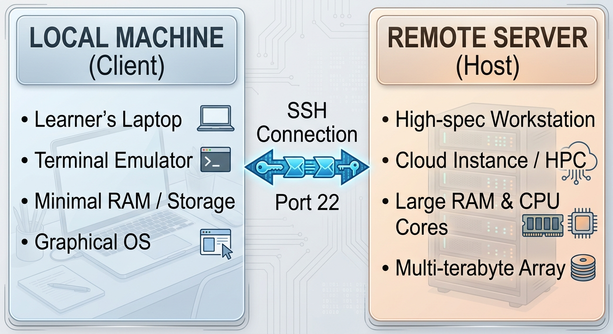
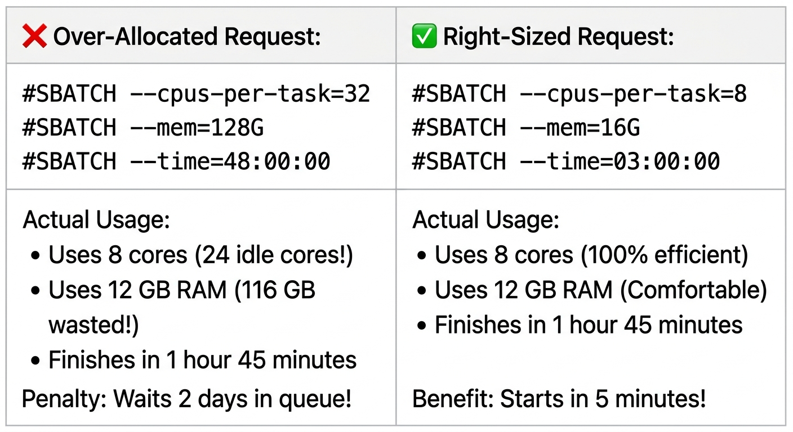

::: {.callout-tip}
#### Learning Objectives

- Evaluate the benefits and trade-offs of using a centralized server or shared HPC cluster versus student laptops for bioinformatics workshops in low-resource settings.
- Select and build the optimal classroom server setup: local in-room servers (offline LAN), remote institutional/regional HPC clusters, or single-instance cloud servers.
- Provision and configure multi-user training environments securely, including automated batch account creation, storage quotas, and shared read-only reference directories.
- Prevent and mitigate server overload on shared servers using resource isolation mechanisms (`cgroups`, `pam_limits`, wrapper scripts, and SLURM training reservations/QoS).
- Deploy zero-install, firewall-resilient access interfaces (such as browser-based web terminals via JupyterHub, RStudio Server, or `ttyd`) to overcome student client hardware limitations and institutional port 22 blocking.
- Monitor classroom server health and resource contention in real time using trainer dashboards (`htop`, `glances`, `squeue`), and implement rapid remediation for runaway student processes.
- Formulate robust fallback contingencies for server failure, power blackouts, and network disconnections during live instruction.
:::

## Introduction: The Centralized Server

When teaching bioinformatics in low-resource settings, one of the most consequential decisions an instructor makes is **where the computational work will physically take place**. 

In an ideal world, every learner arrives with an identical, high-performance laptop running Linux or macOS, equipped with 16 GB of RAM and administrative rights. In low-resource environments, however, the classroom reality is radically heterogeneous:

- Trainees bring personal laptops ranging from decade-old dual-core machines with 4 GB of RAM to modern Windows 11 ultrabooks burdened by third-party antivirus software.
- Many clinicians and institutional researchers use locked-down laptops provided by hospitals or government ministries that prohibit software installation or command-line developer tools.
- Operating systems vary wildly across Windows 10/11, legacy Windows 7, macOS (Intel vs. Apple Silicon M-series), and diverse Linux distributions.

If an instructor chooses to run software directly on student laptops, the workshop risks falling into hours of debugging installation: Day 1 is completely consumed by troubleshooting compiler errors, PATH configurations, Windows line endings, and failed Conda solves. By the time the first biological command is executed, students are exhausted.



Deploying a **centralized server or High-Performance Computing (HPC) cluster** has several operational advantages:

1. **Environmental Uniformity:** Every trainee logs into the exact same Linux environment with pre-installed software, identical reference files, identical paths, and guaranteed reproducible behavior.
2. **Hardware Equalization:** A student on a \$200 netbook with 2 GB of RAM has access to the same 32 CPU cores and 128 GB of RAM as a student on a high-end workstation.
3. **Preservation of Cognitive Load:** Learners focus their mental energy on biological concepts, data interpretation, and Unix command syntax rather than system-level packaging errors.

However, moving computation to a centralized server introduces a critical trade-off: **you replace 25 isolated points of failure with a single, shared point of failure**. If the server crashes, if the network switch drops, or if 25 students overwhelm the CPU simultaneously, the entire classroom halts. 

As a trainer, your goal is to harness the power of centralized infrastructure while ensuring you've introduced safeguards to ensure uninterrupted learning.


## Classroom Server Topologies: Choosing the Right Model

Instructors in low-resource settings can deploy centralized compute using three primary topologies, each with distinct advantages, infrastructure requirements, and vulnerability profiles:

| Topology | Infrastructure Requirements | Primary Advantages | Critical Vulnerabilities & Risks |
| :--- | :--- | :--- | :--- |
| **1. In-Room Local Server** (LAN / Offline) | • Physical tower server or mini-PC<br>• Local network switch or Wi-Fi router<br>• Venue UPS / inverter | • **Zero internet required**; immune to fiber cuts<br>• Blazing fast local data transfers<br>• Zero cloud subscription costs | • Physical transport of hardware<br>• Dependent on classroom power grid<br>• Single physical point of failure |
| **2. Institutional / Regional HPC** (SLURM) | • Institutional cluster or regional HPC (e.g. CHPC, WACREN)<br>• Stable outbound internet | • Massive compute and memory capacity<br>• Exposes learners to real-world HPC workflows<br>• Zero local hardware transport | • Campus Wi-Fi often blocks Port 22 (SSH)<br>• Bandwidth latency and dropouts<br>• Queue wait times during live class |
| **3. Cloud Training Server** (IaaS) | • Single large cloud VM (AWS, GCP, Hetzner)<br>• Outbound internet access<br>• Credit card / cloud grant | • Elastic, on-demand sizing (e.g. 32 vCPU, 64 GB RAM)<br>• Disposable (destroyed after workshop)<br>• Easy pre-workshop image cloning | • Dependent on continuous internet<br>• Risk of "bill shock" if forgotten<br>• International currency payment barriers |

: Table 1: Comparative analysis of classroom compute topologies

**Model 1: The In-Room Local Server (The Offline "Cluster-in-a-Box")**

For venues with unpredictable internet, the **in-room local server** is the gold standard of resilient training.

```
┌────────────────────────────────────────────────────────────────────────┐
│                   IN-ROOM LOCAL SERVER ARCHITECTURE                    │
├────────────────────────────────────────────────────────────────────────┤
│                                                                        │
│   [ Portable Server / Tower / NUC ]                                    │
│   • 16–32 Cores, 64 GB RAM, 2 TB NVMe                                  │
│   • Pre-configured with accounts, data, and web terminal               │
│   • Plugged into Uninterruptible Power Supply (UPS)                    │
│                     │                                                  │
│                     ▼                                                  │
│   [ Local Gigabit Switch / Offline Wi-Fi 6 Router ]                    │
│   (No external internet connection required; local subnet 192.168.1.x) │
│         │                  │                  │                  │     │
│         ▼                  ▼                  ▼                  ▼     │
│   [ Laptop 01 ]      [ Laptop 02 ]      [ Laptop 03 ]      [ Laptop 25 ]
│   (Connects via browser to https://192.168.1.100 or local SSH)         │
│                                                                        │
└────────────────────────────────────────────────────────────────────────┘
```

In this architecture, the instructor brings a powerful portable workstation (such as an Intel NUC, a high-spec gaming laptop, or a compact tower server) directly into the room. The server is connected via Ethernet to an inexpensive Wi-Fi 6 router or gigabit switch. 

Students connect to the local Wi-Fi network and access the server via its local IP address (e.g., `192.168.1.100`). Because data packets never leave the room, **the workshop proceeds seamlessly even if the entire university loses outbound internet connectivity**.

::: {.callout-tip}
## The Hardware Profile of a Portable Classroom Server
An instructor does not need a massive enterprise server rack to teach 25 students. A modern compact mini-PC (e.g. AMD Ryzen 9 or Intel Core i9 with 16–24 cores, 64 GB of DDR5 RAM, and a 2 TB NVMe SSD) costs under \$1,000, weighs less than 1.5 kg, fits into a backpack, and draws under 120W of power—making it easily supported by a small consumer UPS or 12V vehicle battery inverter during blackouts.
:::

**Model 2: The Shared Institutional or Regional HPC Cluster**

When teaching advanced workflows (such as genome-wide variant discovery across hundreds of samples, *de novo* assembly, or RNA-seq quantification) that exceed the RAM of a single standalone machine, tapping into a shared institutional or regional HPC cluster (governed by SLURM) becomes necessary.

However, using a production HPC for live training requires specialized operational negotiation with system administrators:

- **Never rely on the default public queue:** In a standard academic queue, a student's 10-second alignment test may sit in `PENDING` state behind a multi-day molecular dynamics simulation submitted by another research group.
- **Request a Dedicated Classroom Reservation:** Work with HPC administrators at least 3 weeks prior to the workshop to configure a dedicated reservation:
  ```bash
  # Administrator command creating a training reservation for 32 cores:
  scontrol create reservation user=instructor,trainee01,trainee02,... \
           starttime=2026-11-10T08:00:00 duration=08:00:00 \
           nodes=node[01-02] flags=SPEC_NODES,OVERLAP reservation=workshop2026
  ```
  Students then submit jobs directly into the reservation without queue delays:
  ```bash
  sbatch --reservation=workshop2026 run_alignment.sh
  ```
- **Establish a Training Partition with Dedicated QoS:** Alternatively, request a temporary `training` partition with a high-priority Quality of Service (QoS) that restricts maximum walltime to 30 minutes and caps jobs per user to prevent queue starvation.

**Model 3: The Single Cloud Virtual Machine**

If physical hardware transport is impossible and the training venue has reliable internet, launching a single multi-core cloud instance (e.g., AWS EC2 `c6i.8xlarge` with 32 vCPUs and 64 GB RAM) provides an instant, throwaway training environment.

- **Pre-Configure Once, Clone Infinitely:** Build your environment on a base image, take a snapshot, and launch it the morning of the workshop.
- **Automated Teardown:** Configure an automated cron job or AWS CloudWatch alarm to terminate or stop the instance if CPU utilization remains below 2% for 60 consecutive minutes, eliminating accidental weekend "bill shock."

## Server Architecture and Provisioning for 25 Trainees

Setting up a multi-user server for training requires deliberate system hygiene. A common mistake made by inexperienced trainers is creating accounts manually or giving all students a shared single login (`student` with password `password123`). 

::: {.callout-warning}
## Don't Use Single Accounts
Never allow students to log in under a single shared username. Inevitably, one student will accidentally run `rm -rf *`, another will overwrite a classmate's intermediate output file, and a background process launched by student A will lock the database for student B. Every learner must have an isolated user account and individual home directory.
:::

**1. Automated Batch Account Generation**

Use a shell script to automate account creation, generate temporary passwords, and enforce standard permissions.

```bash
#!/usr/bin/env bash
# ==============================================================================
# File: provision_classroom_accounts.sh
# Purpose: Automated provisioning of 25 isolated trainee accounts
# ==============================================================================
set -euo pipefail

NUM_STUDENTS=25
COURSE_GROUP="trainees"
PASSWORD_FILE="classroom_credentials.csv"

# 1. Create a dedicated group for students
groupadd -f "${COURSE_GROUP}"

echo "Username,TemporaryPassword" > "${PASSWORD_FILE}"

for i in $(seq -w 1 "${NUM_STUDENTS}"); do
    USERNAME="trainee${i}"
    # Generate an authentic, easy-to-type temporary password
    TEMP_PASS="BioLearn2026!${i}"

    if id "${USERNAME}" &>/dev/null; then
        echo "User ${USERNAME} already exists. Skipping."
    else
        # Create user with home directory and dedicated group
        useradd -m -g "${COURSE_GROUP}" -s /bin/bash "${USERNAME}"
        echo "${USERNAME}:${TEMP_PASS}" | chpasswd
        
        # Force password change upon first login (optional, depending on skill level)
        # chage -d 0 "${USERNAME}"

        # Record credentials in master trainer ledger
        echo "${USERNAME},${TEMP_PASS}" >> "${PASSWORD_FILE}"
        echo "Created account for ${USERNAME}"
    fi
done

chmod 600 "${PASSWORD_FILE}"
echo "Provisioning complete. Credential ledger saved to ${PASSWORD_FILE}."
```

**2. Directory Architecture and Reference Hygiene**

Disk input/output (I/O) is often the slowest subsystem on a shared server. If 25 students each download a 1 GB FASTQ file and attempt to index the same human reference genome inside their personal home directories, the storage drive will choke on concurrent write operations, freezing all terminals.

Structure the filesystem with strict separation between **shared read-only assets** and **individual working directories**:

```
/
├── shared/                       # System-wide read-only course directory
│   ├── data/                     # Raw sequencing reads (chmod 555)
│   │   ├── sample_01_R1.fq.gz
│   │   └── sample_01_R2.fq.gz
│   ├── references/               # Pre-indexed reference genomes (chmod 555)
│   │   ├── ecoli_k12.fasta
│   │   ├── ecoli_k12.fasta.bwt   # PRE-BUILT BWA INDEX!
│   │   └── ecoli_k12.fasta.fai
│   └── containers/               # Pre-downloaded Apptainer .sif images (chmod 555)
│       └── fastp_v0.23.4.sif
│
└── home/                         # Individual student home directories
    ├── trainee01/
    │   └── analysis/             # Students write output here
    ├── trainee02/
    └── ...
```

::: {.callout-important}
## Use Pre-Built Indices
**Never instruct students to run reference indexing commands during a live workshop.** 
Running `bwa index` or `bowtie2-build` on 25 concurrent sessions will exhaust CPU cores, overwhelm disk I/O, and duplicate dozens of gigabytes of identical index files. Always pre-build indices in `/shared/references/` and instruct learners to point their alignment tools to the shared index path:
```bash
# Correct training instruction: Point to shared read-only reference
bwa mem -t 2 /shared/references/ecoli_k12.fasta sample_R1.fq sample_R2.fq > aligned.sam
```
:::

**3. Enforcing Disk Storage Quotas**

To prevent an accidental recursive loop or runaway uncompressed SAM file from consuming 100% of the server's disk space (which crashes system services like MySQL or SSH), enforce hard disk quotas on the `/home` filesystem:

```bash
# Set a soft quota of 10 GB and hard quota of 15 GB for all users in the 'trainees' group
setquota -g trainees 10G 15G 0 0 /home
```


## Preventing Server Overlaod

The most perilous moment during a bioinformatics workshop is server overload when students simultaneously submit resource hungry jobs and the sever quickly runs out of memory and crashes. 

```
                               
 Instructor: "Now press Enter!" ───►  25 Trainees simultaneously run:
                                      bwa mem -t 8 raw_R1.fq raw_R2.fq
                                                │
                                                ▼
 ┌─────────────────────────────────────────────────────────────────────────────┐
 │                         SERVER RESOURCE SATURATION                          │
 ├─────────────────────────────────────────────────────────────────────────────┤
 │ • 25 students × 8 threads = 200 threads competing on a 32-core CPU          │
 │ • Context-switching overhead spikes; CPU load average jumps to 150+         │
 │ • Memory allocations exceed physical RAM; system begins thrashing SWAP disk │
 │ • Out-Of-Memory (OOM) Killer executes; terminates trainee pipelines & SSH   │
 └─────────────────────────────────────────────────────────────────────────────┘
```

When 25 students execute a multi-threaded command at the exact same millisecond, an unconstrained server will instantly collapse. Instructors must implement proactive resource containment strategies.

**1. Resource Containment on a Standalone Linux Server**

If you are teaching on a single standalone server (in-room or cloud), use Linux kernel features to restrict resource consumption per user:

*Method A: Setting Limits with `/etc/security/limits.conf`*
Configure PAM limits to restrict the maximum memory and number of processes any individual student can spawn:

```text
# /etc/security/limits.conf
# <domain>      <type>  <item>         <value>
@trainees       hard    nproc          50          # Max 50 processes per user
@trainees       hard    as             8388608     # Max 8 GB virtual memory per process
@trainees       hard    maxlogins      2           # Max 2 simultaneous SSH logins per user
```

*Method B: Hard Resource Capping with Control Groups (cgroups v2)*
Modern Linux distributions (Ubuntu 22.04+, Debian 12+) allow you to assign all user sessions to a systemd slice that enforces hard CPU and memory caps:

```ini
# /etc/systemd/system/user-.slice.d/10-trainee-limits.conf
[Slice]
# Restrict the entire trainee pool to 80% of total CPU cores
CPUQuota=800%
# Hard memory cap: user processes are throttled or OOM-killed before starving system
MemoryMax=48G
```

**2. Thread Hygiene and Defensive Wrapper Scripts**

Learners frequently assume that specifying higher thread flags makes their code run faster. If a student notices the server has 32 cores and runs `bwa mem -t 32`, they monopolize the entire machine.

- **Explicit Thread Rules:** Establish a strict classroom rule that no command may exceed `-t 2` (or `-t 4`, depending on server sizing).
- **Defensive Wrapper Scripts:** Replace heavy bioinformatics binaries with shell wrappers in `/usr/local/bin` that automatically intercept and sanitize excessive thread requests:

```bash
#!/usr/bin/env bash
# /usr/local/bin/fastp - Wrapper to enforce classroom thread limits
REAL_FASTP="/opt/tools/fastp/fastp"
MAX_THREADS=2

# Intercept and cap requested threads
ARGS=()
while [[ $# -gt 0 ]]; do
    case "$1" in
        -w|--thread)
            REQUESTED_THREADS="$2"
            if [ "${REQUESTED_THREADS}" -gt "${MAX_THREADS}" ]; then
                ARGS+=("-w" "${MAX_THREADS}")
                echo "[Classroom Server Notice] Capping threads from ${REQUESTED_THREADS} to ${MAX_THREADS} to prevent server overload." >&2
            else
                ARGS+=("-w" "${REQUESTED_THREADS}")
            fi
            shift 2
            ;;
        *)
            ARGS+=("$1")
            shift
            ;;
    esac
done

exec "${REAL_FASTP}" "${ARGS[@]}"
```

**3. Protecting the Login Node on a Shared HPC Cluster**

If teaching on a shared institutional HPC cluster, the single greatest operational hazard is **students running heavy computations directly on the login node**.

Because novice students are accustomed to running commands in whichever terminal is in front of them, they will inevitably execute `spades.py`, `samtools sort`, or `bwa mem` in their login shell rather than writing an `sbatch` script or requesting an interactive `srun` session.



To protect the login node and maintain peace with institutional sysadmins:

1. **Pre-Flight Instruction:** Use the airport terminal analogy explicitly before granting server credentials: *the login node is the ticket desk; running an analysis here is like trying to taxi an airplane through the departure hall.*
2. **Automated Login Node Watchdogs:** Install or ask sysadmins to enable a lightweight watchdog (such as `systemd-oomd`, `kill-monopolizer`, or a custom cron script) that monitors login node processes and terminates any user process exceeding 10 minutes of CPU time or 4 GB of RAM, sending a helpful automated warning to the user.
3. **Provide Standardized SLURM Templates:** Eliminate syntax anxiety by providing pre-written SLURM script templates where students only need to modify input file names.

## Connecting Learners

The traditional method of connecting to a remote server is the Unix Secure Shell (`ssh trainee01@192.168.1.100`). However, in low-resource settings, raw SSH introduces may not work as anticipated:

- **Windows Friction:** Windows users on older machines lack OpenSSH in PowerShell and struggle with configuring PuTTY, private keys, and X11 forwarding.
- **Port 22 Blocking:** Campus and hotel guest Wi-Fi networks in LMICs frequently block outbound Port 22 (SSH) for security reasons, permitting only HTTP (Port 80) and HTTPS (Port 443).
- **Socket Disconnections:** Intermittent Wi-Fi or laptop power-saving sleep modes drop the SSH socket, terminating running foreground processes.

### Web-Based Terminal Interfaces

Deploying a **browser-based access layer** eliminates client-side hurdles entirely. Trainees open a standard web browser (Chrome, Firefox, Edge) and interact with a full Linux terminal inside a web tab:

| Platform | Key Teaching Capabilities |
| :--- | :--- |
| **JupyterHub** (with JupyterLab) | • Spawns full Linux Bash terminals<br>• Supports interactive Python/R notebooks<br>• Built-in file browser for downloading<br>• Runs over standard HTTPS (Port 443) |
| **RStudio Server** | • Integrated R console + Linux terminal<br>• Visual plot pane for inspecting graphs<br>• Familiar environment for biostatisticians |
| **`ttyd` / Apache Guacamole** | • Ultra-lightweight web-to-terminal gateway<br>• Minimal server overhead (~20 MB RAM)<br>• Bypasses all client SSH software needs |

: Browser-based training interfaces

#### Operational Advantages of Web Terminals:

1. **Zero Client Installation:** Absolutely no software needs to be installed on student laptops. Even a locked-down government hospital laptop can access the training server via a browser.
2. **Universal Firewall Traversal:** All traffic runs over HTTPS (Port 443), which is universally whitelisted on university and guest Wi-Fi networks.
3. **Session Persistence by Default:** If a student's Wi-Fi drops or their laptop battery dies, their web session remains alive on the server. When they reconnect their browser, their terminal state and running pipelines are exactly where they left them!

### Hardening Raw SSH Sessions with `tmux`

If your workshop curriculum explicitly requires teaching raw SSH connectivity, harden the server against network drops by configuring a terminal multiplexer (`tmux`) to launch automatically upon login:

```bash
# Add to /etc/skel/.bashrc (copied to all new user accounts upon creation)
if [[ -z "$TMUX" ]] && [ "$SSH_CONNECTION" != "" ]; then
    # Attach to existing session or create a new session named after the user
    tmux attach-session -t "$USER" 2>/dev/null || tmux new-session -s "$USER"
fi
```

With this single snippet, if a student loses their Wi-Fi connection during an alignment command, the process continues running safely on the server. When they reconnect and log back in, `tmux` reattaches their terminal instantly, preventing lost work and panic.


## Real-Time Monitoring

While leading a hands-on practical session, the lead instructor and roving helpers cannot simply assume the server is behaving correctly. You need real-time situational awareness of server health.

```
┌────────────────────────────────────────────────────────────────────────┐
│                    REAL-TIME MONITORING                                │
├────────────────────────────────────────────────────────────────────────┤
│ Keep a dedicated terminal open on a secondary monitor or laptop:       │
│                                                                        │
│ 1. htop / glances : Real-time CPU, RAM, and Swap utilization           │
│ 2. iotop -o       : Real-time identification of disk I/O bottlenecks   │
│ 3. df -h /home    : Monitoring rapid disk space consumption            │
│ 4. squeue / qstat : Monitoring queue states (if on a SLURM cluster)    │
└────────────────────────────────────────────────────────────────────────┘
```

### Critical Early Warning Indicators

Keep a secondary screen or spare tablet open to `htop` during all exercises. Learn to recognize these three operational emergency indicators:

1. **Load Average Exceeding Core Count:**
   - *Symptom:* On a 16-core machine, load average climbs past 40.0.
   - *Diagnosis:* Multiple trainees have launched over-threaded commands.
   - *Action:* Identify offending user PIDs in `htop` (press `P` to sort by CPU%) and gracefully throttle them (`renice +10 <PID>`) or terminate them (`kill -15 <PID>`).
2. **High I/O Wait Percentage (`wa` in top):**
   - *Symptom:* CPU utilization appears low, but `wa` exceeds 30–40% and all student terminals feel sluggish.
   - *Diagnosis:* Storage bus saturation. Multiple students are uncompressing large archives, writing uncompressed SAM files, or running concurrent sorting operations on a slow hard drive.
   - *Action:* Pause the classroom verbally. Check who is writing massive temporary files (`iotop -o`) and ensure everyone is using streaming pipes (`|`) rather than intermediate uncompressed files.
3. **Rapid Swap Churn:**
   - *Symptom:* Physical RAM hits 98% and Swap begins ticking upward rapidly (several megabytes per second).
   - *Diagnosis:* Imminent server freeze. When Linux swaps actively during high-demand workloads, responsiveness drops to near zero.
   - *Action:* Immediately terminate the most memory-intensive process (`kill -9 <PID>`) before the kernel locks up completely.

### What to do when the server is about to crash?

Have these three emergency one-liners memorized or saved in an executable script on your trainer account:

```bash
# 1. Kill all processes belonging to a single runaway student
sudo pkill -u trainee14

# 2. Find and list the 10 largest files created in /home in the last hour
sudo find /home -type f -mmin -60 -exec du -h {} + | sort -hr | head -n 10

# 3. Emergency purge of orphaned temp files if disk reaches 100%
sudo rm -rf /tmp/* /var/tmp/*
```


## Contingency Planning

In resource-constrained environments, it may be useful to **assume the server will fail.** 

A local power spike might trip the power supply; campus IT might unexpectedly reboot the building's central switch; or an undetected kernel bug might panic the server mid-afternoon. 

As an instructor you need to be able to pivot when disaster strikes:

```
┌────────────────────────────────────────────────────────────────────────┐
│                          CONTINGENCY MATRIX                            │
├────────────┬───────────────────────────────────────────────────────────┤
│ TIER 1     │ Primary Plan: Centralized Server / HPC Cluster            │
│ (Optimal)  │ Full multi-user interactive environment, pre-built indices│
├────────────┼───────────────────────────────────────────────────────────┤
│ TIER 2     │ Plan B: The "Cooking Show" Pre-Computed Outputs           │
│ (Degraded) │ Server compute fails, but web file server still serves;   │
│            │ distribute pre-computed BAM/VCF files via USB or local IP;│
│            │ pivot immediately to data interpretation and QC modules.  │
├────────────┼───────────────────────────────────────────────────────────┤
│ TIER 3     │ Plan C: Standalone Offline Micro-Datasets on USB          │
│ (Survival) │ Total server/power failure; students run static binaries  │
│            │ or lightweight micro-datasets locally on battery laptops. │
└────────────┴───────────────────────────────────────────────────────────┘
```

1. **Maintain a "Cooking Show" USB Drive:**
   Always carry three high-speed USB 3.0 flash drives loaded with the final output directories (BAM files, variant call tables, FastQC HTML reports) for every exercise in the curriculum. If the server goes offline during an alignment exercise, do not spend two hours trying to reboot it. Distribute the pre-computed outputs and transition immediately to teaching quality control and biological interpretation!
2. **Maintain Battery and Network Independence:**
   Plug the local server and the classroom Wi-Fi router into an independent Uninterruptible Power Supply (UPS) or lithium battery power bank. This ensures that when the venue lights cut out during a power cut, the classroom compute network remains operational for an additional 45–60 minutes.


## Interactive Exercises for Future Trainers

::: {.callout-exercise}
### Designing a Server Provisioning Plan

You have been asked to deliver a four day hands-on workshop on microbial whole-genome sequencing (WGS) for 24 participants at a regional research institute. 

The institute provides you with a dedicated workstation in the computer lab:

- **Hardware:** 32 CPU cores, 64 GB of RAM, 1 TB SSD, running Ubuntu 22.04 LTS.
- **Network:** The lab has a local 100 Mbps Ethernet switch, but outbound campus internet is capped at 2 Mbps and frequently drops for 20–30 minutes at a time.
- **Student Devices:** Participants will bring personal laptops running a mix of Windows 10, Windows 11, and macOS. Five participants have locked-down institutional hospital laptops with no administrative privileges.

Answer the following questions:

1. **Topology & Access Layer:** Which server topology and client access layer would you configure to ensure zero-install access and immunity to internet dropouts?
2. **Directory & Data Design:** How would you organize the reference genome files and raw FASTQ files to prevent storage exhaustion and indexing bottlenecks?
3. **Resource Safeguards:** What technical safeguards will you implement to ensure that 24 simultaneous `bwa mem` commands do not trigger an Out-Of-Memory (OOM) crash?

::: {.callout-answer collapse="true"}
#### Server Provisioning

1. **Topology & Access Layer:**
   - Deploy an **In-Room Local Server** connected directly to the lab's local Ethernet switch. Assign the server a static local IP (e.g. `192.168.1.100`).
   - Deploy **JupyterHub** or **ttyd / RStudio Server** running over HTTPS on Port 443. This completely bypasses the need for client SSH software, allows the five locked-down hospital laptops to connect via their web browser, and operates 100% offline without requiring outbound campus internet.

2. **Directory & Data Design:**
   - Create a central read-only directory: `/shared/wgs_course/` with permissions `chmod -R 555`.
   - Store all raw sequencing data (subsampled micro-datasets) and the reference genome in this directory.
   - Pre-index the reference genome (`bwa index` and `samtools faidx`) inside `/shared/wgs_course/reference/` prior to the workshop.
   - Set individual user quotas on `/home` (`setquota -g trainees 10G 15G 0 0 /home`) to prevent runaway disk fill.

3. **Resource Safeguards:**
   - 24 students $\times$ 4 threads = 96 threads, which will thrash a 32-core machine. Therefore, hard-cap student threads to **2 threads maximum** (`-t 2`).
   - Implement a wrapper script for `bwa` and `spades.py` that intercepts and caps the thread argument.
   - Configure `/etc/security/limits.conf` to restrict each trainee account to a maximum of 4 GB of resident memory (`as`) and 40 concurrent processes (`nproc`).
   - Pre-compute downstream assembly outputs and store them on a USB flash drive as a Tier 2 fallback.
:::
:::

::: {.callout-exercise}
### Diagnosing a Classroom Freeze

You are co-facilitating a hands-on practical session. The instructor announces: *"Everyone, now run the alignment pipeline on your sample!"*

Two minutes later, multiple hands go up. Students report that their web terminals have frozen, typing has a 10-second lag, and three students display error screens reading `502 Bad Gateway - Connection to backend lost`.

You switch to your trainer terminal and run `top`:

```
top - 14:22:10 up 4 days,  2:15, 26 users,  load average: 78.42, 45.12, 18.05
Tasks: 412 total,  38 running, 374 sleeping,   0 stopped,   0 zombie
%Cpu(s): 12.2 us, 42.8 sy,  0.0 ni,  0.0 id, 44.8 wa,  0.0 hi,  0.2 si,  0.0 st
MiB Mem :  64120.4 total,   1024.2 free,  61850.1 used,   1246.1 buff/cache
MiB Swap:  16384.0 total,   2104.5 free,  14279.5 used.    840.2 avail Mem 

  PID USER      PR  NI    VIRT    RES    SHR S  %CPU  %MEM     TIME+ COMMAND
 8412 trainee04 20   0   14.2g   8.1g   1.2g R 398.2  12.8   4:12.18 bwa
 8490 trainee11 20   0   12.8g   7.4g   1.1g R 385.0  11.7   3:58.42 bwa
 8511 trainee09 20   0   18.1g  12.2g   0.8g R 370.4  19.2   4:05.10 bwa
 8544 trainee18 20   0   16.4g   9.8g   0.9g R 365.1  15.4   3:44.20 bwa
```

1. **Diagnostic Analysis:** What specific hardware bottlenecks have caused the classroom freeze? Identify at least two critical metrics from the `top` output that explain the system state.
2. **Immediate Remediation:** What exact operational steps will you take right now to prevent the server from crashing completely?
3. **Classroom Choreography:** What instructions should the lead trainer communicate verbally to the students while you resolve the crisis?

::: {.callout-answer }
#### Diagnosing a Classroom Freeze

1. **Diagnostic Analysis:**
   - **RAM Exhaustion & Swap Thrashing:** Physical RAM is 98% full (only 1 GB free out of 64 GB), and 14.2 GB of Swap space has been consumed. When memory overflows into disk swap, the operating system spends all its cycles moving memory pages to and from disk rather than computing.
   - **Severe I/O Wait (`44.8 wa`):** Over 44% of CPU cycles are idle waiting for disk I/O, caused by swap thrashing and multiple unbuffered write operations.
   - **Extreme Load Average (78.42):** 78 tasks are competing for execution queues on the CPU, freezing the web server and dropping HTTP sockets (causing `502 Bad Gateway`).
   - **Root Cause:** A subset of students (trainee04, trainee09, trainee11, trainee18) ran unconstrained alignments requesting excessive threads and memory, starving the entire classroom pool.

2. **Immediate Remediation:**
   - Free memory immediately by terminating the largest runaway processes before the kernel crashes:
     ```bash
     sudo kill -15 8511 8412 8490 8544
     # If unresponsive after 5 seconds:
     sudo kill -9 8511 8412 8490 8544
     ```
   - Swap will clear and memory pressure will drop instantly. Restart the web server gateway if needed:
     ```bash
     sudo systemctl restart jupyterhub   # or nginx / ttyd
     ```

3. **Classroom Choreography:**
   - **The Lead Trainer's Verbal Announcement:** 
     *"Everyone, pause where you are! Please do not refresh your browsers. We hit a resource spike because our alignments demanded more memory than the machine expected. This is completely normal and an excellent real-world lesson in server capacity. We are clearing the queue right now; we'll resume in 60 seconds."*
   - Once stable, debrief the room transparently: show the `top` output on the projector, explain what `wa` and swap mean, enforce the `-t 2` flag, and have students re-launch their jobs in two staggered batches (e.g. left side of the room first, right side second).
:::
:::


## Summary

::: {.callout-tip}
#### Key Points

- **Using a Centralized Server:** Centralized compute equalizes heterogeneous student hardware, guarantees a uniform software environment, and eliminates the "Installation Abyss" on Day 1.
- **Correct Setup for Every Venue:** Choose the right infrastructure for your connectivity context—the in-room offline server (immune to internet cuts), shared institutional/regional HPC (for massive datasets), or disposable cloud VMs (for flexibility).
- **Automate Provisioning:** Never use a single shared account. Use automated shell scripts to batch-provision isolated accounts, enforce disk quotas, and restrict permissions.
- **Isolate Shared Assets:** Store reference genomes, indices, and raw micro-datasets in a central read-only directory (`chmod 555`). Pre-build all reference indices before the workshop starts.
- **Mitigate Server Overload:** Constrain per-user CPU and memory using `cgroups`, `pam_limits.conf`, thread-capping wrapper scripts, or dedicated SLURM training reservations with restricted QoS.
- **Adopt Web-Based Access:** Prefer browser-based terminal interfaces (JupyterHub, RStudio Server, `ttyd`) over raw SSH to eliminate client-side installation friction and bypass institutional Port 22 blocking.
- **Monitor Server Health:** Monitor server health in real time using a secondary screen running `htop` or `glances`. Watch for high I/O wait and swap spikes before they crash the server.
- **Always Have a Plan B:** Maintain pre-computed outputs and standalone offline micro-datasets on USB flash drives so instruction can pivot instantly if the server fails.
:::
