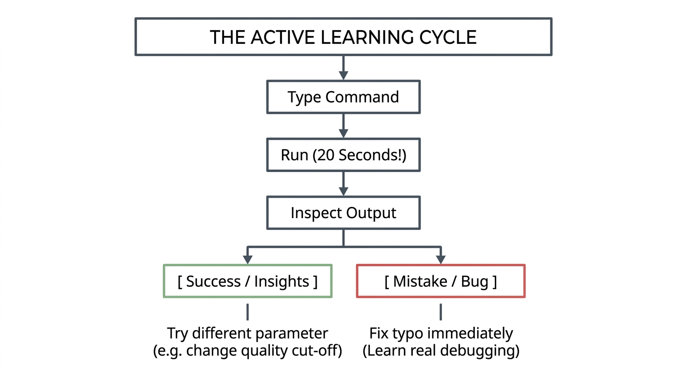
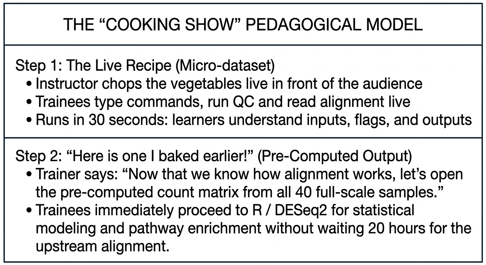

::: {.callout-tip}
#### Learning Objectives

- Explain the pedagogical imperative for micro-datasets in bioinformatics training, contrasting them with full-scale research datasets.
- Implement technical strategies to engineer micro-datasets (random downsampling, locus targeting, chromosome subsetting, and synthetic generation).
- Maintain paired-end read synchronization during subsampling using tools like `seqtk`.
- Combine live micro-dataset execution with pre-computed outputs (the "cooking show" model) to teach both pipeline mechanics and downstream biological interpretation.
- Diagnose and manage learner expectations regarding algorithm runtimes, depth of coverage, and assembly fragmentation.
- Package lightweight data bundles that can be distributed instantly over slow networks, mobile data, or USB drives.
:::

## Introduction: The Live Training Dilemma

In bioinformatics research, bigger is usually better. Scientists seek deep coverage, large sample cohorts, and whole-genome sequencing (WGS) datasets to maximize statistical power. 

However, in **training**—particularly in resource-constrained classrooms—using full-scale research data is one of the most common causes of pedagogical failure.

| Full-scale research data | Micro-dataset |
| :--- | :--- |
| • 40 GB paired-end FASTQ files | • 15 MB subsampled FASTQ files |
| • Requires 4–8 hours to download | • Downloads in 3 seconds / USB copy |
| • Requires 32–64 GB RAM (HPC only) | • Runs in 350 MB RAM (any laptop) |
| • Pipeline runs for 3.5 hours | • Pipeline runs in 25 seconds |
| • Trainees stare at a frozen screen and lose focus | • Instant feedback, iteration, and active learning |

: Table 1: The classroom runtime trap

When an alignment or assembly step takes two hours to run during class:

1. **Instruction halts:** The trainer has nothing to demonstrate while the computer crunches numbers.
2. **Errors are catastrophic:** If a student misplaces a flag or mistypes a file path, they only discover the error after two hours of waiting.
3. **Hardware collapses:** Student laptops run out of RAM, crash, or overheat, derailing the workshop.

A **micro-dataset** is a deliberately engineered, downscaled dataset that preserves the exact format, structural integrity, and biological signatures of real-world data, but executes in **seconds or a few minutes** on modest consumer hardware.


## The Pedagogical Power of Rapid Feedback Loops

In adult learning theory, skill acquisition relies on **tight feedback loops**:



Micro-datasets transform bioinformatics from a passive waiting game into an active experimental laboratory. Trainees can experiment with parameter tuning—such as comparing assembly results with different k-mer lengths or trimming thresholds—and observe the consequences immediately.


## Strategies for Engineering Micro-datasets

There are four primary methodologies for creating high-quality micro-datasets. Each method serves different biological and computational learning objectives:

| Strategy | How it works | Best for teaching |
| :--- | :--- | :--- |
| 1. Random downsampling | Subsample a small fraction of reads | Read QC, adapter trimming, fast mapping verification |
| 2. Locus-specific extraction | Extract reads mapping to 1 gene | Variant calling, AMR gene detection, coverage analysis |
| 3. Chromosome / contig slicing | Use Chr21/22 or a small plasmid | Human genetics, eukaryotic RNA-seq, genome browsers |
| 4. Synthetic in silico simulation | Generate reads with known errors | Teaching error profiles, ground-truth benchmarking |

: Table 2: Micro-dataset engineering strategies

### 1. Random Downsampling with `seqtk`

The simplest approach is randomly sampling a small fraction of reads (e.g. 50,000 reads out of 5,000,000).

::: {.callout-warning}
## The Paired-End Synchronization Trap
In paired-end sequencing, Read 1 (`_R1.fq`) and Read 2 (`_R2.fq`) must appear in the exact same sequence order line-by-line. If you randomly sample `R1` and `R2` independently with different random seeds, the read pairs will be mismatched, and downstream aligners will fail with `mate pair missing` errors.

**Rule:** Always use a fixed random seed (`-s 100`) when sampling paired reads:
:::

```bash
# Install seqtk via Conda or static binary
# Subsample exactly 20,000 read pairs using a fixed seed (-s 100)
seqtk sample -s 100 raw_R1.fastq.gz 20000 | gzip > micro_R1.fastq.gz
seqtk sample -s 100 raw_R2.fastq.gz 20000 | gzip > micro_R2.fastq.gz
```

### 2. Locus-Specific Extraction: Real Biology in Miniature

Random downsampling reduces coverage across the whole genome, which can make *de novo* assembly fragmented or variant calling under-powered. 

A more elegant technique is **locus-specific extraction**:

1. Map full-scale sequencing reads against a reference genome.
2. Extract only the reads that align to a specific gene of interest (e.g. the 4.5 kb *rpoB* gene in *Mycobacterium tuberculosis* responsible for rifampicin antibiotic resistance).
3. Convert those mapped reads back into raw FASTQ format.

```bash
# 1. Extract reads overlapping the rpoB gene coordinates (Chromosome: 759,807 - 763,325)
samtools view -b full_alignment.bam "Chromosome:759807-763325" > rpoB_region.bam

# 2. Extract matched pairs and convert back to FASTQ
samtools collate -u -O rpoB_region.bam | \
samtools fastq -1 micro_rpoB_R1.fq.gz -2 micro_rpoB_R2.fq.gz -
```

*The Result:* The micro-dataset is under 2 MB in size, but retains **80× depth of coverage** over the target gene! Trainees can run QC, alignment, and variant calling in 15 seconds, and successfully detect the clinical drug-resistance mutation.

### 3. Slicing Reference Genomes: Small Model Organisms
- When teaching eukaryotic genomics, never use the full 3.1 GB human reference genome. Use human **Chromosome 22** or **Chromosome 21**, or a 2 Mb region.
- When teaching bacterial genomics, use a small plasmid (e.g. 50 kb) or viral genome (e.g. SARS-CoV-2, 29.9 kb). A complete SARS-CoV-2 genome can be assembled *de novo* using SPAdes in under 45 seconds on an ordinary laptop!

### 4. In Silico Synthetic Datasets
Using simulators like **Badread** (for Oxford Nanopore) or **InSilicoSeq / ART** (for Illumina), trainers can generate synthetic reads containing deliberate, ground-truth biological variants or quality anomalies:

- A dataset with a known 5 bp deletion to teach variant validation.
- A dataset with synthetic adapter contamination to teach trimming.


## The "Cooking Show" Model: Staged Workflows

A common question from trainers is: *"If we use micro-datasets, how do we teach downstream topics that require full-scale data (such as differential expression statistical power, PCA plots, or large phylogenetic trees)?"*

The solution is the **"Cooking Show" pedagogical technique**:



This model provides the best of both worlds:

1. **Mechanical Transparency:** Learners experience the real command-line execution and inspect intermediate files.
2. **Biological Authenticity:** Downstream interpretation is performed on statistically robust, full-scale datasets.


## Managing Learner Expectations

When teaching with micro-datasets, instructors must be transparent with learners about what is happening behind the scenes:

::: {.callout-note}
## Essential Classroom Communication
Always explain to your learners:

- *"We are running this on a subsampled micro-dataset containing 30,000 reads so that our laptops can finish the calculation in 20 seconds."*
- *"When you return to your laboratory and run this exact same command on a 40-million-read whole-genome dataset, the syntax and logic will be identical, but it will require 16 GB of RAM and 4 hours on your institutional server or HPC cluster."*
:::

If you fail to clarify this, learners may develop unrealistic expectations, assuming full-scale bioinformatics pipelines take 30 seconds, or become baffled when their research datasets fail to run on a personal laptop.


## Interactive Exercises for Future Trainers

These exercises will help you practice subsampling data correctly and structuring staged training lessons.

::: {.callout-exercise}
## Subsampling Paired-End Reads Safely

You have a 12 GB paired-end FASTQ dataset (`patient_R1.fastq.gz` and `patient_R2.fastq.gz`) from an outbreak investigation. You want to create a lightweight micro-dataset of exactly 25,000 read pairs for an introductory quality control practical.

1. Write the exact command-line syntax using `seqtk` to subsample this dataset.
2. Why is the `-s` flag mandatory when generating paired-end training sets?
3. How can you verify that your resulting files are properly synchronized and have the exact same line count?

::: {.callout-hint}
Recall that a standard FASTQ read consists of 4 lines, and both files must share the exact same random sampling sequence.
:::

::: {.callout-answer}
### Subsampling Protocol & Verification

1. **Exact Commands:**
   ```bash
   # Subsample exactly 25,000 reads from R1 and R2 using identical seed 42
   seqtk sample -s 42 patient_R1.fastq.gz 25000 | gzip > micro_R1.fastq.gz
   seqtk sample -s 42 patient_R2.fastq.gz 25000 | gzip > micro_R2.fastq.gz
   ```

2. **Why `-s` is Mandatory:**
   The `-s` flag specifies the pseudo-random number generator seed. If you omit `-s` (or use two different seeds), `seqtk` will select a different random set of reads from `R1` than from `R2`. The pairs will become de-synchronized, breaking downstream tools like `bwa` or `fastp`.

3. **Verification Command:**
   ```bash
   # Check that both files have exactly 100,000 lines (25,000 reads × 4 lines)
   zcat micro_R1.fastq.gz | wc -l
   zcat micro_R2.fastq.gz | wc -l
   
   # Check that the first read header matches between both files
   zcat micro_R1.fastq.gz | head -n 1
   zcat micro_R2.fastq.gz | head -n 1
   ```
:::
:::

::: {.callout-exercise}
## Designing a Locus-Specific Training Dataset

You are designing a 2-hour practical on detecting antimicrobial resistance (AMR) mutations in *Staphylococcus aureus*. 

- **The Problem:** Full-genome alignment and variant calling takes 45 minutes per student, and the classroom laptops have only 4 GB RAM.
- **The Target:** The *mecA* gene (which confers methicillin resistance / MRSA).

Design a micro-dataset strategy that allows learners to run read alignment and variant calling live during class in under 2 minutes:

1. What reference sequence should you provide to the learners?
2. What reads should be included in the micro-dataset?
3. What biological lesson can still be authentically demonstrated despite the tiny data footprint?

::: {.callout-answer}
### Micro-Dataset Design

1. **Reference Sequence:**
   Provide either a small 10 kb reference contig containing the *mecA* gene cassette (SCC*mec*) or a mini-reference FASTA containing only the *mecA* coding sequence and flanking promoters, rather than the entire 2.8 Mb *S. aureus* genome.

2. **Read Selection:**
   Extract reads from an authentic MRSA isolate that specifically map to the *mecA* locus at ~50× coverage (~2,000 paired-end reads total, resulting in a compressed FASTQ file under 300 KB).

3. **Authentic Biological Lesson:**
   - Trainees map the reads against the *mecA* cassette in 10 seconds.
   - They run `samtools depth` or inspect alignments in IGV to confirm coverage.
   - They execute variant calling to identify the specific single nucleotide polymorphism (SNP) associated with resistance.
   - *Result:* Full biological authenticity, zero classroom downtime, zero memory crashes.
:::
:::


## Summary

::: {.callout-tip}
#### Key Points

- **Micro-datasets Prioritize Active Learning:** By shrinking datasets to megabytes, algorithms execute in seconds, allowing students to experiment, make mistakes, and receive instant feedback.
- **Eliminate Bandwidth & Hardware Barriers:** Micro-datasets run on 4 GB RAM laptops, require zero HPC infrastructure, and can be shared instantly via USB thumb drives or mobile internet.
- **Maintain Paired-End Synchronization:** Always use fixed seeds (`seqtk sample -s 100`) when downsampling paired-end reads to ensure Read 1 and Read 2 stay aligned.
- **Locus-Specific Extraction Preserves Depth:** Extracting reads covering a single gene of interest (e.g. *rpoB* or *mecA*) maintains realistic depth of coverage for authentic variant calling while keeping file sizes under 2 MB.
- **Combine with the "Cooking Show" Model:** Run micro-datasets live to teach command mechanics, then transition to pre-computed full-scale outputs for statistically rigorous downstream interpretation.
- **Communicate Context Clearly:** Always remind students that real research datasets will require more time and compute, ensuring they understand the scaling differences.
:::
