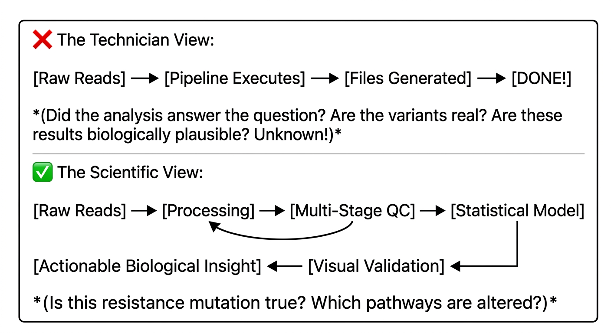
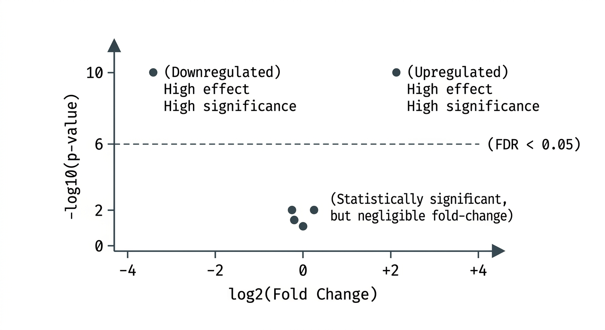

::: {.callout-tip}
#### Learning Objectives

- Distinguish between computational pipeline completion and true biological discovery, avoiding the "pipeline completion fallacy".
- Evaluate multi-stage quality control metrics across the sequencing lifecycle (raw reads, alignments, assemblies, and variant calls).
- Identify and diagnose common technical artifacts, including batch effects, PCR duplicates, GC-bias, and platform-specific error profiles.
- Apply statistical rigour to high-dimensional biological data, correctly explaining multiple testing correction (False Discovery Rate) and effect sizes.
- Utilize visual inspection tools (such as IGV, PCA plots, and heatmaps) to validate computational predictions before wet-lab confirmation.
- Design case-study-driven pedagogical activities that train life scientists to extract actionable biological meaning from complex genomic outputs.
:::

## Introduction: Beyond the Green Checkmark

A recurring pitfall in bioinformatics education is stopping the lesson the moment a computational tool finishes running. A pipeline printing `Exit status 0` or generating a 20,000-row variant call format (VCF) file is merely the end of computation—it is the **beginning** of scientific inquiry.



For adult learners—who are predominantly clinicians, epidemiologists, agricultural researchers, and molecular biologists—the value of bioinformatics lies in **data interpretation**:

- *Which of these 5,000 variants actually confers drug resistance?*
- *Is this gene expression difference driven by our drug treatment or an experimental batch effect?*
- *Does this phylogenetic tree prove hospital transmission or community acquisition?*

In low-resource settings, data interpretation is doubly critical. When laboratory budgets for experimental validation (e.g. Sanger sequencing or qPCR confirmation) are scarce, researchers must possess the critical faculties to distinguish authentic biological signal from technical artifacts *in silico*.


## Multi-Stage Quality Control: Trust, but Verify

Quality control (QC) is not a single checkpoint performed on raw FASTQ files. Rigorous bioinformatics requires continuous sanity checks at every transition point in the workflow:

| Stage | Standard tools | Key diagnostic metrics |
| :--- | :--- | :--- |
| 1. Raw reads | FastQC, fastp, MultiQC | Per-base quality scores (Q30), adapter contamination, GC% |
| 2. Alignment | Samtools flagstat, QualiMap, Mosdepth | Mapping rate (%), depth of coverage, duplication rate |
| 3. Assembly | QUAST, BUSCO, CheckM | N50, total length, contig count, single-copy orthologs |
| 4. Variant calls | bcftools stats, vcf-validator | Transition/transversion (Ti/Tv) ratio, depth per variant |

: Table 1: The multi-stage QC progression

### 1. Raw Read Quality: Phred Scores and Sequencing Errors
- **Phred Quality Score ($Q$):** Logarithmically relates to base-calling error probability ($P = 10^{-Q/10}$).
  - $Q20 = 1\text{ in }100\text{ error rate (}99\%\text{ accuracy)}$.
  - $Q30 = 1\text{ in }1,000\text{ error rate (}99.9\%\text{ accuracy)}$.
- **Platform Differences:** Illumina platforms primarily produce substitution errors, whereas long-read platforms (Oxford Nanopore, PacBio) historically struggle with homopolymer indels (insertions/deletions in runs of identical nucleotides like `AAAAAA`).

### 2. Alignment Quality: Depth vs. Breadth of Coverage
Teach learners to distinguish two fundamental concepts:

- **Breadth of Coverage:** The percentage of the reference genome covered by at least one sequencing read (e.g. 98% of the genome is covered).
- **Depth (Fold) of Coverage:** How many unique reads overlap a specific nucleotide position on average (e.g. $30\times$ depth).
- *Clinical rule of thumb:* You cannot reliably call heterozygous diploid variants or low-frequency somatic mutations with $5\times$ coverage; reliable variant calling generally requires at least $20\times$–$30\times$ depth.

### 3. Assembly Quality: N50 and Biological Completeness
- **N50:** The contig length such that 50% of the entire assembly is contained in contigs of this size or larger.
- *Trainer Warning:* A high N50 does not automatically mean a good assembly! An assembly can have a high N50 because misassemblies fused unrelated genomic regions together. Always combine N50 with **BUSCO** (Benchmarking Universal Single-Copy Orthologs) to measure whether expected core biological genes are present and complete.


## Identifying and Eliminating Technical Artifacts

Bioinformatics outputs are frequently contaminated by non-biological noise. Instructors must train learners to spot these classic technical artifacts:

| Artifact | Biological consequence |
| :--- | :--- |
| PCR duplicates | Artificially inflates variant allele frequencies |
| Batch effects | Confounds treatment groups with processing dates |
| Cross-contamination | False pathogen detection or mixed-lineage calls |
| GC-content bias | Dropouts in high GC regions (e.g. bacterial promoters) |

: Table 2: Common technical artifacts

### The Peril of Batch Effects

A **batch effect** occurs when non-biological experimental variables (such as the day of extraction, technician, reagent lot, or sequencing lane) correlate with the biological condition under study.

::: {.callout-important}
## The Unrecoverable Study Design
Imagine an RNA-seq experiment comparing 10 tuberculosis patients with 10 healthy controls:

- All 10 TB samples are extracted on Monday by Technician A using Kit Lot #1.
- All 10 Control samples are extracted on Friday by Technician B using Kit Lot #2.

No bioinformatic algorithm, normalisation formula, or statistical model can separate the biological disease signal from the technical extraction differences. Teach your learners: **Good bioinformatics cannot rescue flawed experimental design!**
:::


## Statistical Rigour: Avoiding False Discoveries

Modern high-throughput biology is characterized by the **large $p$, small $n$ problem**: we measure thousands of features ($p$, e.g. 20,000 genes or 500,000 SNPs) across a small number of biological samples ($n$, e.g. 6 to 20 individuals).

### The Multiple Testing Trap

In classical hypothesis testing, an alpha threshold of $p < 0.05$ means there is a 5% chance of falsely rejecting the null hypothesis (a false positive).

- If you test **one** gene, a false positive rate of 5% is acceptable.
- If you test **20,000** genes simultaneously:
  $$20,000 \times 0.05 = 1,000\text{ false positive genes!}$$
You will find 1,000 "statistically significant" genes entirely by random chance.

### Multiple Testing Correction: FDR vs Bonferroni
- **Bonferroni Correction:** Multiplies each $p$-value by the total number of tests ($p_{\text{adj}} = p \times m$). Highly conservative; frequently eliminates true biological discoveries in omics studies.
- **Benjamini-Hochberg False Discovery Rate (FDR / $q$-value):** Controls the proportion of false positives among all rejected null hypotheses. An $\text{FDR} < 0.05$ means that among the genes called significant, at most 5% are expected to be false discoveries. This is the gold standard in RNA-seq and GWAS.



Teach learners to evaluate **both** dimensions of the Volcano plot:

1. **Statistical Significance:** How reproducible is the difference ($y$-axis: $-\log_{10} p$).
2. **Biological Magnitude / Effect Size:** Is the fold-change biologically meaningful ($x$-axis: $\log_2 \text{Fold Change}$)? A gene with $p = 10^{-6}$ but only a 1.05-fold change is rarely biologically actionable.


## Visual Inspection: The Human-in-the-Loop Imperative

Computational algorithms use heuristics and statistical models that make assumptions about coverage and sequencing noise. Before reporting a crucial result, bioinformaticians must visually inspect the underlying raw data.

### Integrative Genomics Viewer (IGV)

IGV is the de facto desktop and web tool for visualising aligned sequencing reads against a reference genome.

```
Reference: ... A  T  G  C  [C]  T  A  G  G  C  A  T  C  G  A ...
Reads:         A  T  G  C  [T]  T  A  G  G
               A  T  G  C  [T]  T  A  G  G  C  A
                  T  G  C  [T]  T  A  G  G  C  A  T
                     G  C  [T]  T  A  G  G  C  A  T  C
                     G  C  [T]  T  A  G  G  C  A  T  C  G
                           ▲
                     100% of reads carry 'T' mutation!
                     Depth = 25x, clean mapping quality (MAPQ 60)
                     ==> High-confidence variant!
```

### Visualizing Outliers: PCA and Unsupervised Clustering
Before performing differential expression or association testing, always generate an exploratory **Principal Component Analysis (PCA)** plot:

- Do biological replicates cluster tightly together?
- Do untreated and treated groups separate cleanly along PC1 or PC2?
- Is there a clear outlier sample that was swapped or suffered library degradation?


## Pedagogical Strategies: Teaching Data Interpretation

Teaching data interpretation requires moving away from linear software tutorials and toward **scenario-based inquiry**:

1. **The "Mystery Case Study" Method:**
   Provide trainees with a simulated clinical or outbreak scenario. Give them a processed dataset with a hidden problem (e.g. an unannounced sample swap, a high-duplication control, or an uncorrected batch effect). Challenge them to find the true biological conclusion without falling into the trap.
2. **The "Spot the Bug" Gallery:**
   Show a series of figures (FastQC reports, PCA plots, phylogenetic trees) and ask learners: *"Is this sample usable? What went wrong in the wet lab or computational pipeline?"*
3. **Translational Communication:**
   Have learners write a 3-sentence summary of their genomic findings addressed to a hospital doctor or farm extension officer. Translating raw VCF coordinates into actionable clinical advice builds genuine domain mastery.


## Interactive Exercises for Future Trainers

These exercises will test your ability to design interpretation challenges that develop critical thinking in your trainees.

::: {.callout-exercise}
## Diagnosing an Anomaly in an RNA-seq PCA Plot

You provide your workshop trainees with an exploratory PCA plot from an experiment examining malaria parasite gene expression in response to an antimalarial drug:

- 3 Biological Replicates: Untreated (`Ctrl_1`, `Ctrl_2`, `Ctrl_3`)
- 3 Biological Replicates: Drug-Treated (`Treat_1`, `Treat_2`, `Treat_3`)

The PCA plot shows:

- `Ctrl_1`, `Ctrl_2`, and `Treat_3` cluster tightly together on the left side of PC1 (explaining 78% of the variance).
- `Treat_1`, `Treat_2`, and `Ctrl_3` cluster tightly together on the right side of PC1.

1. What is the most probable biological or technical explanation for this PCA pattern?
2. If a student ignores this plot and runs differential expression analysis directly, what erroneous conclusions will they draw?
3. What investigative steps should you teach the student to verify their hypothesis?

::: {.callout-hint}
Look closely at which samples are clustering with each other across the two experimental conditions.
:::

::: {.callout-answer}
### PCA Diagnosis & Investigation

1. **Diagnosis:**
   There is a classic **sample swap** between `Ctrl_3` and `Treat_3`. Rather than all controls clustering together, two controls cluster with one treated sample, and two treated samples cluster with one control sample.

2. **Consequence of Ignoring:**
   The statistical model will compare mixed groups. The variance within both groups will be artificially inflated, masking true drug-responsive genes and producing completely erroneous differentially expressed gene lists.

3. **Investigative Steps:**
   - **Check Known Marker Genes:** Inspect the expression of genes known to be induced exclusively by the drug. If `Ctrl_3` exhibits high expression of drug markers while `Treat_3` shows zero expression, the sample swap is confirmed.
   - **Check Metadata & Laboratory Notebooks:** Trace the tubes back to extraction dates and sequencing barcodes to identify where the label swap occurred.
:::
:::

::: {.callout-exercise}
## Distinguishing Real Mutations from Artifacts in IGV

A trainee calls you over during a variant-calling practical. An automated pipeline reported a nonsense mutation in the *katG* gene (causing isoniazid resistance in *M. tuberculosis*). The trainee asks if this confirms the strain is drug-resistant.

You open the BAM file in IGV and observe:

- Total read depth at the site: $35\times$.
- Exactly 4 reads show the mutation; 31 reads match the wild-type reference.
- All 4 mutated reads originate from the same sequencing strand (100% strand bias) and the mutation is located in the terminal 3 base pairs of each read.
- The mapping quality (MAPQ) of the 4 mutated reads is 0 (indicating non-unique mapping elsewhere in the genome).

1. Is this a high-confidence drug-resistance mutation? Explain your reasoning based on the IGV observations.
2. What three specific red flags indicate this is an artifact?
3. What filtering parameters would you teach learners to apply to their VCF files to eliminate such false positives automatically?

::: {.callout-answer}
### Variant Validation Analysis

1. **Assessment:**
   **No, this is almost certainly a false positive technical artifact.** It should not be reported as a drug-resistance mutation.

2. **Three Red Flags:**
   - **Extreme Strand Bias:** Real biological mutations occur across reads originating from both the forward and reverse strands. Mutations seen exclusively on one strand typically reflect chemical damage (e.g. cytosine deamination) or sequencing chemistry error.
   - **Position at Read Ends:** The terminal bases of Illumina reads have the lowest Phred quality scores and highest error rates.
   - **Mapping Quality Zero ($\text{MAPQ} = 0$):** MAPQ 0 means the read maps equally well to multiple repetitive locations in the genome. The reads likely originate from a homologous gene or pseudogene elsewhere on the chromosome.

3. **VCF Filtering Parameters:**
   Teach students to filter raw VCF files with `bcftools filter`:
   ```bash
   bcftools filter -e 'QUAL < 30 || DP < 10 || MQ < 20 || SAF == 0 || SAR == 0' raw.vcf
   ```
   *(Filters out low quality, low depth, poor mapping quality, and extreme strand bias).*
:::
:::


## Summary

::: {.callout-tip}
#### Key Points

- **Pipeline Completion is Not Interpretation:** Successful software execution does not guarantee biological validity. Rigorous analysis requires multi-stage quality control, statistical correction, and visual validation.
- **Implement Multi-Stage QC:** Evaluate quality across the lifecycle: raw read Phred scores, alignment depth/breadth, assembly N50/BUSCO completeness, and variant metrics.
- **Guard Against Technical Artifacts:** Watch for batch effects, PCR duplicates, and platform-specific error profiles before making biological claims. Remember: computational analysis cannot rescue fundamentally flawed experimental designs.
- **Correct for Multiple Testing:** In high-dimensional data, an alpha threshold of $p < 0.05$ produces hundreds of false positives by chance. Always use False Discovery Rate (FDR / Benjamini-Hochberg) and evaluate both significance and effect size (Volcano plots).
- **Inspect Key Variants Visually:** Use IGV and PCA plots as sanity checks. Verify mapping quality, read depth, and strand bias before committing scarce wet-lab funds to experimental validation.
- **Teach with Realistic Scenarios:** Design exercises around messy data, deliberate artifacts, and translational communication to build authentic scientific intuition in adult life-science learners.
:::
