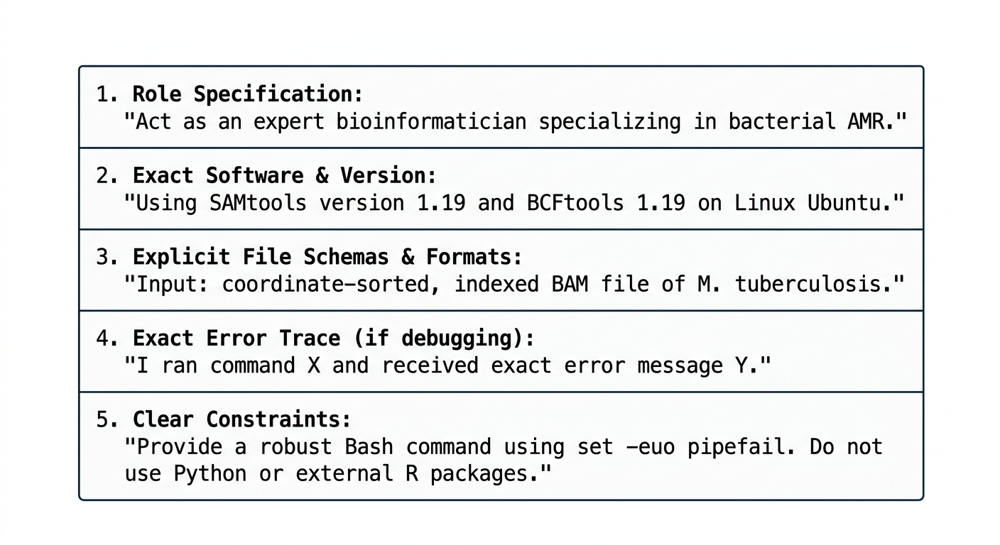
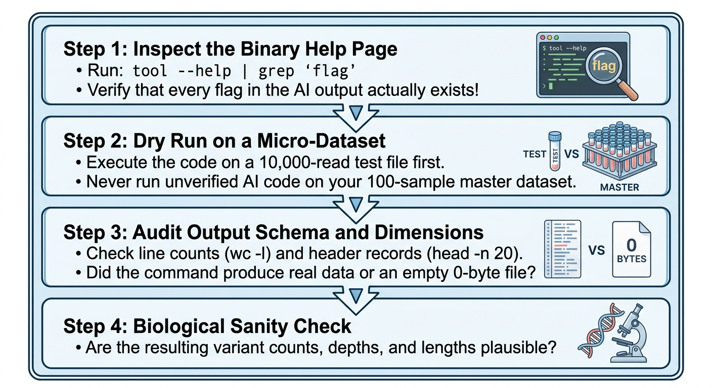

::: {.callout-tip}
#### Learning Objectives

- Evaluate the opportunities and limitations of Generative AI (LLMs) as an accessible "virtual mentor" for researchers in low-resource environments.
- Diagnose common AI failure modes in computational biology, including flag hallucinations, deprecated syntax, and biological confabulations.
- Construct context-rich prompts that specify software versions, file format schemas, and exact error traces.
- Apply the **"Trust but Verify" Protocol** to rigorously cross-check AI outputs against official documentation and micro-dataset dry runs.
- Navigate data privacy, ethics, and genomic sovereignty boundaries when using commercial AI tools.
- Establish a transparent, pedagogically sound Course AI Policy for bioinformatics workshops.
:::

## Introduction: The "Virtual Mentor" in Low-Resource Settings

In well-funded research hubs, novice bioinformaticians are surrounded by experienced colleagues: postdocs down the hall, institutional core facilities, and dedicated Slack channels where they can ask for debugging advice.

In many low-resource institutions, however, researchers work as **"lone bioinformaticians"**. They are often the only person in their department attempting to run high-throughput sequencing pipelines. When an analysis throws a cryptic stack trace or an environmental error, they have no local mentor to turn to.

| Without AI (Isolated) | With AI (Empowered) |
| :--- | :--- |
| • Stuck on syntax error for days | • Immediate error log explanation |
| • No local code reviewer | • 24/7 interactive code review |
| • Baffled by complex shell flags | • Plain-language syntax breakdowns |
| • Slow, manual boilerplate writing | • Rapid shell/Python scaffolding |
| • High dropout / project stalls | • Maintained momentum & confidence |

: Table 1: The promise of AI in low-resource contexts

Generative Artificial Intelligence (Large Language Models such as Claude, Gemini, ChatGPT, and local open-source models) can serve as a transformative **equalizer**. It acts as a tireless, 24/7 personal tutor that can explain error messages, generate initial pipeline templates, and demystify Linux commands.

However, like any powerful laboratory instrument, AI can produce catastrophic results if used without rigorous calibration, verification, and ethical awareness.


## High-Risk AI Failure Modes in Bioinformatics

Large language models are probabilistic word prediction engines, not biological execution environments. In specialized scientific computing, they frequently fail in predictable ways:

| Hazard | Mechanism | Biological Consequence |
| :--- | :--- | :--- |
| **1. Flag Hallucination** | Models invent plausible-sounding flags that do not exist | Pipeline crashes with `unrecognized option` or silently misbehaves |
| **2. Deprecated Syntax & Tools** | Trained on older web data (e.g. Biostars archives) | Recommends dead tools (TopHat2, Python 2) rather than modern standards |
| **3. Biological Confabulation** | Confabulates gene targets or cites fake literature | Claims non-existent SNPs cause drug resistance; cites fabricated PubMed DOIs |
| **4. The Copy-Paste Blindspot** | Learners bypass cognitive effort during training | Zero skill retention; completely helpless when the AI prompt fails |

: Table 2: Common AI hazards in bioinformatics

### 1. Flag Hallucinations: Mixing Tools
LLMs frequently merge options from competing tools. For example, when asked to write a BWA-MEM command, an AI might insert `--local` (a Bowtie2 flag) or `--very-sensitive`. In other cases, it will invent flags that sound intuitive (e.g. `fastp --min-depth 20`) but have never existed in the tool's source code.

### 2. The Trap of Outdated Standards
Because training data contains vast amounts of legacy forum discussions from 2012–2018, models frequently suggest obsolete bioinformatics practices:

- Recommending `TopHat` instead of `HISAT2` or `STAR`.
- Using deprecated GATK3 syntax (`-T UnifiedGenotyper`) instead of GATK4 (`HaplotypeCaller`).
- Writing Python 2 scripts that fail on modern Linux operating systems.


## Data Privacy, Ethics, and Genomic Sovereignty

Commercial cloud AI services (free and paid web chatbots) routinely log user prompts to refine future models. 

Bioinformatics researchers must observe strict **ethical and regulatory red lines**:

::: {.callout-warning}
## The Three Strict Red Lines for AI Prompts
1. **Never Paste Patient Health Information (PHI):** Never include patient names, hospital record numbers, geographic identifiers, or identifiable clinical metadata.
2. **Never Paste Unconsented Raw Human DNA Sequences:** Uploading human genomic reads or individual variant lists to commercial third-party cloud servers can violate national data protection laws (e.g. GDPR, national health ethics board approvals).
3. **Never Expose Sensitive Pathogen Outbreak Data:** Pasting unreleased genome assemblies of high-consequence pathogens (e.g. Ebola, Marburg, novel avian influenza) into public chatbots before national public health clearance violates public health reporting protocols and national genomic sovereignty.
:::

### Safe Alternatives for Sensitive Clinical Work:
- **Anonymized Synthetic Snippets:** Replace real patient barcodes with `sample_01`, and use generic synthetic sequences (`ATCG...`).
- **Offline Local Open-Source Models:** Run open-weights models (such as Llama 3 or Mistral) locally on institutional workstations using lightweight tools like **Ollama**. These run entirely in RAM with zero internet connection, guaranteeing 100% data sovereignty.


## Prompt Engineering for Bioinformaticians

Vague prompts produce hallucinated, generic code. High-quality computational prompts provide explicit technical context:




## The "Trust but Verify" Protocol

Never copy-paste AI-generated code directly into your production research pipeline. Follow this four-step verification protocol:




## Establishing a Course AI Policy

As an instructor, you cannot ban AI—your students will inevitably use it. Instead, establish a transparent **Course AI Policy** that encourages productive use while safeguarding foundational learning:

| ✅ Permitted & Encouraged | ❌ Restricted |
| :--- | :--- |
| • Pasting cryptic terminal error messages for explanation | • Generating code during initial mental-model building exercises |
| • Asking AI to explain Bash flags or regular expressions | • Submitting unverified AI code for capstone assessments |
| • Generating descriptive comments for complex code blocks | • Uploading real clinical or patient genomic datasets |
| • Brainstorming alternative tools for a specific biological assay | • Copy-pasting without being able to explain what each flag does |

: Table 3: Sample workshop AI policy


## Interactive Exercises for Future Trainers

These exercises will test your ability to spot subtle AI errors and guide students toward responsible AI usage.

::: {.callout-exercise}
## Spotting the Hallucination in AI-Generated Code

A trainee prompts an AI tool: *"Write me a Bash command to filter variants in my bacterial VCF file using BCFtools, keeping only SNPs with depth over 20 and quality over 30."*

The AI returns:
```bash
bcftools filter --min-coverage 20 --min-quality 30 --type snp raw.vcf > filtered.vcf
```

1. Identify the three hallucinations in this command.
2. What error will BCFtools return when the trainee runs this?
3. Provide the correct, robust BCFtools command.

::: {.callout-hint}
Check the official `bcftools filter` syntax. Does BCFtools use double-dash long flags like `--min-coverage`, or does it use expression filters (`-e` / `-i`)?
:::

::: {.callout-answer}
### Hallucination Audit & Correction

1. **Three Hallucinations:**
   - `--min-coverage 20`: Does not exist in BCFtools filter (likely borrowed from GATK or VarScan). BCFtools uses the INFO/FORMAT tag `DP`.
   - `--min-quality 30`: Does not exist. BCFtools filters quality using the column tag `QUAL`.
   - `--type snp`: Does not exist in `bcftools filter`. Filtering by variant type is done via `bcftools view -v snps` or inside filter expressions with `TYPE="snp"`.

2. **Terminal Output:**
   BCFtools will exit immediately with:
   `[E::main] unrecognized option '--min-coverage'`

3. **Correct BCFtools Command:**
   ```bash
   bcftools filter -i 'QUAL >= 30 && DP >= 20 && TYPE="snp"' raw.vcf -o filtered.vcf
   ```
:::
:::

::: {.callout-exercise}
## Guiding a Trainee Suffering from "AI Dependency"

During the afternoon practical, you notice that a master's student has two windows open: the workshop tutorial and an AI chatbot. Every time an exercise appears, the student copies the prompt into the AI, copies the generated code, and pastes it into the terminal. 

When you ask the student: *"Why did you use the `-S` flag in that `less` command?"*, the student hesitates and replies: *"I don't know, ChatGPT told me to put it there."*

1. What pedagogical harm is occurring here?
2. How would you intervene supportively without shaming the student?
3. What rule can you establish for the remainder of the session to restore active learning?

::: {.callout-answer}
### Facilitator Intervention

1. **Pedagogical Harm:**
   The student is bypassing the **active struggle** necessary to build long-term neural pathways and spatial mental models. By using AI as an intellectual crutch, the student gains an illusion of competence while remaining completely incapable of debugging or modifying pipelines independently.

2. **Supportive Intervention:**
   - Acknowledge that using modern tools is understandable: *"I see you are using AI to help with syntax—in research, AI can be a great accelerator!"*
   - Highlight the gap: *"However, when you return to your laboratory, the AI won't be able to tell you why your thesis data failed if you don't understand what these flags mean."*
   - Demystify the flag collaboratively: *"Let's test what happens if you run `less` with and without `-S` right now on your screen. Do you see how `-S` stops the lines from wrapping? Now you own that knowledge, not the chatbot!"*

3. **Actionable Rule:**
   Implement the **"Explain Before Run" Rule**:
   *"You may use AI to give you hints, but before you hit Enter on any command, you must be able to turn to your partner and explain what every single flag does. If you can't explain it, you can't run it!"*
:::
:::


## Summary

::: {.callout-tip}
#### Key Points

- **AI is an Accelerator, Not a Substitute:** Large language models act as invaluable 24/7 mentors for isolated researchers in low-resource settings, but they cannot replace foundational computational understanding.
- **Expect Hallucinations:** AI models frequently invent non-existent tool flags, suggest obsolete software pipelines, and confuse competing syntax.
- **Follow the "Trust but Verify" Protocol:** Always verify AI flags against official binary help pages (`tool --help`) and execute dry runs on micro-datasets before scaling up.
- **Maintain Ethical Red Lines:** Never upload unconsented patient health information, identifiable human DNA sequences, or restricted pathogen genomic data to commercial cloud AI chatbots.
- **Enforce Context-Rich Prompting:** Provide specific software versions, exact error traces, and input/output formats to receive accurate technical assistance.
- **Implement Clear Classroom Policies:** Encourage AI for explaining error messages and commenting code, but restrict it during foundational mental-model construction.
:::
