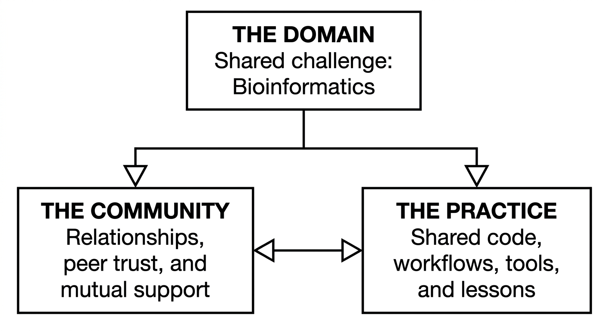
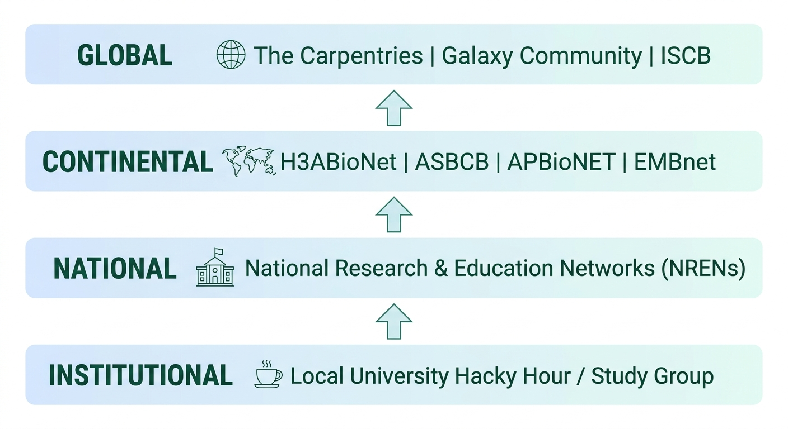

::: {.callout-tip}
#### Learning Objectives

- Define a **Community of Practice (CoP)** and explain how social learning networks prevent post-workshop skill decay and isolation.
- Overcome the **"Lone Bioinformatician" Syndrome** by designing lightweight, low-barrier institutional peer groups (Hacky Hours, Coding Clinics, Study Groups).
- Structure recurring community activities that balance informal troubleshooting with structured skill progression and code review.
- Connect local grassroots groups to established regional, continental, and global bioinformatics networks (H3ABioNet, ASBCB, APBioNET, The Carpentries).
- Implement sustainable community governance and succession planning to ensure peer groups survive member graduations and career transitions.
:::

## Introduction: The "Day Four" Crisis

A familiar and heartbreaking cycle exists in global bioinformatics capacity development:

1. Enthusiastic researchers attend an intensive 3-day bioinformatics workshop.
2. They master Linux navigation, run quality trimming, and execute variant calling with flying colors.
3. On the final afternoon, certificates are distributed amidst celebrations.
4. **On "Day Four"**, participants return to their home institutions... and reality hits.

| Without Community (Isolation) | With Community (Sustained) |
| :--- | :--- |
| • Sole researcher using Linux | • Weekly peer troubleshooting group |
| • Departmental PI demands instant results but provides no compute | • Shared scripts and container libraries across laboratories |
| • First major bug causes project to stall for 6 months | • Safe space to ask questions without judgment |
| • Within 1 year: Skills forgotten, data unanalyzed, money wasted | • Within 1 year: Confident analyst, co-author, and future trainer |

: Table 1: The "Day Four" trajectory

When trainees return to departments where no one else codes, they encounter the **"Lone Bioinformatician" Syndrome**. Without local code review, shared computing infrastructure, or technical mentorship, post-workshop skill attrition is near 100%.

Training courses cannot end when the final slide is projected. **True capacity building requires cultivating local and regional Communities of Practice (CoPs) to sustain learning over the long haul.**

## The Community of Practice (CoP) Framework

In educational theory, cognitive scientists Jean Lave and Etienne Wenger demonstrated that **learning is fundamentally a social process situated in community**. 

A **Community of Practice** is not a formal administrative committee; it is a group of people who share a passion for something they do and learn how to do it better as they interact regularly:

1. **The Domain:** A shared identity and commitment to solving genomic and computational biology problems.
2. **The Community:** Mutual relationships, regular meetups, peer coaching, and psychological safety.
3. **The Practice:** Developing a shared repertoire of resources, reusable Bash scripts, container images, local cheatsheets, and troubleshooting experience.

## Lightweight Formats for Local Communities

Starting a community does not require institutional approval, budgets, or formal syllabi. The most successful groups start small and informal:

| Format | Structure | Why It Works |
| :--- | :--- | :--- |
| **1. Hacky Hour / Coding Clinic** | 1 hour weekly; coffee shop or seminar room | Zero preparation required; informal, welcoming, focuses on live code debugging |
| **2. Carpentries Study Group** | 2 hours bi-weekly; working through an open tutorial | Structured, self-paced progression through an open curriculum |
| **3. Methods Journal Club** | 1 hour monthly; dissecting a code repository | Connects biological domain literature directly to computational reproducibility |
| **4. "Bug-Busting" Hackathon** | Half-day sprint; collaborative work on shared data | High-energy collective focus on a shared institutional sequencing dataset |

: Table 2: Grassroots community formats for bioinformatics sustainability

### The "Hacky Hour" Protocol
- **What it is:** A recurring informal meetup (e.g. every Thursday from 16:00 to 17:00).
- **The Rule:** *"Bring your laptop, bring your broken code, bring your questions."*
- Anyone can show up. A student struggling with an R ggplot error sits next to a researcher who knows R; a postdoc troubleshooting an HPC script works through it with a peer.
- The informal setting dismantles hierarchy: senior professors and first-year master's students troubleshoot side by side.

## Connecting Local Groups to Regional Networks

Local groups in resource-constrained environments cannot survive in isolation. Connecting grassroots institutional clubs into continental and global federations provides access to compute, advanced mentors, and international collaborators:

### Key Regional Networks:
- **Pan-African Networks:**
  - **H3ABioNet:** Maintains active nodes across 15+ African nations, offering monthly webinars, computing support, and curriculum sharing.
  - **African Society for Bioinformatics and Computational Biology (ASBCB):** Hosts biennial conferences, regional student groups (RSGs), and travel fellowships.
- **Global Alliances:**
  - **The Carpentries Community:** Offers instructor training, mentoring circles, and community discussion calls.
  - **Galaxy Community (Galaxy Africa, Galaxy Europe):** Active community chats (Matrix/Gitter), working groups, and free cloud compute allocations.
  - **ISCB Regional Student Groups (RSGs):** Student-led local chapters fostering peer networking, leadership development, and scientific symposia.

## Community Sustainability & Succession Planning

Many grassroots initiatives fail due to the **"Founder's Trap"**: a passionate champion founds a coding club, runs it single-handedly for a year, and when that champion graduates or accepts an overseas fellowship, the club immediately dies.

To build an enduring community:

1. **Distribute Responsibilities from Day One:**
   - Rotate roles every semester: one person manages meeting scheduling, another sends reminders, another moderates discussions.
   - Pair an experienced organizer with a first-year student to mentor the next generation of community leaders.
2. **Secure Institutional Anchors:**
   - Reserve a permanent physical room in the library or department.
   - Convince department chairs to recognize community leadership on student transcripts or as faculty service credits.
3. **Preserve Shared Memory in a Knowledge Hub:**
   - Maintain an institutional GitHub organization or shared Google Drive containing reusable pipeline templates, local HPC guides, and cluster submission scripts.

## Interactive Exercises for Future Trainers

These exercises will guide you in designing a viable launch plan for an institutional community of practice.

::: {.callout-exercise}
## Designing a 6-Month Hacky Hour Launch Plan

You are returning to your home institution after completing this training course. You want to launch a bi-weekly "Bioinformatics Hacky Hour" to support your department's postgraduate students and junior researchers.

Draft an actionable launch strategy addressing:

1. **The Name, Timing, and Physical Venue.**
2. **How you will pitch the initiative to students without making it feel like extra coursework.**
3. **The agenda for the very first meeting (Kickoff session).**
4. **Three specific rules to ensure the meetup remains non-judgmental and psychologically safe.**

::: {.callout-hint}
Focus on low barriers to entry: emphasize peer troubleshooting, informal discussions, and practical benefits.
:::

::: {.callout-answer}
### Hacky Hour Launch Blueprint

1. **Logistics:**
   - **Name:** *"Biocode & Coffee"*
   - **Timing:** Every second Wednesday, 16:00 – 17:00 (end of workday, minimal class clashes).
   - **Venue:** Faculty lounge, campus cafe, or a seminar room with reliable power outlets and a projector.

2. **The Pitch:**
   *"Tired of staring at Bash or R error messages alone in your lab? Join Biocode & Coffee! No lectures, no grades, no homework. Just bring your laptop, your buggy code, and your research questions. Let's fix our scripts together."*

3. **Kickoff Agenda (60 Mins):**
   - **16:00 - 16:15:** Welcome & round-robin introductions (*"What organism are you studying, and what computational tool is currently driving you crazy?"*).
   - **16:15 - 16:40:** Open debugging circle: One volunteer projects an error message on screen; the room troubleshoots it collaboratively.
   - **16:40 - 16:55:** Shared needs brainstorming: What topics should we tackle next? (e.g. RNA-seq, Git, Docker).
   - **16:55 - 17:00:** Next meeting confirmation & volunteer snack host.

4. **Three Safety Rules:**
   - **Rule 1 (Zero Gatekeeping):** No question is too basic. We all started knowing nothing.
   - **Rule 2 (Hands Off Keyboards):** When helping a peer, explain verbally. Never touch someone else's keyboard.
   - **Rule 3 (No Solitary Suffering):** If you are stuck on a bug for more than 30 minutes, bring it to the group!
:::
:::

::: {.callout-exercise}
## Pitching to a Skeptical Department Head

Your university department chair believes that informal coding clubs are a distraction from wet-lab benchwork: *"Our students should be in the lab running PCRs, not drinking coffee and staring at computers."*

Craft a persuasive 3-point counter-pitch demonstrating how a local bioinformatics Community of Practice directly enhances departmental research output and funding competitiveness.

::: {.callout-answer}
### The Departmental Pitch

1. **Accelerates Time-to-Publication:**
   *"Professor, our department currently spends thousands of dollars generating sequencing data, only for the raw files to sit unanalyzed on hard drives for months because students get stuck on basic bioinformatics errors. A peer coding group solves these blockages in hours rather than months, directly speeding up thesis completions and manuscript submissions."*

2. **Dramatically Reduces Reagent Waste:**
   *"Bioinformatics is an essential pre-lab and post-lab quality filter. Researchers who understand computational analysis design better wet-lab experiments, avoid redundant PCR assays, and stop ordering the wrong sequencing depths, saving scarce departmental consumables budgets."*

3. **Increases Grant Competitiveness:**
   *"International funders (NIH, Wellcome Trust, African Academy of Sciences) prioritize institutions that demonstrate robust data management and local analytical self-sufficiency. Showing that our department maintains an active, self-sustaining computational community makes our research proposals far more competitive."*
:::
:::

## Summary

::: {.callout-tip}
#### Key Points

- **Training Without Community Fails:** Without recurring peer interaction, post-workshop skills decay rapidly. Sustained capacity requires building local Communities of Practice.
- **Start Small and Informal:** Launch lightweight formats (Hacky Hours, Coding Clinics, Study Groups) that require zero institutional approval or budget.
- **Foster Psychological Safety:** Create non-judgmental, inclusive spaces where students and faculty can admit confusion and troubleshoot code collaboratively.
- **Connect Grassroots to Continental Networks:** Combat institutional isolation by linking local groups to regional networks like H3ABioNet, ASBCB, and The Carpentries.
- **Plan for Succession Early:** Distribute leadership responsibilities, rotate roles, and institutionalize community spaces to ensure peer groups outlast founding members.
:::
